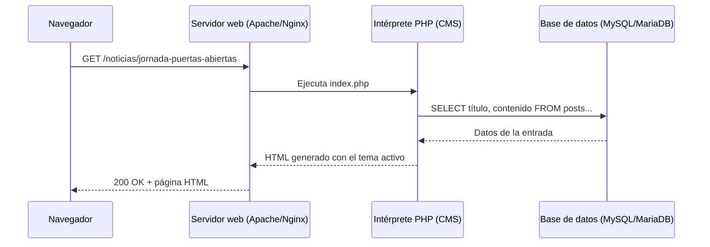
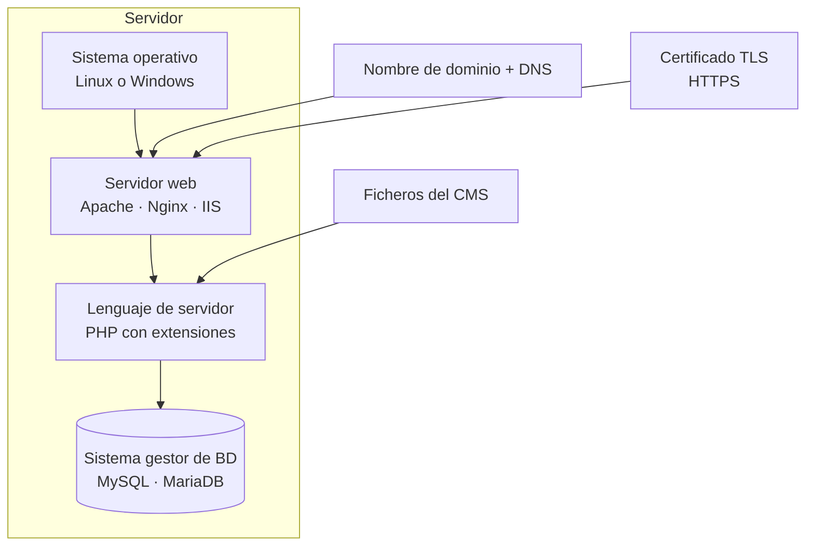

# 1. Qué es un gestor de contenidos. Tipos y características

<ExportPDF />

::: accent-box purple 🎯 Objetivos
- Definir qué es un sistema de gestión de contenidos y qué problema resuelve.
- Clasificar los CMS según su finalidad y su arquitectura.
- Identificar los componentes que necesita un CMS para funcionar.
:::

## 1.1 El problema: mantener una web viva

En los primeros años de la web, cada página era un archivo HTML escrito a mano. Para cambiar una noticia había que editar el archivo, subirlo por FTP al servidor y repetir la operación en todas las páginas que la enlazaban. Esto tenía tres inconvenientes:

- **Solo podía actualizar la web quien sabía HTML** y tenía acceso al servidor.
- **Contenido y diseño estaban mezclados**: cambiar el aspecto implicaba reescribir cientos de páginas.
- **No había control** de quién publicaba qué ni de versiones anteriores.

La respuesta fueron los **sistemas de gestión de contenidos**.

::: accent-box 📖 Definición
Un **gestor de contenidos (CMS)** es una aplicación web que permite **crear, editar, organizar y publicar contenido digital** desde el navegador, **separando el contenido** (que se guarda en una base de datos o en ficheros) **de la presentación** (plantillas o temas), y permitiendo que **varios usuarios con distintos permisos** colaboren sin necesidad de programar.
:::

## 1.2 Características comunes

| Característica | Qué aporta |
|----------------|-----------|
| **Separación contenido / diseño** | Se cambia el tema y todo el sitio adopta el nuevo aspecto sin tocar los textos. |
| **Editor visual** | Se escriben páginas como en un procesador de textos (editor de bloques, WYSIWYG). |
| **Gestión de usuarios y roles** | Cada persona solo puede hacer lo que su rol permite (administrar, editar, escribir, comentar…). |
| **Extensibilidad** | Plugins, módulos o extensiones añaden funciones: formularios, foros, tienda, SEO… |
| **Flujo de publicación** | Borradores, revisión, programación de entradas, historial de revisiones. |
| **Sindicación** | Publicación automática de feeds RSS/Atom para que otros sitios o lectores se suscriban. |
| **Actualizaciones** | El propio CMS avisa de nuevas versiones y parches de seguridad. |

## 1.3 Cómo funciona un CMS

Un CMS clásico es una **aplicación web dinámica**: cada vez que un visitante pide una página, el servidor ejecuta código (normalmente PHP), consulta la base de datos, combina los datos con la plantilla y devuelve HTML al navegador.

Por eso, para instalar la mayoría de los CMS necesitamos la pila de software conocida como **LAMP** (Linux, Apache, MySQL/MariaDB, PHP) o sus variantes **WAMP** (Windows) y **LEMP** (con Nginx).

::: info-box Front-end y back-end
- **Front-end** (parte pública): lo que ven los visitantes del sitio.
- **Back-end** (parte de administración): el panel desde el que se gestiona el sitio. En WordPress está en `/wp-admin`, en Joomla en `/administrator`.
:::

## 1.4 Tipos de gestores de contenidos

### Según su finalidad

| Tipo | Uso típico | Ejemplos |
|------|-----------|----------|
| **Portales y webs corporativas** | Sitios institucionales con muchas secciones | WordPress, Joomla, Drupal |
| **Blogs** | Publicación cronológica de entradas | WordPress, Ghost, Blogger (en la nube) |
| **Wikis** | Documentación colaborativa | DokuWiki, MediaWiki (Wikipedia), BookStack |
| **Foros** | Debates organizados por temas | phpBB, Discourse, Flarum, bbPress |
| **Comercio electrónico** | Tiendas online | WooCommerce (sobre WordPress), PrestaShop, Magento |
| **E-learning (LMS)** | Cursos y aulas virtuales | Moodle, Chamilo → se estudian en el **RA2** |
| **Gestión documental (DMS)** | Ficheros, versiones y flujos de aprobación | Nextcloud, Alfresco → se estudian en el **RA4** |

### Según su arquitectura

- **CMS tradicional (monolítico):** gestiona el contenido y también genera las páginas. Es el caso de WordPress, Joomla o Drupal.
- **CMS sin base de datos (*flat-file*):** guarda el contenido en ficheros de texto. Más sencillo de instalar y de copiar: DokuWiki, Grav.
- **CMS *headless*:** solo gestiona contenido y lo ofrece mediante una API; otra aplicación decide cómo mostrarlo. Ejemplos: Strapi, Directus.
- **Generadores de sitios estáticos:** convierten ficheros Markdown en HTML antes de publicar. **Esta misma web está hecha con VitePress**, un generador estático.
- **CMS en la nube (SaaS):** el proveedor aloja y mantiene todo: WordPress.com, Wix, Google Sites, Weebly → se estudian en el **RA4**.

### Según su licencia

- **Software libre:** WordPress, Joomla y Drupal se distribuyen con licencia **GNU GPL**. Se pueden instalar, estudiar, modificar y redistribuir.
- **Propietarios o comerciales:** Adobe Experience Manager, Sitecore… habituales en grandes empresas.

## 1.5 Comparativa de los CMS más usados

| | WordPress | Joomla | Drupal | DokuWiki |
|---|---|---|---|---|
| **Enfoque** | Blogs, webs, tiendas | Portales con mucha estructura | Proyectos grandes y complejos | Documentación |
| **Curva de aprendizaje** | Baja | Media | Alta | Baja |
| **Base de datos** | MySQL / MariaDB | MySQL / MariaDB / PostgreSQL | MySQL / MariaDB / PostgreSQL / SQLite | No necesita |
| **Extensiones** | Plugins y temas | Componentes, módulos, plugins, plantillas | Módulos y temas | Plugins y plantillas |
| **Uso educativo** | Muy alto | Alto (webs de centros) | Medio | Wikis de departamento |

::: tip-box ¿Cuál elijo?
No hay un CMS "mejor": hay un CMS **adecuado a los requerimientos**. Antes de instalar, responde a estas preguntas: ¿qué tipo de contenido se publicará?, ¿cuántas personas lo gestionarán y con qué conocimientos?, ¿qué servidor hay disponible?, ¿quién lo mantendrá actualizado?
:::

## 1.6 Componentes necesarios para instalar un CMS

- **Servidor web** que atienda las peticiones HTTP/HTTPS.
- **Intérprete del lenguaje** en el que está escrito el CMS (PHP en los cuatro de la tabla) y sus extensiones.
- **Sistema gestor de bases de datos**, salvo en los *flat-file*.
- **Espacio en disco, memoria y permisos** de escritura en las carpetas donde el CMS guarda archivos subidos.
- **Dominio y certificado HTTPS** cuando el sitio se publica en Internet.

En el siguiente apartado concretamos estos requisitos y hacemos la instalación.

::: details 🔁 Autoevaluación rápida
1. ¿Por qué decimos que un CMS separa el contenido de la presentación?
2. Indica un CMS adecuado para: la web de un centro educativo, la documentación interna de un departamento de informática y una tienda online.
3. ¿Qué diferencia a un CMS *flat-file* de uno tradicional?
4. Explica con tus palabras qué ocurre en el servidor cuando un visitante abre una entrada de un blog hecho con WordPress.
:::

---

**Siguiente:** [2. Requisitos e instalación →](./2-requisitos-instalacion)
