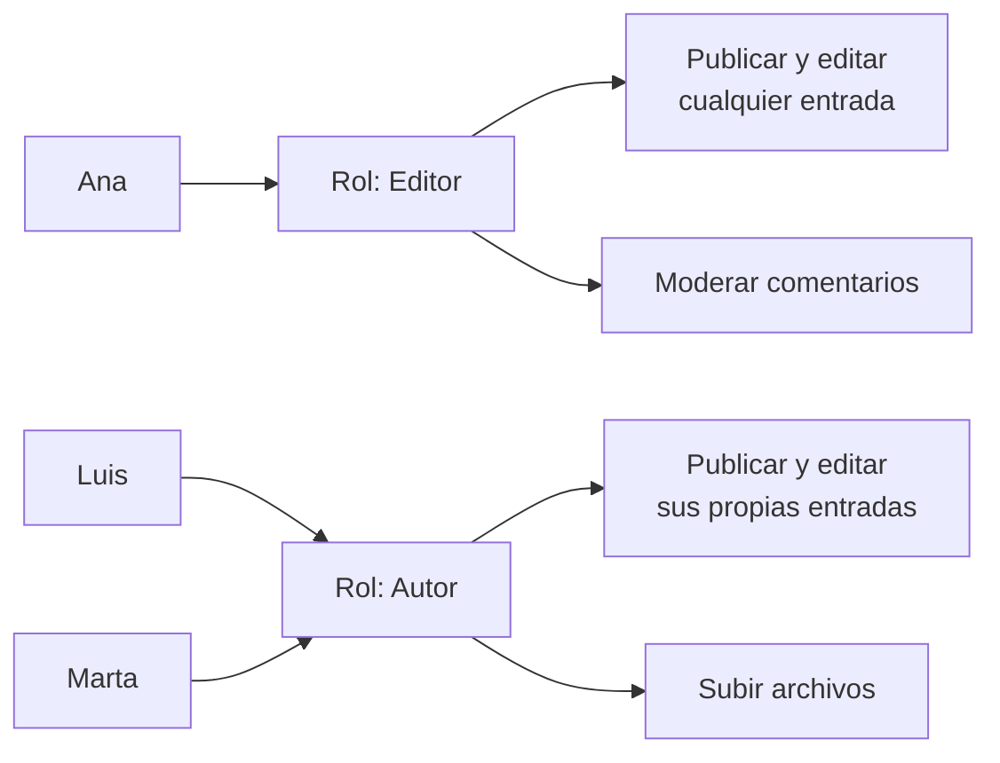
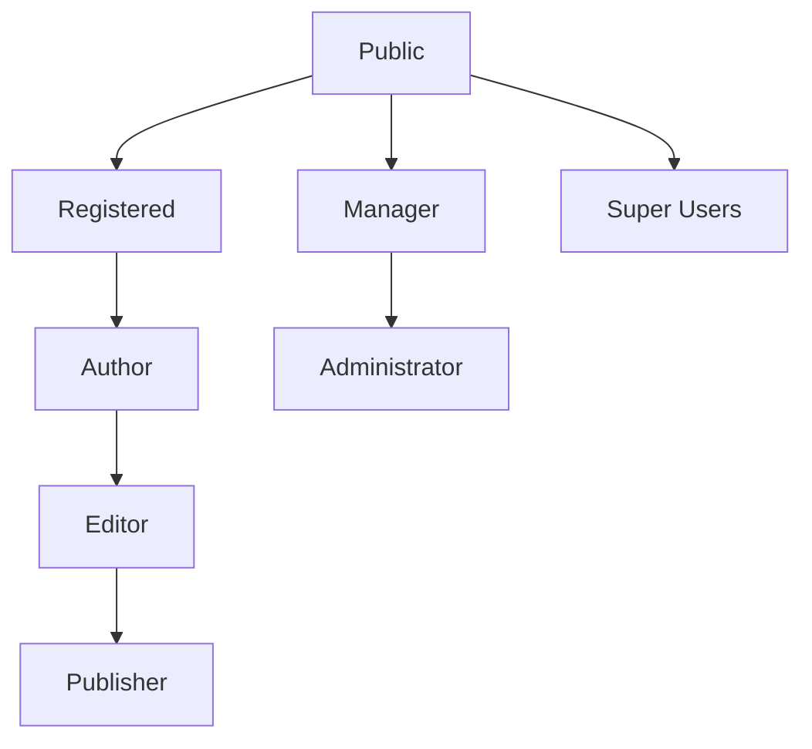

# 3. Creación de usuarios, grupos y roles

<ExportPDF />

::: accent-box purple 🎯 Objetivos
- Diferenciar usuario, rol, grupo y permiso.
- Crear usuarios con roles diferentes y comprobar qué puede hacer cada uno (CE b).
- Aplicar el principio de mínimo privilegio.
:::

## 3.1 Conceptos básicos



- **Usuario:** cuenta con la que una persona se identifica (nombre de usuario + contraseña).
- **Permiso o capacidad:** acción concreta que se puede realizar (publicar, borrar, instalar plugins…).
- **Rol o grupo:** conjunto de permisos que se asigna a los usuarios. Es mucho más cómodo asignar un rol a 30 usuarios que 30 permisos a cada uno.

::: accent-box teal 💡 Principio de mínimo privilegio
Cada usuario debe tener **solo los permisos que necesita** para su trabajo. Un redactor no necesita instalar plugins; si su cuenta se ve comprometida, el daño será limitado.
:::

## 3.2 Roles en WordPress

| Rol | Puede… | Ejemplo en un centro educativo |
|-----|--------|-------------------------------|
| **Administrador** | Todo: plugins, temas, ajustes, usuarios | Coordinador TIC |
| **Editor** | Publicar y editar contenido de cualquiera, moderar comentarios, gestionar categorías | Jefe/a del departamento de comunicación |
| **Autor** | Publicar y editar **sus** entradas y subir archivos | Profesorado |
| **Colaborador** | Escribir entradas, pero **no publicarlas** (quedan pendientes de revisión) | Alumnado de un taller de periodismo |
| **Suscriptor** | Solo gestionar su perfil y leer contenido restringido | Familias |

En una instalación **multisitio** existe además el **Superadministrador**, que gestiona toda la red de sitios.

### Crear un usuario

**Usuarios → Añadir nuevo usuario**: nombre de usuario, correo, nombre, contraseña y **perfil (rol)**. Activa la opción de enviar el aviso al usuario para que pueda establecer su propia contraseña.

::: note-box 📷 Captura sugerida
Listado de usuarios con al menos un usuario de cada rol y la columna "Perfil" visible.
:::

### Con WP-CLI

```bash
wp user create lucia lucia@centro.es --role=editor --display_name="Lucía"
wp user create pablo pablo@centro.es --role=contributor
wp user list --fields=user_login,roles
```

### Roles personalizados

Si ningún rol se ajusta, un plugin como **Members** o **User Role Editor** permite crear roles nuevos o modificar capacidades (por ejemplo, un rol "Revisor" que solo pueda editar páginas).

## 3.3 Usuarios y grupos en Joomla

Joomla usa **grupos** (equivalentes a los roles) organizados en jerarquía, y **niveles de acceso** que deciden quién **ve** cada contenido:



| Grupo | Ámbito |
|-------|--------|
| Registered, Author, Editor, Publisher | Front-end: escribir, editar y publicar desde la parte pública |
| Manager, Administrator | Back-end: acceso al panel de administración |
| Super Users | Control total |

Los **niveles de acceso** (`Public`, `Registered`, `Special`, `Guest`, o los que crees) se asignan a artículos, menús y módulos para que solo algunos grupos los vean. Así se separa **qué puede hacer** un usuario (grupo) de **qué puede ver** (nivel de acceso).

## 3.4 Usuarios en DokuWiki: listas de control de acceso

DokuWiki gestiona permisos por **espacio de nombres** (carpeta de páginas) mediante ACL:

| Permiso | Valor |
|---------|-------|
| Ninguno | 0 |
| Leer | 1 |
| Editar | 2 |
| Crear | 4 |
| Subir archivos | 8 |
| Borrar | 16 |

Ejemplo: el grupo `@alumnado` puede **crear** en `smr2:*` pero solo **leer** en `profesorado:*`.

## 3.5 Buenas prácticas

- No uses `admin` como nombre de usuario del administrador.
- Un administrador **nominal** por persona responsable; nada de cuentas compartidas.
- Revisa periódicamente los usuarios y **elimina o degrada** a quien ya no los necesita (al eliminar, WordPress pide a quién atribuir su contenido).
- Exige contraseñas robustas y, para los roles con más privilegios, **doble factor** (lo veremos en el apartado 6).
- **Comprueba cada rol**: inicia sesión con cada usuario (o en una ventana privada) y verifica que puede hacer lo que debe… y que **no** puede hacer lo que no debe.

::: details 🔁 Autoevaluación rápida
1. ¿Qué rol de WordPress darías a un alumno que escribe noticias que debe revisar un profesor?
2. En Joomla, ¿qué diferencia hay entre un grupo y un nivel de acceso?
3. ¿Qué ocurre con las entradas de un autor cuando eliminas su cuenta?
:::

---

**Anterior:** [← 2. Requisitos e instalación](./2-requisitos-instalacion) · **Siguiente:** [4. Interfaz, módulos y menús →](./4-interfaz-modulos-menus)
