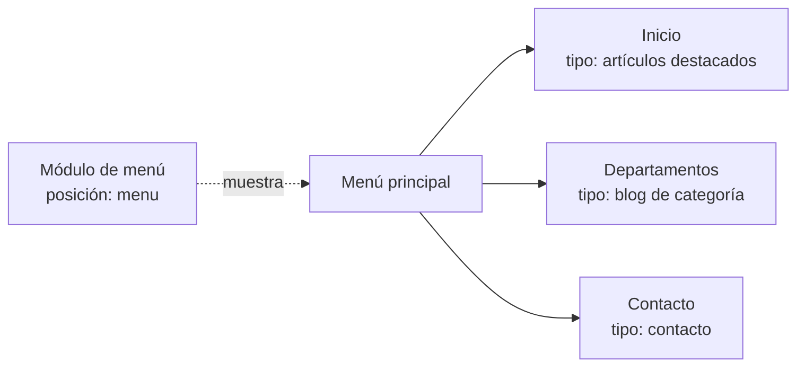

# 4. Interfaz gráfica, personalización, módulos y menús

<ExportPDF />

::: accent-box purple 🎯 Objetivos
- Manejar el panel de administración del CMS.
- Personalizar la apariencia del sitio con temas y ajustes (CE c).
- Instalar y configurar extensiones y menús (CE f).
- Activar la sindicación de contenidos (RSS).
:::

## 4.1 El panel de administración

En WordPress, el **Escritorio** (`/wp-admin`) agrupa las funciones en un menú lateral:

| Menú | Para qué sirve |
|------|----------------|
| **Entradas** | Contenido cronológico (noticias), con categorías y etiquetas |
| **Medios** | Biblioteca de imágenes, vídeos y documentos |
| **Páginas** | Contenido estático (Quiénes somos, Contacto…) |
| **Comentarios** | Moderación |
| **Apariencia** | Temas, editor del sitio, menús, widgets |
| **Plugins** | Instalar, activar, actualizar y desactivar extensiones |
| **Usuarios** | Cuentas y roles |
| **Herramientas** | Importar/exportar, salud del sitio, datos personales |
| **Ajustes** | Configuración general, lectura, comentarios, enlaces permanentes, privacidad |

::: info-box Entradas frente a páginas
Las **entradas** se ordenan por fecha, se agrupan en categorías y aparecen en el feed RSS. Las **páginas** son atemporales y se organizan jerárquicamente (página madre / hija).
:::

## 4.2 Personalizar la interfaz

### Ajustes generales

En **Ajustes → Generales**: título, descripción corta, idioma, zona horaria (`Madrid`) y formato de fecha. En **Ajustes → Lectura** se decide si la portada muestra las últimas entradas o una página estática.

### Temas

Un **tema** controla el aspecto de todo el sitio. Hoy conviven dos tipos:

| Tipo | Cómo se personaliza | Ejemplos |
|------|---------------------|----------|
| **Tema de bloques** (*Full Site Editing*) | **Apariencia → Editor**: se editan visualmente plantillas, cabecera, pie, estilos globales (colores, tipografías) | Twenty Twenty-Five, Ollie |
| **Tema clásico** | **Apariencia → Personalizar**, menús y widgets | Astra, GeneratePress |

Para cambiar de tema: **Apariencia → Temas → Añadir nuevo tema**, buscar, **Instalar** y **Activar**.

::: tip-box Tema hijo
Si vas a modificar el código de un tema, crea un **tema hijo**. Así, cuando el tema padre se actualice, tus cambios no se perderán.
:::

### Identidad visual

- **Logotipo** e **icono del sitio** (favicon).
- **Paleta de colores y tipografía** desde los estilos globales.
- **Cabecera y pie** con la información del centro o la empresa.

::: note-box 📷 Captura sugerida
El editor del sitio con los estilos globales abiertos, mostrando la paleta de colores elegida.
:::

## 4.3 Módulos y extensiones

Cada CMS llama de forma distinta a sus extensiones:

| WordPress | Joomla | Drupal | Función |
|-----------|--------|--------|---------|
| Plugin | Componente | Módulo | Añade una funcionalidad completa (tienda, foro, formularios) |
| Bloque / widget | Módulo | Bloque | Pequeña caja de contenido en una zona de la página (últimas noticias, buscador) |
| Plugin | Plugin | Módulo | Actúa "por debajo" ante eventos (SEO, caché, autenticación) |
| Tema | Plantilla | Tema | Aspecto visual |

### Instalar un plugin en WordPress

1. **Plugins → Añadir nuevo plugin**.
2. Busca por nombre o función y revisa: **número de instalaciones activas**, **última actualización**, **compatibilidad** con tu versión y **valoraciones**.
3. **Instalar ahora → Activar**.
4. Configúralo desde su entrada en el menú o en **Ajustes**.

Plugins habituales en un sitio educativo:

| Necesidad | Plugin |
|-----------|--------|
| Formularios de contacto | Contact Form 7, WPForms Lite |
| Foro | bbPress (apartado 5) |
| Seguridad | Wordfence, Solid Security (apartado 6) |
| Copias de seguridad | UpdraftPlus (apartado 7) |
| Estadísticas | WP Statistics, Independent Analytics |
| Cumplimiento RGPD (cookies) | Complianz, CookieYes |

::: warning-box Cuantos menos, mejor
Cada plugin es código de terceros que se ejecuta en tu servidor. Instala **solo los necesarios**, de fuentes fiables, y **elimina** (no solo desactives) los que no uses.
:::

### En Joomla

**Sistema → Instalar → Extensiones**: se sube el paquete `.zip` o se instala desde el directorio oficial (JED). Los **módulos** se colocan en **posiciones** de la plantilla (`sidebar-right`, `footer`…) y se asignan a los elementos de menú en los que deben aparecer.

## 4.4 Menús

Un **menú** es un conjunto de enlaces de navegación. Puede apuntar a páginas, entradas, categorías o URL externas.

### En WordPress (tema de bloques)

**Apariencia → Editor → Navegación**: añade el bloque *Navegación* a la cabecera y arrastra páginas, categorías o enlaces personalizados. Puedes crear **submenús** anidando elementos.

### En WordPress (tema clásico)

**Apariencia → Menús**: crea el menú, añade elementos desde el panel izquierdo, ordénalos arrastrando y asígnalo a una **ubicación** del tema (menú principal, pie…).

### En Joomla

Joomla distingue entre **menú** (contenedor) y **elemento de menú** (cada enlace). El **tipo de elemento** decide qué se muestra: un artículo, un blog de categoría, un formulario de contacto, un enlace externo… Para que el menú sea visible hay que **crear un módulo de menú** y colocarlo en una posición.

## 4.5 Sindicación de contenidos (RSS)

La **sindicación** permite que otras webs o lectores de noticias (Feedly, Thunderbird, Inoreader) reciban automáticamente el contenido nuevo. WordPress genera los feeds sin configurar nada:

| Feed | URL |
|------|-----|
| Últimas entradas | `/feed/` |
| Una categoría | `/category/noticias/feed/` |
| Comentarios | `/comments/feed/` |

En **Ajustes → Lectura** decides cuántos elementos incluye el feed y si muestra el texto completo o un extracto. Con el bloque **RSS** puedes, además, mostrar en tu web las noticias de otro sitio.

::: details 🔁 Autoevaluación rápida
1. ¿Qué diferencia hay entre un tema de bloques y un tema clásico en la forma de personalizar?
2. Indica tres criterios para decidir si instalar un plugin.
3. En Joomla, he creado un menú pero no aparece en la web. ¿Qué me falta?
4. ¿Qué URL tiene el feed de la categoría "eventos" de un WordPress?
:::

---

**Anterior:** [← 3. Usuarios y roles](./3-usuarios-roles) · **Siguiente:** [5. Foros y reglas de acceso →](./5-foros)
