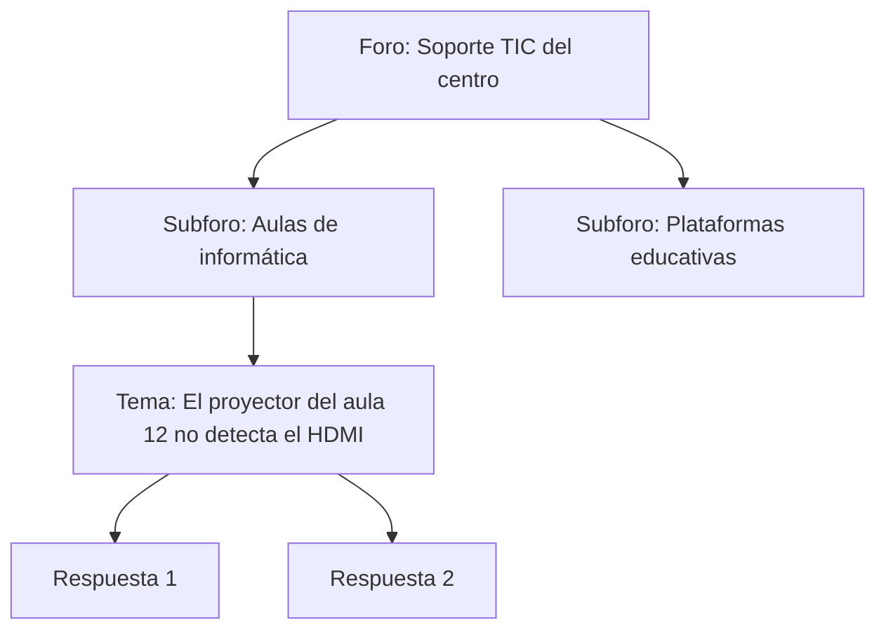

# 5. Creación de foros. Reglas de acceso

<ExportPDF />

::: accent-box purple 🎯 Objetivos
- Habilitar un foro dentro de un gestor de contenidos (CE h).
- Definir reglas de acceso y moderación.
- Comprobar el funcionamiento con usuarios de distintos roles.
:::

## 5.1 ¿Para qué un foro?

Un **foro** es un espacio de comunicación **asíncrona** organizado por temas. A diferencia de los comentarios de una entrada, permite que los usuarios **abran sus propios debates**, que quedan archivados y se pueden buscar.

| Opción | Tipo | Comentario |
|--------|------|-----------|
| **bbPress** | Plugin de WordPress | Ligero, integrado con los usuarios de WordPress |
| **Kunena** | Componente de Joomla | Foro completo para Joomla |
| **Módulo Forum** | Drupal | Incluido en el núcleo hasta Drupal 9; hoy se instala como módulo |
| **phpBB, Discourse, Flarum** | Aplicaciones independientes | Cuando el foro es el centro del proyecto |

## 5.2 Instalar y configurar bbPress

1. **Plugins → Añadir nuevo plugin**, busca **bbPress**, instálalo y actívalo.
2. **Ajustes → Foros**: revisa las opciones principales:

| Ajuste | Recomendación |
|--------|---------------|
| Bloqueo de edición | Permitir editar durante 5 minutos tras publicar |
| Limitación de envíos (*flooding*) | 10 segundos entre mensajes |
| Rol automático en foros | `Participante` para los usuarios registrados |
| Publicación anónima | **Desactivada** (evita spam y mensajes sin autoría) |
| Slug del foro | `foros` → la portada del foro estará en `/foros/` |

3. **Foros → Nuevo foro**: crea el foro principal y los subforos (atributo *Superior*).
4. Añade el enlace al foro en el **menú** principal.

### Roles de bbPress

bbPress añade **roles de foro**, independientes del rol de WordPress:

| Rol de foro | Puede |
|-------------|-------|
| **Keymaster** | Todo en los foros (lo recibe el administrador) |
| **Moderador** | Editar, cerrar, mover, fusionar y borrar temas y respuestas |
| **Participante** | Crear temas y responder |
| **Espectador** | Solo leer |
| **Bloqueado** | Nada |

## 5.3 Reglas de acceso

Las **reglas de acceso** determinan **quién puede ver** y **quién puede escribir** en cada foro.

### Visibilidad del foro

Al crear un foro, bbPress permite elegir:

- **Público:** cualquiera puede leerlo.
- **Privado:** solo usuarios registrados que han iniciado sesión.
- **Oculto:** solo moderadores y keymasters (útil para un foro interno de moderación).

### Estado y tipo

- **Abierto / cerrado:** un foro cerrado se puede leer pero no admite mensajes nuevos.
- **Foro / categoría:** una categoría solo agrupa subforos; no admite temas directamente.

### Normas de uso

Publica un **tema fijo** (*sticky*) con las normas del foro: respeto, no compartir datos personales, buscar antes de preguntar, usar títulos descriptivos, etc. Las normas también son una regla de acceso: quien no las cumple puede pasar a **Bloqueado**.

::: info-box Ejemplo de diseño de reglas de acceso
| Foro | Visibilidad | Quién escribe | Moderación |
|------|------------|---------------|------------|
| Anuncios | Público | Solo moderadores (foro cerrado para participantes) | Equipo directivo |
| Dudas de clase | Privado | Participantes (alumnado) | Profesorado |
| Sala de profesores | Oculto | Moderadores | Coordinación |
:::

## 5.4 Moderación y antispam

- Activa **Ajustes → Comentarios → Moderación**: retener mensajes con más de *N* enlaces o con palabras concretas.
- Usa un antispam (**Akismet**, **Antispam Bee**) o un CAPTCHA en el registro.
- Desactiva el registro abierto si el foro es solo para usuarios que das de alta tú (**Ajustes → Generales → Cualquiera puede registrarse**).

## 5.5 Foros en Joomla con Kunena

1. Instala Kunena desde **Sistema → Instalar → Extensiones**.
2. **Componentes → Kunena → Categorías**: crea secciones y categorías.
3. En cada categoría, el campo **Acceso** usa los niveles de acceso y grupos de Joomla para definir quién ve y quién publica.
4. Crea un **elemento de menú** de tipo *Kunena → Índice del foro*.

## 5.6 Pruebas de funcionamiento del foro

Comprueba cada regla iniciando sesión con distintos usuarios:

| Usuario | Prueba | Esperado |
|---------|--------|----------|
| Visitante sin sesión | Abrir un foro privado | No lo ve o se le pide iniciar sesión |
| Participante | Crear un tema en "Dudas de clase" | Se publica |
| Participante | Escribir en "Anuncios" | No puede |
| Moderador | Cerrar y fijar un tema | Puede |
| Participante | Publicar 2 mensajes en menos de 10 s | El segundo se bloquea (*flooding*) |

::: details 🔁 Autoevaluación rápida
1. ¿Qué diferencia hay entre un foro privado y uno oculto en bbPress?
2. ¿Por qué no es buena idea permitir publicaciones anónimas?
3. Diseña las reglas de acceso de un foro para un club de lectura con socios y visitantes.
:::

---

**Anterior:** [← 4. Interfaz, módulos y menús](./4-interfaz-modulos-menus) · **Siguiente:** [6. Seguridad, actualizaciones e informes →](./6-seguridad-actualizaciones)
