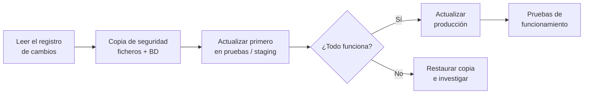

# 6. Mecanismos de seguridad, actualizaciones e informes de acceso

<ExportPDF />

::: accent-box purple 🎯 Objetivos
- Actualizar el CMS, sus plugins y temas, priorizando las actualizaciones de seguridad (CE e).
- Activar y configurar los mecanismos de seguridad del gestor (CE g).
- Obtener informes de accesos al sitio.
:::

## 6.1 ¿Por qué se atacan los CMS?

Al ser tan populares, los CMS son un objetivo rentable: un fallo en un plugin usado por miles de webs permite atacarlas todas a la vez de forma automatizada. Los ataques más habituales son:

| Ataque | Cómo se previene |
|--------|------------------|
| Explotar plugins o temas **desactualizados** | Actualizar y eliminar lo que no se usa |
| **Fuerza bruta** contra `/wp-login.php` | Contraseñas robustas, límite de intentos, 2FA |
| Subida de ficheros maliciosos | Permisos correctos, no editar ficheros desde el panel |
| **Spam** en comentarios y foros | Antispam, moderación |
| Robo de credenciales en redes no cifradas | HTTPS obligatorio |

::: danger-box Nulled = infectado
Nunca instales temas o plugins de pago "gratis" descargados de webs no oficiales (*nulled*). Suelen incluir puertas traseras.
:::

## 6.2 Actualizaciones

### Tipos de actualización en WordPress

| Tipo | Ejemplo | Riesgo | Política recomendada |
|------|---------|--------|---------------------|
| **Menor / de seguridad** | 6.8.1 → 6.8.2 | Muy bajo | Automática (activada por defecto) |
| **Mayor** | 6.8 → 6.9 | Medio | Tras copia de seguridad y prueba |
| **Plugins y temas** | Varía | Variable | Automáticas para los críticos de seguridad; manual con revisión del registro de cambios para el resto |
| **Traducciones** | — | Nulo | Automáticas |

El **Escritorio → Actualizaciones** muestra todo lo pendiente. Desde **Plugins** se puede activar la **actualización automática** de cada plugin.

### Procedimiento seguro de actualización



Con WP-CLI:

```bash
wp core check-update
wp core update && wp core update-db
wp plugin update --all
wp theme update --all
```

::: info-box Y el sistema operativo
Actualizar el CMS no sirve de mucho si el servidor tiene un PHP o un Apache vulnerables. Programa también `sudo apt update && sudo apt upgrade` o activa `unattended-upgrades` para los parches de seguridad de Ubuntu.
:::

### Actualizaciones en Joomla

**Sistema → Actualizar → Joomla** comprueba la versión del núcleo y **Sistema → Actualizar → Extensiones** la de las extensiones. Joomla incluye una **comprobación previa** que avisa de extensiones incompatibles antes de una actualización mayor.

## 6.3 Mecanismos de seguridad del propio CMS

### Incluidos en WordPress

- **Contraseñas de aplicación** y **contraseñas fuertes** sugeridas por defecto.
- **Salud del sitio** (Herramientas): avisa de versiones obsoletas de PHP, plugins inactivos o falta de HTTPS.
- **Cerrar sesión en todas partes** desde el perfil del usuario.
- **Claves y *salts*** en `wp-config.php`: si se sospecha un robo de sesión, se regeneran ([api.wordpress.org/secret-key/1.1/salt](https://api.wordpress.org/secret-key/1.1/salt/)) y todas las sesiones caducan.

### Endurecimiento en `wp-config.php`

```php
define( 'DISALLOW_FILE_EDIT', true );   // desactiva el editor de código del panel
define( 'FORCE_SSL_ADMIN', true );      // administración solo por HTTPS
define( 'WP_AUTO_UPDATE_CORE', 'minor' ); // actualizaciones automáticas menores
```

### Mediante un plugin de seguridad

**Wordfence** o **Solid Security** añaden:

- **Límite de intentos de inicio de sesión** y bloqueo de IP.
- **Autenticación en dos pasos (2FA)** con app (Google Authenticator, Aegis, Microsoft Authenticator).
- **Cortafuegos de aplicación (WAF)** y escaneo de ficheros modificados.
- **Registro de actividad** y alertas por correo.

::: note-box 📷 Captura sugerida
Configuración del 2FA activa para el usuario administrador.
:::

### En Joomla

- **Autenticación multifactor** integrada (Usuarios → Gestionar → editar usuario → *Autenticación multifactor*).
- **Configuración global → Servidor → Forzar HTTPS**.
- El componente **Registros de acciones de usuario** (*User Actions Log*) guarda quién hizo qué y cuándo.

### En el servidor

- **HTTPS** con certificado gratuito de **Let's Encrypt** (`sudo apt install certbot python3-certbot-apache && sudo certbot --apache`).
- **Permisos**: directorios `755`, ficheros `644`, `wp-config.php` `640` o `600`.
- Ocultar la versión del servidor (`ServerTokens Prod`, `ServerSignature Off` en Apache).

## 6.4 Informes de accesos

Saber **quién visita el sitio y qué hace** sirve para detectar ataques y para mejorar el contenido.

### Registros del servidor

Apache registra cada petición en `/var/log/apache2/access.log`:

```text
192.168.1.34 - - [12/Oct/2026:10:15:02 +0200] "GET /wordpress/ HTTP/1.1" 200 15234 "-" "Mozilla/5.0 ..."
203.0.113.9 - - [12/Oct/2026:10:15:07 +0200] "POST /wordpress/wp-login.php HTTP/1.1" 200 4521 "-" "python-requests/2.31"
```

Comandos útiles para analizarlo:

```bash
# Las 10 IP que más peticiones hacen
sudo awk '{print $1}' /var/log/apache2/access.log | sort | uniq -c | sort -rn | head
# Intentos de inicio de sesión
sudo grep "POST .*wp-login.php" /var/log/apache2/access.log | wc -l
```

Herramientas como **GoAccess** generan un informe HTML a partir de estos registros:

```bash
sudo apt install goaccess
sudo goaccess /var/log/apache2/access.log --log-format=COMBINED -o /var/www/html/informe.html
```

### Estadísticas desde el CMS

| Herramienta | Características |
|-------------|----------------|
| **WP Statistics**, **Independent Analytics** | Plugins que guardan las estadísticas en tu propia base de datos (sin enviar datos a terceros) |
| **Matomo** | Analítica web libre, autoalojada, respetuosa con el RGPD |
| **Google Analytics** | Servicio externo; exige aviso y consentimiento de cookies |
| **Registro de actividad** (Wordfence, Simple History) | Quién inicia sesión, qué cambia y cuándo |

::: warning-box Privacidad
Las estadísticas tratan datos personales (IP, comportamiento). Informa en la **política de privacidad** y pide consentimiento cuando uses cookies no técnicas.
:::

::: details 🔁 Autoevaluación rápida
1. ¿Qué tipo de actualización de WordPress se aplica automáticamente por defecto?
2. ¿Qué hace `DISALLOW_FILE_EDIT` y por qué mejora la seguridad?
3. En el `access.log` ves 3.000 peticiones `POST /wp-login.php` desde una misma IP en una hora. ¿Qué está ocurriendo y qué mecanismo activarías?
:::

---

**Anterior:** [← 5. Foros](./5-foros) · **Siguiente:** [7. Copias de seguridad →](./7-copias-seguridad)
