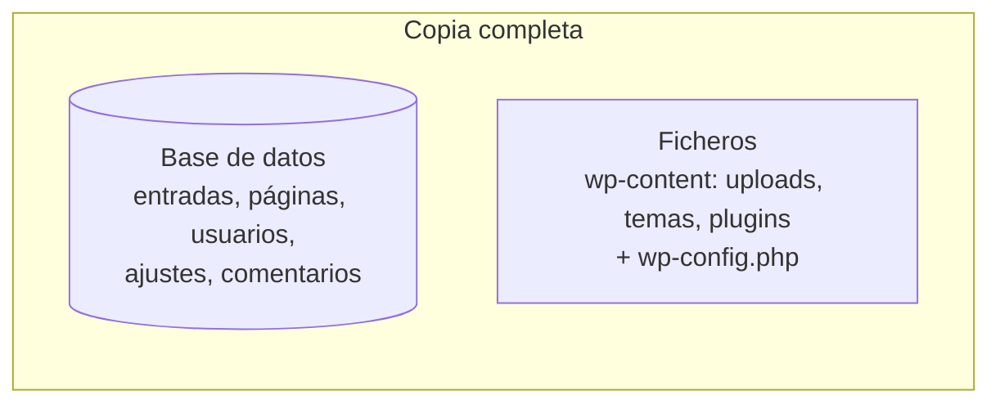

# 7. Copias de seguridad de los contenidos

<ExportPDF />

::: accent-box purple 🎯 Objetivos
- Identificar qué hay que copiar de un CMS.
- Realizar copias de seguridad manuales y automáticas (CE j).
- Restaurar una copia y comprobar que el sitio funciona.
:::

## 7.1 ¿Qué hay que copiar?

Un CMS guarda la información en **dos lugares** y la copia debe incluir **ambos**:



| Si solo copias… | Pierdes… |
|-----------------|----------|
| La base de datos | Imágenes, documentos subidos, temas y plugins |
| Los ficheros | Todos los textos, usuarios y configuración |

## 7.2 Estrategia: la regla 3-2-1

::: accent-box teal 💡 Regla 3-2-1
- **3** copias de los datos (la original + 2 copias).
- En **2** soportes distintos (disco del servidor y almacenamiento externo).
- **1** copia fuera del lugar (*off-site*): otra ubicación o la nube.
:::

Define también:

- **Frecuencia:** depende de cuánto cambia el sitio. Un periódico digital, a diario; la web de un centro, semanalmente y siempre **antes de cada actualización**.
- **Retención:** cuántas copias se guardan (por ejemplo, las 4 últimas semanales).
- **Tipo:** **completa** (todo), **incremental** (lo que cambió desde la última copia) o **diferencial** (lo que cambió desde la última completa).

## 7.3 Copia manual desde la línea de comandos

```bash
FECHA=$(date +%F)
mkdir -p ~/backups

# 1. Base de datos
mysqldump -u wpuser -p --single-transaction wordpress > ~/backups/wp-db-$FECHA.sql

# 2. Ficheros
sudo tar czf ~/backups/wp-files-$FECHA.tar.gz -C /var/www/html wordpress

ls -lh ~/backups
```

Con WP-CLI la exportación de la base de datos es aún más sencilla:

```bash
wp db export ~/backups/wp-db-$FECHA.sql
```

### Automatizar con cron

```bash
# crontab -e  → copia todos los domingos a las 03:00
0 3 * * 0 /home/admin/scripts/backup-wp.sh >> /home/admin/backups/backup.log 2>&1
```

## 7.4 Copia desde el panel: UpdraftPlus

1. Instala y activa **UpdraftPlus**.
2. **Ajustes → Copias de seguridad UpdraftPlus → Ajustes**:
   - Programación de ficheros y base de datos (por ejemplo, semanal) y número de copias a conservar.
   - **Almacenamiento remoto:** Google Drive, OneDrive, Dropbox, FTP/SFTP, S3…
3. Pulsa **Hacer una copia de seguridad ahora** para comprobar que funciona.
4. Descarga los ficheros generados (`-db.gz`, `-uploads.zip`, `-themes.zip`, `-plugins.zip`, `-others.zip`).

::: note-box 📷 Captura sugerida
Pestaña "Copias de seguridad existentes" de UpdraftPlus con al menos una copia completa.
:::

### En Joomla: Akeeba Backup

**Akeeba Backup** genera un único archivo `.jpa` con base de datos y ficheros, y la herramienta **Akeeba Kickstart** permite restaurarlo en el mismo servidor o en otro.

### En DokuWiki

Al no tener base de datos, basta con copiar las carpetas `data/` (páginas, medios, historial), `conf/` (configuración y usuarios) y las plantillas o plugins añadidos. El plugin **BackupTool** lo hace desde el panel.

## 7.5 Restaurar una copia

::: warning-box Una copia que no se ha restaurado nunca no es una copia fiable
Programa simulacros: restaura en una máquina de pruebas y comprueba que el sitio funciona.
:::

### Restauración manual

```bash
# Ficheros
sudo tar xzf wp-files-2026-10-12.tar.gz -C /var/www/html
sudo chown -R www-data:www-data /var/www/html/wordpress

# Base de datos (la BD y el usuario deben existir)
mysql -u wpuser -p wordpress < wp-db-2026-10-12.sql
```

Si restauras en **otro servidor o dominio**, revisa `wp-config.php` (datos de conexión) y cambia las URL guardadas en la base de datos:

```bash
wp search-replace 'http://antiguo.local' 'https://nuevo.ejemplo.es' --all-tables
```

### Restauración con UpdraftPlus

**Copias de seguridad existentes → Restaurar**, marca los componentes (base de datos, plugins, temas, subidas, otros) y confirma.

### Comprobación final

Tras restaurar, repite las **pruebas de funcionamiento** del apartado 2.8: portada, acceso al panel, imágenes, enlaces permanentes, usuarios y foro.

::: details 🔁 Autoevaluación rápida
1. Has copiado solo `wp-content`. ¿Puedes recuperar el sitio? ¿Por qué?
2. Explica la regla 3-2-1 con un ejemplo para la web de tu centro.
3. ¿Qué comando hay que ejecutar si restauras un WordPress en un dominio diferente?
:::

---

**Anterior:** [← 6. Seguridad y actualizaciones](./6-seguridad-actualizaciones) · **Unidad:** [Volver a la presentación](../index)
