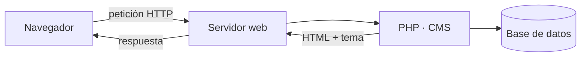

<SlidesViewer>

## RA1 · Gestores de contenidos

::: accent-box 🧱 Instalación y administración de CMS
**Aplicaciones Web · 2º SMR**

Instalar, configurar, asegurar y mantener un gestor de contenidos como lo haría un técnico de sistemas.
:::

---

## Qué vamos a aprender

::: accent-box purple 🎯 Objetivos
- Identificar requisitos e instalar un CMS.
- Gestionar usuarios con roles distintos.
- Personalizar la interfaz, instalar extensiones y menús.
- Habilitar foros con reglas de acceso.
- Actualizar, asegurar y hacer copias de seguridad.
:::

---

## ¿Qué es un CMS?

> Aplicación web para **crear, editar, organizar y publicar** contenido desde el navegador, **separando contenido y diseño** y permitiendo trabajar a **varios usuarios con distintos permisos**.

::: info-box Ejemplos
- **Webs y blogs:** WordPress, Joomla, Drupal
- **Wikis:** DokuWiki, MediaWiki
- **Foros:** phpBB, Discourse
- **Tiendas:** WooCommerce, PrestaShop
:::

---

## Cómo funciona

::: accent-box 💡 Pila LAMP
**L**inux · **A**pache · **M**ySQL/MariaDB · **P**HP
:::

---

## Requisitos de WordPress

::: info-box Software
- PHP 8.3+ con extensiones (`mysqli`, `gd`, `mbstring`, `xml`, `zip`…)
- MySQL 8.0+ o MariaDB 10.6+
- Apache (`mod_rewrite`) o Nginx
- HTTPS
:::

::: tip-box Herramientas
LAMP nativo · XAMPP en Windows · Docker · phpMyAdmin · WP-CLI
:::

---

## Instalación en 4 pasos

1. Instalar la pila **LAMP**.
2. Crear **base de datos** y **usuario propio** (nunca `root`).
3. Descargar el CMS en `/var/www/html` y asignar **permisos** a `www-data`.
4. Completar el **asistente web** → genera `wp-config.php`.

::: warning-box Seguridad desde el minuto 1
Cambia el prefijo `wp_` y no llames `admin` al administrador.
:::

---

## Roles de WordPress

| Rol | Puede |
|-----|-------|
| Administrador | Todo |
| Editor | Publicar y editar todo el contenido |
| Autor | Publicar lo suyo |
| Colaborador | Escribir, sin publicar |
| Suscriptor | Leer y editar su perfil |

::: accent-box teal 💡 Mínimo privilegio
Cada usuario, solo los permisos que necesita.
:::

---

## Personalizar y ampliar

::: info-box Apariencia
Temas de bloques (editor del sitio) o clásicos (personalizador) · logo · colores · tipografía · menús
:::

::: tip-box Extensiones
Plugins (WordPress) · componentes, módulos y plugins (Joomla). **Pocos, fiables y actualizados.**
:::

---

## Foros con reglas de acceso

| Foro | Visibilidad | Escriben |
|------|------------|----------|
| Anuncios | Público | Moderadores |
| Dudas | Privado | Participantes |
| Profesorado | Oculto | Moderadores |

::: info-box bbPress
Roles de foro: Keymaster · Moderador · Participante · Espectador · Bloqueado
:::

---

## Seguridad y actualizaciones

::: danger-box Amenazas
Plugins desactualizados · fuerza bruta · ficheros maliciosos · spam
:::

::: accent-box success ✨ Defensas
Actualizar · 2FA · límite de intentos · HTTPS · `DISALLOW_FILE_EDIT` · permisos 755/644 · revisar `access.log`
:::

---

## Copias de seguridad

::: accent-box teal 💡 Regla 3-2-1
3 copias · 2 soportes · 1 fuera del lugar
:::

- **Base de datos** (`mysqldump`) **+ ficheros** (`wp-content`, `wp-config.php`)
- Automatizar: cron o UpdraftPlus
- **Restaurar y probar** periódicamente

---

## Resumen

::: accent-box purple 🧭 Recuerda
Requisitos → Instalación → Usuarios → Personalización → Foros → Seguridad → Copias.

Y **después de cada cambio: pruebas de funcionamiento.**
:::

</SlidesViewer>
