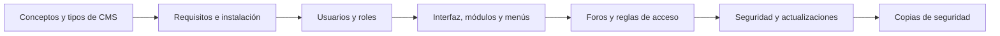

# 🧱 RA1 · Instalación y administración de gestores de contenidos

<ExportPDF />

::: accent-box 🎯 Resultado de aprendizaje
**RA1.** Instala gestores de contenidos, identificando sus aplicaciones y configurándolos según requerimientos.
:::

Un **gestor de contenidos** (CMS, *Content Management System*) es la herramienta con la que hoy se construye la mayoría de los sitios web: periódicos digitales, webs de centros educativos, tiendas online o blogs. En esta unidad aprenderás a **instalar, configurar, asegurar y mantener** un CMS como lo haría un técnico de sistemas microinformáticos: preparando el servidor, creando usuarios con distintos permisos, personalizando el sitio, habilitando un foro y garantizando que existen copias de seguridad.

::: info-box CMS de referencia en esta unidad
Trabajaremos sobre **WordPress**, el CMS más extendido, y lo compararemos con **Joomla** y **Drupal**. También veremos un gestor ligero tipo wiki (**DokuWiki**) para entender que no todos los CMS necesitan base de datos.
:::

## Criterios de evaluación

| CE | Descripción | Dónde se trabaja |
|:--:|-------------|------------------|
| a | Se han identificado los requerimientos necesarios para instalar gestores de contenidos. | [Apuntes 1](./contenidos/1-conceptos-tipos), [2](./contenidos/2-requisitos-instalacion) · P1 |
| b | Se han gestionado usuarios con roles diferentes. | [Apuntes 3](./contenidos/3-usuarios-roles) · P2 |
| c | Se ha personalizado la interfaz del gestor de contenidos. | [Apuntes 4](./contenidos/4-interfaz-modulos-menus) · P2 |
| d | Se han realizado pruebas de funcionamiento. | [Apuntes 2](./contenidos/2-requisitos-instalacion) · P1 |
| e | Se han realizado tareas de actualización del gestor de contenidos, especialmente las de seguridad. | [Apuntes 6](./contenidos/6-seguridad-actualizaciones) · P3 |
| f | Se han instalado y configurado los módulos y menús necesarios. | [Apuntes 4](./contenidos/4-interfaz-modulos-menus) · P2 |
| g | Se han activado y configurado los mecanismos de seguridad proporcionados por el propio gestor de contenidos. | [Apuntes 6](./contenidos/6-seguridad-actualizaciones) · P3 |
| h | Se han habilitado foros y establecido reglas de acceso. | [Apuntes 5](./contenidos/5-foros) · P3 |
| i | Se han realizado pruebas de funcionamiento. | Todas las prácticas |
| j | Se han realizado copias de seguridad de los contenidos del gestor. | [Apuntes 7](./contenidos/7-copias-seguridad) · P3 |

## Contenidos

1. [Qué es un gestor de contenidos. Tipos y características](./contenidos/1-conceptos-tipos)
2. [Requisitos, herramientas e instalación en sistemas libres y propietarios](./contenidos/2-requisitos-instalacion)
3. [Creación de usuarios, grupos y roles](./contenidos/3-usuarios-roles)
4. [Interfaz gráfica, personalización, módulos, menús y sindicación](./contenidos/4-interfaz-modulos-menus)
5. [Creación de foros y reglas de acceso](./contenidos/5-foros)
6. [Mecanismos de seguridad, actualizaciones e informes de acceso](./contenidos/6-seguridad-actualizaciones)
7. [Copias de seguridad y restauración](./contenidos/7-copias-seguridad)

🎞️ [Diapositivas de la unidad](./contenidos/diapositivas) · 🛠️ [Prácticas y rúbricas](./ejercicios/)

## Qué necesitas

- Una máquina virtual (VirtualBox, VMware o Proxmox) con **Ubuntu Server 24.04 LTS** o una distribución similar, o bien un equipo Windows con **XAMPP**.
- Conexión a Internet para descargar paquetes.
- Un navegador actualizado y un editor de texto (VS Code, Notepad++…).

::: tip-box Consejo para la modalidad semipresencial
Haz una **instantánea (snapshot)** de la máquina virtual antes de cada práctica. Si algo sale mal, volverás al punto de partida en segundos y podrás repetir el proceso tantas veces como necesites.
:::
