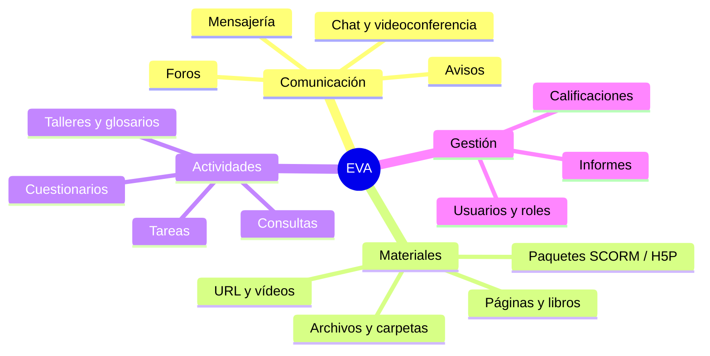

# 1. Aprendizaje a distancia y sistemas de gestión del aprendizaje

<ExportPDF />

::: accent-box purple 🎯 Objetivos
- Definir e-learning, LMS y entorno virtual de aprendizaje.
- Clasificar las plataformas por tipo y licencia.
- Identificar los elementos lógicos de un EVA: comunicación, materiales y actividades.
:::

## 1.1 Conceptos básicos

- **E-learning:** formación que se apoya en Internet para que profesorado y alumnado se comuniquen y accedan a los contenidos **sin coincidir en el espacio y, a menudo, tampoco en el tiempo**.
- **B-learning (*blended*) o semipresencial:** combina sesiones presenciales con trabajo en una plataforma, como este ciclo.
- **M-learning:** aprendizaje desde dispositivos móviles.

::: accent-box 📖 Definición
Un **sistema de gestión del aprendizaje (LMS)** es una aplicación web que permite **organizar, distribuir y controlar** actividades de formación: alta de usuarios y cursos, publicación de materiales, actividades evaluables, comunicación y seguimiento del progreso. Cuando hablamos del espacio en el que se aprende, solemos llamarlo **entorno virtual de aprendizaje (EVA)** o **aula virtual**.
:::

::: info-box LMS y LCMS
- Un **LMS** se centra en la **gestión** (usuarios, matriculación, calificaciones, informes).
- Un **LCMS** (*Learning Content Management System*) se centra en **crear y reutilizar contenidos** didácticos.

Las plataformas actuales, como Moodle, combinan ambas cosas.
:::

## 1.2 Características de un LMS

| Característica | Ejemplo en Moodle |
|----------------|------------------|
| **Interactividad** | Foros, mensajería, retroalimentación de tareas |
| **Flexibilidad** | Distintos formatos de curso, idiomas, temas |
| **Escalabilidad** | Desde un aula a miles de usuarios (Aules) |
| **Estandarización** | Paquetes SCORM, IMS Common Cartridge, LTI, H5P |
| **Usabilidad y accesibilidad** | Interfaz adaptable a móvil, cumplimiento WCAG |
| **Seguimiento** | Libro de calificaciones, finalización de actividades, informes |

## 1.3 Tipos de plataformas

### Según la licencia

| Tipo | Ventajas | Inconvenientes | Ejemplos |
|------|----------|----------------|----------|
| **Software libre** | Sin coste de licencia, comunidad, se puede adaptar y autoalojar | Necesita personal técnico para instalar y mantener | **Moodle**, Chamilo, Canvas LMS (edición libre), Open edX |
| **Comercial** | Soporte del fabricante | Coste por usuario, dependencia del proveedor | Blackboard Learn, D2L Brightspace |
| **En la nube / SaaS** | Nada que instalar | Menos control sobre los datos y la personalización | Google Classroom, Microsoft Teams para Educación, MoodleCloud |

### Según su uso

- **Educación reglada:** aulas por grupo y materia (Aules, Moodle de universidades).
- **Formación corporativa:** cursos de empresa, con itinerarios y certificaciones.
- **MOOC:** cursos masivos abiertos (Coursera, edX, MiríadaX).

## 1.4 Elementos lógicos de un entorno virtual

- **Comunicación:** síncrona (chat, videoconferencia con BigBlueButton) y asíncrona (foros, mensajes, avisos).
- **Materiales o recursos:** contenidos que el alumnado consulta pero no "entrega".
- **Actividades:** el alumnado hace algo que se puede evaluar o registrar.

## 1.5 Moodle

**Moodle** (*Modular Object-Oriented Dynamic Learning Environment*) nació en 2002, creado por Martin Dougiamas. Es software libre (GPL), está escrito en **PHP** y usa una base de datos **MySQL/MariaDB o PostgreSQL**. Se traduce a más de 100 idiomas y lo usan cientos de millones de usuarios.

::: tip-box Versiones
Moodle publica dos versiones al año y, cada cierto tiempo, una **LTS** (soporte extendido). Para un centro educativo se recomienda usar una LTS o la última estable. Consulta el calendario en [moodledev.io/general/releases](https://moodledev.io/general/releases).
:::

::: details 🔁 Autoevaluación rápida
1. ¿Qué diferencia hay entre un LMS y un LCMS?
2. Clasifica en recurso, actividad o comunicación: un PDF, un cuestionario, un foro de dudas, una consulta para elegir fecha de examen, un enlace a un vídeo.
3. ¿Qué ventajas e inconvenientes tiene para un centro usar Google Classroom frente a un Moodle propio?
:::

---

**Siguiente:** [2. Instalación y estructura →](./2-instalacion-estructura)
