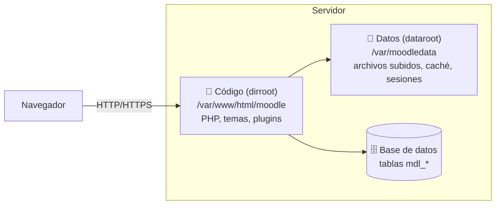
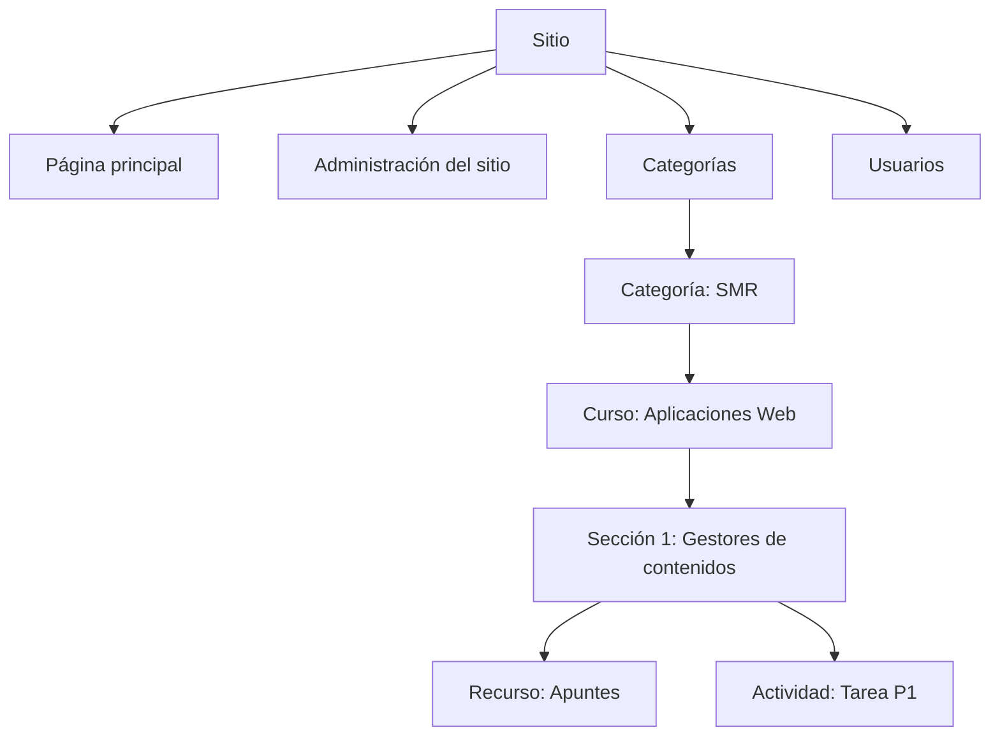

# 2. Instalación de Moodle y estructura del sitio

<ExportPDF />

::: accent-box purple 🎯 Objetivos
- Instalar Moodle en un sistema operativo libre y en uno propietario.
- Reconocer la estructura del sitio y la jerarquía de directorios generada (CE a).
:::

## 2.1 Arquitectura de una instalación de Moodle

Moodle guarda la información en **tres sitios distintos**. Entender esto es la clave de la estructura del sitio y de las copias de seguridad:



| Elemento | Contiene | ¿Accesible desde la web? |
|----------|----------|--------------------------|
| **Código** (`dirroot`) | Ficheros PHP de Moodle, temas, plugins y `config.php` | Sí |
| **Datos** (`dataroot`, *moodledata*) | Archivos que suben los usuarios, cachés, sesiones, idiomas descargados | **No, nunca** |
| **Base de datos** | Usuarios, cursos, calificaciones, configuración… (tablas con prefijo `mdl_`) | No |

::: danger-box moodledata fuera del directorio web
Si `moodledata` estuviera dentro de `/var/www/html`, cualquiera podría descargar los archivos de los usuarios escribiendo su URL. El instalador se niega a continuar si detecta esta situación.
:::

## 2.2 Requisitos

Los requisitos dependen de la versión. Consúltalos siempre en las *release notes* de [moodledev.io](https://moodledev.io/general/releases). Como referencia para las versiones 4.5 LTS y 5.x:

| Elemento | Requisito orientativo |
|----------|----------------------|
| PHP | 8.1 o superior (8.2+ para Moodle 5.x), con `max_input_vars = 5000` o más |
| Extensiones PHP | `curl`, `gd`, `intl`, `mbstring`, `soap`, `xml`, `xmlrpc` (opcional), `zip`, `sodium`, `opcache`, y el *driver* de la BD |
| Base de datos | MariaDB 10.6+/10.11+, MySQL 8.0+/8.4+ o PostgreSQL 13+/15+ |
| Servidor web | Apache o Nginx |
| Hardware de prácticas | 2 GB de RAM y 5 GB libres como mínimo |

## 2.3 Instalación en un sistema libre (Ubuntu Server 24.04)

### Paso 1. Paquetes

```bash
sudo apt update
sudo apt install -y apache2 mariadb-server php libapache2-mod-php php-mysql \
  php-curl php-gd php-intl php-mbstring php-soap php-xml php-zip git unzip
```

Edita `/etc/php/8.3/apache2/php.ini` (y `/etc/php/8.3/cli/php.ini`) y establece:

```ini
max_input_vars = 5000
upload_max_filesize = 100M
post_max_size = 100M
```

### Paso 2. Base de datos

```sql
CREATE DATABASE moodle DEFAULT CHARACTER SET utf8mb4 COLLATE utf8mb4_unicode_ci;
CREATE USER 'moodleuser'@'localhost' IDENTIFIED BY 'Cambia_Esta_Clave_2026';
GRANT ALL PRIVILEGES ON moodle.* TO 'moodleuser'@'localhost';
FLUSH PRIVILEGES;
```

### Paso 3. Código y directorio de datos

Descarga la versión estable desde [download.moodle.org](https://download.moodle.org/) o clónala con Git (más cómodo para actualizar):

```bash
cd /var/www/html
sudo git clone -b MOODLE_405_STABLE --depth 1 https://github.com/moodle/moodle.git
sudo mkdir /var/moodledata
sudo chown -R www-data:www-data /var/moodledata /var/www/html/moodle
sudo chmod -R 770 /var/moodledata
sudo systemctl restart apache2
```

::: info-box La carpeta public/ en las versiones más recientes
A partir de **Moodle 5.1**, el código accesible desde la web se encuentra en la subcarpeta **`public/`** y el *DocumentRoot* del servidor debe apuntar a ella. Comprueba las instrucciones de instalación de la versión que descargues.
:::

### Paso 4. Asistente de instalación

Abre `http://IP-DEL-SERVIDOR/moodle` y sigue el asistente:

1. **Idioma** de la instalación.
2. **Rutas:** dirección web, directorio de Moodle y **directorio de datos** (`/var/moodledata`).
3. **Controlador de base de datos:** *MariaDB (native/mariadb)*.
4. **Datos de la BD:** servidor `localhost`, nombre, usuario, contraseña y prefijo de tablas (`mdl_`).
5. **Comprobación del servidor**: todo debe aparecer en verde (*OK*). Lo que aparezca en rojo hay que resolverlo antes de seguir.
6. Instalación de las tablas y **cuenta del administrador**.
7. **Ajustes de la página principal**: nombre completo y corto del sitio, zona horaria, política de registro.

::: note-box 📷 Captura sugerida
Pantalla de "Comprobaciones del servidor" del instalador con todos los requisitos en OK.
:::

También se puede instalar desde la terminal:

```bash
sudo -u www-data php /var/www/html/moodle/admin/cli/install.php
```

### Paso 5. Tarea programada (cron)

Moodle necesita ejecutar **tareas periódicas** (envío de correos de los foros, copias automáticas, limpieza…). Sin cron, muchas funciones no se ejecutan:

```bash
sudo crontab -u www-data -e
# Añadir:
* * * * * /usr/bin/php /var/www/html/moodle/admin/cli/cron.php > /dev/null
```

## 2.4 Instalación en un sistema propietario (Windows)

1. Instala **XAMPP** y arranca Apache y MySQL.
2. En `C:\xampp\php\php.ini`, establece `max_input_vars = 5000` y activa las extensiones necesarias (`extension=intl`, `extension=sodium`, `extension=zip`…). Reinicia Apache.
3. Descomprime Moodle en `C:\xampp\htdocs\moodle` y crea el directorio de datos **fuera** de `htdocs`, por ejemplo `C:\xampp\moodledata`.
4. Crea la base de datos y el usuario desde `http://localhost/phpmyadmin`.
5. Abre `http://localhost/moodle` y sigue el mismo asistente.
6. Para el cron, crea una **tarea programada de Windows** que ejecute cada minuto `C:\xampp\php\php.exe C:\xampp\htdocs\moodle\admin\cli\cron.php`.

::: tip-box Alternativas rápidas
- **Docker:** imágenes como `bitnami/moodle` levantan Moodle y MariaDB con un `docker-compose.yml`.
- **MoodleCloud:** Moodle alojado por Moodle HQ, sin instalación (con limitaciones).
:::

## 2.5 Jerarquía de directorios

### Directorio del código (`dirroot`)

```text
moodle/
├── admin/        ← administración del sitio y scripts CLI (admin/cli)
├── auth/         ← métodos de autenticación (manual, email, ldap, oauth2…)
├── backup/       ← motor de copias de seguridad y restauración
├── blocks/       ← bloques (calendario, navegación, actividad reciente…)
├── course/       ← gestión de cursos y categorías
├── enrol/        ← métodos de matriculación (manual, autoinscripción, cohorte…)
├── grade/        ← libro de calificaciones
├── lang/         ← idioma base (inglés)
├── lib/          ← bibliotecas del núcleo
├── login/        ← páginas de acceso
├── mod/          ← módulos de actividad (assign, forum, quiz, choice, resource…)
├── question/     ← banco de preguntas y formatos de importación
├── report/       ← informes (registros, participación, actividad…)
├── theme/        ← temas (boost, classic)
├── user/         ← perfiles de usuario
├── config.php    ← ¡configuración generada por el instalador!
└── version.php   ← versión instalada
```

Cada **plugin** se instala en la carpeta de su tipo: un tema en `theme/`, una actividad en `mod/`, un bloque en `blocks/`…

### `config.php`

```php
<?php
unset($CFG); global $CFG; $CFG = new stdClass();
$CFG->dbtype    = 'mariadb';
$CFG->dbhost    = 'localhost';
$CFG->dbname    = 'moodle';
$CFG->dbuser    = 'moodleuser';
$CFG->dbpass    = '********';
$CFG->prefix    = 'mdl_';
$CFG->wwwroot   = 'http://192.168.1.50/moodle';
$CFG->dataroot  = '/var/moodledata';
$CFG->admin     = 'admin';
$CFG->directorypermissions = 02777;
require_once(__DIR__ . '/lib/setup.php');
```

### Directorio de datos (`moodledata`)

```text
moodledata/
├── filedir/      ← TODOS los archivos subidos, guardados por su hash SHA1
├── cache/        ← caché de la aplicación
├── localcache/   ← caché local del servidor
├── lang/         ← paquetes de idioma descargados (es, ca_valencia…)
├── sessions/     ← sesiones de los usuarios
├── temp/         ← temporales (incluye copias en curso)
└── trashdir/     ← archivos borrados pendientes de eliminar
```

::: info-box ¿Por qué no veo los PDF con su nombre en filedir?
Moodle guarda cada archivo **una sola vez**, con un nombre que es su **huella SHA1**, aunque se use en varios cursos. El nombre original y su ubicación en los cursos se guardan en la tabla `mdl_files` de la base de datos. Por eso, para recuperar Moodle, hacen falta **a la vez** la base de datos y `moodledata`.
:::

### Estructura lógica del sitio



::: details 🔁 Autoevaluación rápida
1. ¿Qué tres elementos forman una instalación de Moodle y qué contiene cada uno?
2. ¿Por qué `moodledata` no puede estar dentro del directorio publicado por el servidor web?
3. ¿En qué carpeta instalarías un nuevo tema? ¿Y un nuevo tipo de actividad?
4. ¿Qué ocurre si no se configura el cron?
:::

---

**Anterior:** [← 1. E-learning y LMS](./1-conceptos-tipos) · **Siguiente:** [3. Personalización →](./3-personalizacion)
