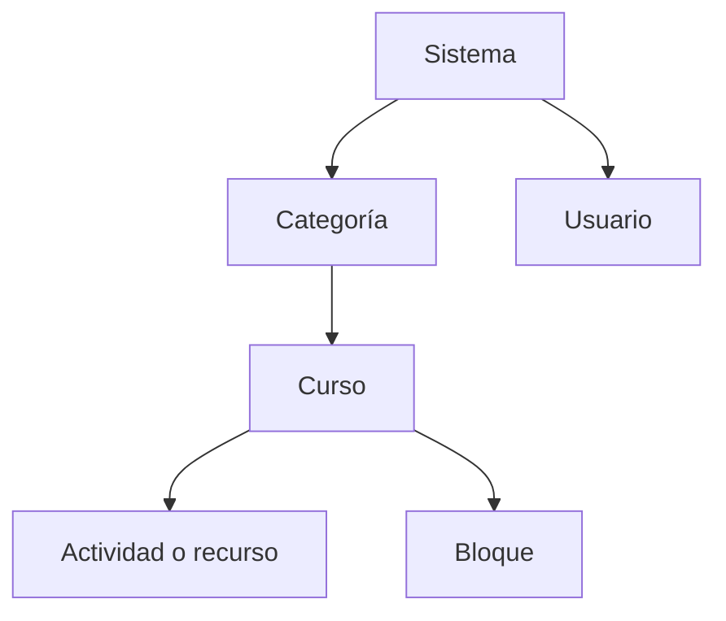

# 4. Cursos, usuarios, grupos y perfiles

<ExportPDF />

::: accent-box purple 🎯 Objetivos
- Crear categorías y cursos siguiendo especificaciones.
- Gestionar usuarios, roles, matriculaciones y grupos.
- Manipular y generar perfiles personalizados (CE c).
- Configurar los modos de registro y autenticación.
:::

## 4.1 Categorías y cursos

Las **categorías** organizan los cursos como si fueran carpetas, y pueden anidarse:

```text
Ciclos Formativos
└── SMR (Sistemas Microinformáticos y Redes)
    ├── 1º SMR
    └── 2º SMR
        ├── 0228 Aplicaciones Web
        └── 0227 Servicios en Red
```

**Administración del sitio → Cursos → Gestionar cursos y categorías**:

1. **Crear nueva categoría** (nombre, categoría padre, número ID y descripción).
2. **Crear nuevo curso** dentro de la categoría, con:

| Campo | Ejemplo | Comentario |
|-------|---------|-----------|
| Nombre completo | Aplicaciones Web 2026-27 | Visible en listados |
| Nombre corto | AW-2SMR-2627 | **Único**, aparece en la navegación |
| Fecha de inicio / fin | 15/09/2026 – 31/05/2027 | Para informes y ocultación automática |
| Formato | **Temas** o **Semanal** | También *Actividad única* o *Social* |
| Número de secciones | 6 | Una por RA |
| Visibilidad | Mostrar / Ocultar | Ocultar hasta que esté preparado |
| Finalización | Activada | Necesaria para el seguimiento del progreso |

::: tip-box Crear muchos cursos a la vez
**Administración del sitio → Cursos → Subir cursos** permite crear cursos de forma masiva a partir de un fichero **CSV** (`shortname,fullname,category_idnumber`).
:::

## 4.2 Usuarios

### Crear usuarios

- **Uno a uno:** *Administración del sitio → Usuarios → Cuentas → Agregar usuario*.
- **De forma masiva:** *Usuarios → Cuentas → Subir usuarios* con un CSV:

```csv
username,password,firstname,lastname,email,cohort1
alu01,Temp_2026!,Ana,García,ana@ejemplo.es,2SMR
alu02,Temp_2026!,Luis,Pérez,luis@ejemplo.es,2SMR
```

Las **cohortes** son agrupaciones de usuarios a nivel de sitio o categoría (por ejemplo, todo el grupo de 2º SMR) que se pueden matricular de una vez en varios cursos.

## 4.3 Roles y contextos

En Moodle, un **rol** es un conjunto de permisos (*capacidades*) que se asigna a un usuario **en un contexto** concreto:



Un permiso asignado en un contexto **se hereda** hacia abajo: un "Gestor" en la categoría *SMR* gestiona todos los cursos de esa categoría.

| Rol | Contexto habitual | Puede |
|-----|-------------------|-------|
| **Administrador** | Sistema | Todo |
| **Gestor** (*Manager*) | Sistema o categoría | Crear y gestionar cursos y usuarios |
| **Creador de cursos** | Sistema o categoría | Crear cursos |
| **Profesor** (*editingteacher*) | Curso | Editar el curso, calificar |
| **Profesor sin permiso de edición** | Curso | Calificar, pero no modificar el curso |
| **Estudiante** | Curso | Participar en actividades |
| **Invitado** | Curso | Ver sin participar |
| **Usuario identificado** | Sistema | Rol base de cualquier usuario con sesión |

### Matricular en un curso

En el curso: **Participantes → Matricular usuarios**, elige usuarios o cohortes y el rol. Los **métodos de matriculación** del curso (*Participantes → Métodos de matriculación*) son:

- **Manual:** la hace el profesorado o el administrador.
- **Autoinscripción:** el alumnado se apunta, opcionalmente con **clave de matriculación**.
- **Sincronización de cohortes:** todos los miembros de una cohorte quedan matriculados.
- **Acceso de invitados**.

## 4.4 Grupos y agrupamientos

Dentro de un curso, los **grupos** separan al alumnado (por ejemplo, *2SMR-A* y *2SMR-B*):

- **Modo de grupo** del curso o de cada actividad: *No hay grupos*, *Grupos separados* (cada grupo solo ve lo suyo) o *Grupos visibles*.
- **Agrupamientos:** conjuntos de grupos, para asignar una actividad solo a ciertos grupos.
- Se pueden **crear automáticamente** (por número de grupos o de miembros) o importar con CSV.

## 4.5 Perfiles personalizados

"Perfil" en Moodle tiene dos sentidos, y el CE c trabaja con ambos:

### a) Perfil de usuario: campos personalizados

**Administración del sitio → Usuarios → Cuentas → Campos del perfil de usuario**: crea campos nuevos agrupados en categorías.

| Tipo de campo | Ejemplo |
|---------------|---------|
| Menú desplegable | *Grupo:* 2SMR-A / 2SMR-B |
| Casilla | *Autoriza publicación de imágenes* |
| Texto | *NIA* (número de identificación del alumno) |
| Fecha | *Fecha de nacimiento* |

Para cada campo decides si es **obligatorio**, **bloqueado** (solo lo cambia el administrador), **único** y **quién puede verlo**. Estos campos se pueden rellenar con la subida de usuarios por CSV (`profile_field_NIA`).

### b) Rol personalizado (perfil de permisos)

**Administración del sitio → Usuarios → Permisos → Definir roles → Añadir un nuevo rol**:

1. Parte de un **arquetipo** (por ejemplo, *student*).
2. Define en qué **contextos** se puede asignar.
3. Ajusta las **capacidades** (*Permitir, Prevenir, Prohibir, No establecido*).

Ejemplo: rol **Delegado/a de clase** = estudiante + permiso para publicar en el foro de Avisos (`mod/forum:addnews`).

Para comprobar un rol, usa **Cambiar rol a…** (en el menú de usuario dentro de un curso) o **Comprobar permisos** en *Participantes*.

::: note-box 📷 Captura sugerida
Perfil de un usuario mostrando los campos personalizados y página "Comprobar permisos" del nuevo rol.
:::

## 4.6 Modos de registro y autenticación

**Administración del sitio → Extensiones → Autenticación → Gestionar autenticación**:

| Método | Uso |
|--------|-----|
| **Cuentas manuales** | El administrador crea las cuentas (recomendado en centros educativos) |
| **Autorregistro por correo** | Cualquiera crea su cuenta y la confirma por email |
| **Sin acceso** (*nologin*) | Suspende el acceso de una cuenta |
| **LDAP / Active Directory** | Usa las cuentas del dominio del centro |
| **OAuth 2** | Inicio de sesión con Google o Microsoft |

En **Ajustes comunes** se configura si el registro es libre (*Auto-registro*), la **política de contraseñas** (longitud, dígitos, mayúsculas, símbolos) y el bloqueo de cuentas tras varios intentos fallidos.

::: warning-box Autorregistro abierto
Si activas el autorregistro, limita los dominios de correo permitidos (*allowemailaddresses*) y activa un CAPTCHA: los sitios con registro abierto reciben cuentas de spam a diario.
:::

::: details 🔁 Autoevaluación rápida
1. ¿Qué diferencia hay entre un grupo y una cohorte?
2. Un usuario es "Profesor" en un curso. ¿Puede crear cursos nuevos? ¿Por qué?
3. Diseña dos campos de perfil personalizados útiles para un curso de formación de empresa.
4. ¿Qué método de autenticación usarías si el centro ya tiene cuentas en un Active Directory?
:::

---

**Anterior:** [← 3. Personalización](./3-personalizacion) · **Siguiente:** [5. Recursos, actividades y comunicación →](./5-recursos-actividades)
