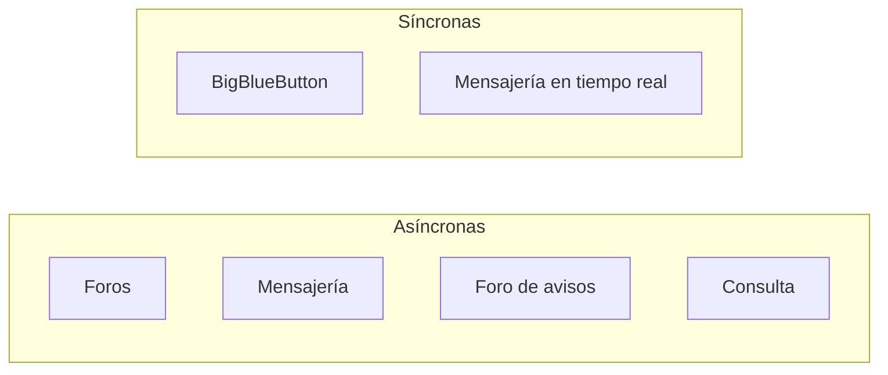

# 5. Recursos, actividades, comunicación e intercambio de contenidos

<ExportPDF />

::: accent-box purple 🎯 Objetivos
- Añadir recursos y actividades a un curso y activar funcionalidades.
- Comprobar la comunicación mediante foros, consultas, mensajería y otros (CE d).
- Importar y exportar contenidos en distintos formatos (CE e).
:::

## 5.1 Recursos

Con el **modo edición** activado, en cada sección: **Añadir una actividad o un recurso**.

| Recurso | Uso |
|---------|-----|
| **Archivo** | Un PDF, una presentación, un vídeo… |
| **Carpeta** | Varios archivos agrupados |
| **Página** | Contenido escrito directamente con el editor |
| **Libro** | Contenido largo dividido en capítulos (exportable e imprimible) |
| **URL** | Enlace a una web externa |
| **Área de texto y medios** (*Etiqueta*) | Texto o imagen intercalado en la página del curso |

## 5.2 Actividades

| Actividad | Qué hace el alumnado |
|-----------|----------------------|
| **Tarea** | Entrega archivos o texto; el profesorado califica y comenta |
| **Cuestionario** | Responde preguntas del banco de preguntas (corrección automática) |
| **Foro** | Debate por escrito |
| **Consulta** | Elige una opción entre varias (votación rápida) |
| **Encuesta** (*Feedback*) | Responde un cuestionario de opinión creado por el profesorado |
| **Glosario**, **Wiki**, **Base de datos** | Construye contenido colaborativo |
| **Taller** | Evalúa trabajos de compañeros (coevaluación) |
| **Lección** | Recorre contenido con bifurcaciones según sus respuestas |
| **H5P** | Contenido interactivo (vídeos con preguntas, presentaciones…) |
| **SCORM** | Paquete de aprendizaje estándar con seguimiento |
| **BigBlueButton** | Videoconferencia integrada (se habilita en *Gestionar actividades*) |

::: info-box Actividades retiradas
Desde Moodle 5.0, las antiguas actividades **Chat** y **Encuesta predefinida** (*Survey*) ya no forman parte de la distribución estándar; si se necesitan, se instalan como plugins adicionales.
:::

### Activar funcionalidades

El administrador decide qué módulos están disponibles: **Administración del sitio → Extensiones → Actividades → Gestionar actividades** (mostrar u ocultar cada módulo). Otras funciones se activan en **Funcionalidades avanzadas**: finalización de actividades, insignias, competencias, blogs, RSS, informes analíticos…

## 5.3 Herramientas de comunicación



### Foros

| Tipo de foro | Características |
|--------------|----------------|
| **Avisos** (*Announcements*) | Creado automáticamente; solo publica el profesorado; suscripción forzosa |
| **Foro para uso general** | Cualquiera abre debates |
| **Debate sencillo** | Un único hilo |
| **Pregunta y respuesta** | El alumnado ve las respuestas ajenas solo después de responder |
| **Cada persona plantea un tema** | Un debate por estudiante |
| **Foro estándar en formato blog** | Los temas se muestran como entradas de blog |

Ajustes relevantes: **modo de suscripción** (opcional, forzosa, automática, deshabilitada), **umbral de mensajes para bloqueo**, **calificación** del foro y **modo de grupo**.

::: info-box Los correos de los foros dependen del cron
Los mensajes de foro se envían por correo **unos 30 minutos después** de publicarse (tiempo de edición) y **solo si el cron se ejecuta**. Si no llegan, revisa el cron y la configuración de correo saliente (*Servidor → Correo electrónico → Configuración de correo saliente*).
:::

### Consulta

Pregunta con varias opciones: elegir fecha de examen, tema del proyecto… Se configura si se muestran los resultados, si se permite cambiar la respuesta, el límite de respuestas por opción y la fecha de cierre.

### Mensajería y notificaciones

- **Mensajes privados** y **grupales** (se puede activar la conversación de grupo para los grupos del curso).
- **Preferencias de notificación** de cada usuario (web, correo, móvil).

### Cómo comprobar que la comunicación funciona

| Prueba | Usuario | Esperado |
|--------|---------|----------|
| Publicar en *Avisos* | Profesor | Mensaje visible y correo recibido por el alumnado |
| Intentar publicar en *Avisos* | Estudiante | No puede |
| Responder en un foro *Pregunta y respuesta* | Estudiante | Ve las otras respuestas solo tras publicar la suya |
| Votar en una consulta y ver resultados | Estudiante | Según la configuración |
| Enviar un mensaje privado | Estudiante → Profesor | Notificación recibida |

::: tip-box Correo de pruebas
En un entorno de prácticas puedes capturar todos los correos con **Mailpit** (`docker run -p 8025:8025 -p 1025:1025 axllent/mailpit`) y configurar en Moodle el servidor SMTP `localhost:1025`.
:::

## 5.4 Importar y exportar contenidos

Moodle intercambia contenidos en muchos formatos. Esta es la parte central del CE e:

| Qué | Exportar | Importar | Formatos |
|-----|----------|----------|----------|
| **Preguntas** | Banco de preguntas → Exportar | Banco de preguntas → Importar | **GIFT**, **Moodle XML**, Aiken, texto con formato |
| **Calificaciones** | Calificaciones → Exportar | Calificaciones → Importar | CSV, Excel (XLSX), ODS, texto plano, XML |
| **Usuarios** | Administración → Usuarios → Acciones masivas → Descargar | Subir usuarios | CSV, Excel, ODS… |
| **Contenido de un curso** | Copia de seguridad (`.mbz`) | Restaurar / Importar de otro curso | MBZ |
| **Paquete IMS Common Cartridge** | — | Restaurar | IMSCC (contenidos de otros LMS) |
| **Paquetes de aprendizaje** | — | Actividad SCORM / H5P | ZIP SCORM 1.2/2004, `.h5p` |
| **Glosario** | Exportar entradas | Importar entradas | XML |
| **Base de datos** (actividad) | Exportar entradas | Importar entradas | CSV, ODS |
| **Libro** | Imprimir libro | Importar capítulos | HTML, ZIP |

### Ejemplo: preguntas en formato GIFT

```text
// Pregunta de opción múltiple
::P1 Moodledata::¿Dónde guarda Moodle los archivos subidos? {
  =En moodledata/filedir
  ~En la carpeta mod/
  ~En la base de datos, como BLOB
}

// Verdadero / falso
::P2 Cron::Moodle puede enviar los correos de los foros sin configurar el cron. {F}

// Respuesta corta
::P3 Prefijo::¿Qué prefijo tienen por defecto las tablas de Moodle? {=mdl_ =mdl}
```

Guarda el texto en un fichero `.txt` con codificación UTF-8 e impórtalo desde **Banco de preguntas → Importar → GIFT**.

### Importar de otro curso

**Curso → Más → Reutilizar curso → Importar**: copia actividades y recursos de otro curso en el que eres profesor, sin datos de usuarios. Ideal para preparar el curso del año siguiente.

::: details 🔁 Autoevaluación rápida
1. ¿Qué tipo de foro usarías para que el alumnado no copie respuestas de sus compañeros?
2. Los correos del foro no llegan. Indica dos causas posibles.
3. Escribe una pregunta GIFT de opción múltiple sobre el CE que prefieras.
4. ¿Qué formato usarías para traer a Moodle un curso exportado desde Canvas?
:::

---

**Anterior:** [← 4. Cursos, usuarios y perfiles](./4-cursos-usuarios) · **Siguiente:** [6. Administración →](./6-administracion)
