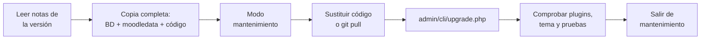

# 6. Copias de seguridad, informes, seguridad y documentación

<ExportPDF />

::: accent-box purple 🎯 Objetivos
- Realizar copias de seguridad y restauraciones de cursos y del sitio completo (CE f).
- Obtener informes de acceso y utilización del sitio (CE g).
- Revisar la seguridad y aplicar actualizaciones.
- Elaborar documentación orientada a la formación de los usuarios.
:::

## 6.1 Copias de seguridad de un curso

**Curso → Más → Reutilizar curso → Copia de seguridad** (o el icono de copia en *Gestionar cursos y categorías*). El asistente tiene cinco pasos:

1. **Ajustes iniciales:** qué incluir: usuarios matriculados, asignaciones de rol, actividades y recursos, bloques, filtros, comentarios, calificaciones, registros…
2. **Ajustes del esquema:** marcar o desmarcar secciones y actividades concretas.
3. **Confirmación y revisión:** nombre del fichero (`copia_de_seguridad-moodle2-course-…-.mbz`).
4. **Ejecutar copia**.
5. **Completar:** el fichero queda en el **área de copias de seguridad del curso**, desde donde se puede descargar.

::: info-box ¿Con o sin datos de usuario?
- **Sin usuarios:** copia la "plantilla" del curso (contenidos y actividades). Útil para reutilizarlo el curso siguiente.
- **Con usuarios:** incluye matriculaciones, entregas, mensajes de foro y calificaciones. Útil como **archivo** del curso terminado.
:::

### Restaurar un curso

**Administración del sitio → Cursos → Restaurar curso** (o *Reutilizar curso → Restaurar* dentro de un curso). Sube el `.mbz` y elige el destino:

- **Como un curso nuevo** en una categoría.
- **En este curso**, combinando con el contenido existente o **borrando** el contenido previo.

### Copias automatizadas

**Administración del sitio → Cursos → Copias de seguridad → Ajustes de las copias de seguridad automatizadas**: días de la semana, hora, carpeta de destino (fuera de `moodledata`), número máximo de copias a conservar y qué incluir. Se ejecutan **mediante el cron**.

## 6.2 Copia de seguridad del sitio completo

Las copias de cursos **no** incluyen la configuración del sitio, los usuarios que no están matriculados, los plugins instalados ni los temas. Para recuperar la plataforma completa hay que copiar **los tres elementos** de la instalación:

```bash
FECHA=$(date +%F)
# 0. Poner el sitio en modo mantenimiento
sudo -u www-data php /var/www/html/moodle/admin/cli/maintenance.php --enable
# 1. Base de datos
mysqldump -u moodleuser -p --single-transaction moodle > moodle-db-$FECHA.sql
# 2. Datos
sudo tar czf moodledata-$FECHA.tar.gz -C /var moodledata
# 3. Código (incluye config.php y los plugins)
sudo tar czf moodle-code-$FECHA.tar.gz -C /var/www/html moodle
# 4. Salir del modo mantenimiento
sudo -u www-data php /var/www/html/moodle/admin/cli/maintenance.php --disable
```

::: tip-box Restauración completa
Para restaurar: recrea la base de datos e importa el `.sql`, descomprime `moodledata` y el código en sus rutas, revisa permisos (`www-data`) y `config.php` y, después, purga las cachés (`admin/cli/purge_caches.php`).
:::

## 6.3 Informes de acceso y utilización

**Administración del sitio → Informes** (a nivel de sitio) y **Curso → Informes** (a nivel de curso):

| Informe | Responde a… |
|---------|------------|
| **Registros** (*Logs*) | ¿Quién hizo qué, cuándo y desde qué IP? Se filtra por curso, usuario, fecha, actividad y acción. Se puede **descargar** en CSV, Excel, ODS… |
| **Registros activos** (*Live logs*) | ¿Qué está pasando ahora mismo? |
| **Actividad del curso** | ¿Cuántas veces se ha visto cada recurso o actividad? |
| **Participación en el curso** | ¿Quién ha participado (o no) en una actividad concreta? |
| **Finalización de actividades** | ¿Qué estudiantes han completado cada actividad? |
| **Informe de actividad del usuario** | Resumen o detalle de un estudiante |
| **Usuarios en línea** / **Últimos accesos** | ¿Quién está conectado? ¿Cuándo accedió cada uno por última vez? (*Participantes*, columna *Último acceso al curso*) |
| **Estadísticas** | Gráficas de accesos por periodo (requiere activar *Estadísticas* en Funcionalidades avanzadas) |
| **Generador de informes** (*Report builder*) | Informes personalizados con columnas y filtros a medida (usuarios, cursos, participantes…) |

::: note-box 📷 Captura sugerida
Informe de registros de un curso filtrado por un estudiante y un día concreto.
:::

::: warning-box Protección de datos
Los registros contienen datos personales. Configura en **Administración del sitio → Plugins → Almacenes de registros** el tiempo que se conservan y explica en la política de privacidad qué se registra y para qué.
:::

## 6.4 Seguridad del sitio

**Administración del sitio → Informes → Comprobaciones de seguridad** revisa automáticamente decenas de puntos: si el registro es abierto, si los invitados pueden ver perfiles, si `moodledata` es accesible desde la web, si las contraseñas son débiles, si el rol de estudiante tiene capacidades peligrosas…

Otras medidas:

- **HTTPS** en todo el sitio.
- **Política de contraseñas** y **bloqueo de cuentas** tras intentos fallidos.
- **Autenticación multifactor** (*Administración del sitio → Plugins → Autenticación multifactor*), disponible en el núcleo desde Moodle 4.3.
- **Revisar los roles** asignados y las capacidades de riesgo (marcadas con iconos de riesgo XSS, spam, configuración, privacidad).
- **Notificaciones** de nuevas versiones en *Administración del sitio → Notificaciones*.

## 6.5 Actualizar Moodle



Con Git:

```bash
cd /var/www/html/moodle
sudo -u www-data git pull                     # actualización menor en la misma rama
sudo -u www-data php admin/cli/upgrade.php    # actualiza la base de datos
```

Para pasar a una versión mayor se cambia de rama (`git checkout MOODLE_500_STABLE`), comprobando antes los requisitos de PHP y base de datos de la nueva versión.

## 6.6 Documentación para los usuarios

Una plataforma solo funciona si las personas saben usarla. Como técnico, deberás elaborar **materiales de formación** adaptados a cada perfil:

| Destinatario | Contenidos de la guía |
|--------------|----------------------|
| **Alumnado** | Primer acceso y cambio de contraseña, completar el perfil, navegar por un curso, entregar una tarea, participar en un foro, consultar calificaciones, app móvil |
| **Profesorado** | Activar edición, añadir recursos y actividades, calificar, gestionar grupos, copias de su curso, importar preguntas |
| **Gestores** | Altas masivas, cohortes, creación de cursos, informes |

Buenas prácticas para redactar la documentación:

- **Una tarea por apartado**, con pasos numerados y una captura por paso.
- Lenguaje sencillo y orientado a la acción ("Pulsa…", "Escribe…").
- Indica **qué verá el usuario** al terminar cada paso.
- Incluye un apartado de **problemas frecuentes**.
- Publícala **dentro de Moodle** (un recurso *Libro* o *Página* en un curso de acogida) para que siempre esté a mano.

::: details 🔁 Autoevaluación rápida
1. ¿Qué no incluye una copia de seguridad de un curso?
2. ¿Qué informe usarías para saber qué estudiantes no han abierto el tema 3?
3. ¿Qué tres elementos copiarías antes de actualizar Moodle?
4. Redacta los pasos de una guía breve: "Cómo entregar una tarea".
:::

---

**Anterior:** [← 5. Recursos y actividades](./5-recursos-actividades) · **Unidad:** [Volver a la presentación](../index)
