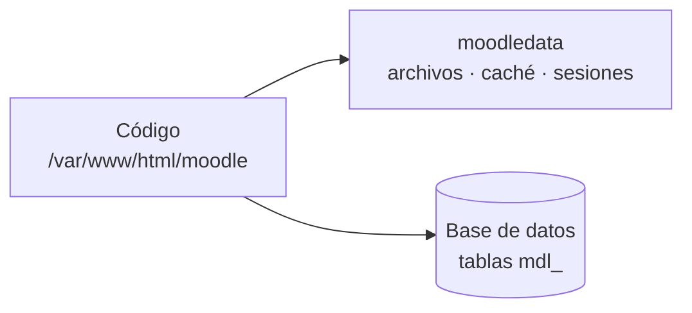

<SlidesViewer>

## RA2 · Sistemas de gestión del aprendizaje

::: accent-box 🎓 Instalación y administración de un LMS
**Aplicaciones Web · 2º SMR**

Del alumno al administrador: tu propio Moodle.
:::

---

## Qué vamos a aprender

::: accent-box purple 🎯 Objetivos
- Reconocer la estructura del sitio y sus directorios.
- Modificar el aspecto de la plataforma.
- Crear perfiles y roles personalizados.
- Comprobar foros, consultas y mensajería.
- Importar/exportar, copiar, restaurar e informar.
:::

---

## LMS / EVA

> Aplicación web para **organizar, distribuir y controlar** la formación: usuarios, cursos, materiales, actividades, comunicación y seguimiento.

::: info-box Ejemplos
- **Libres:** Moodle (Aules), Chamilo, Canvas, Open edX
- **Nube:** Google Classroom, Teams Educación, MoodleCloud
:::

---

## Elementos lógicos

| Comunicación | Materiales | Actividades |
|---|---|---|
| Foros | Archivos | Tareas |
| Mensajería | Páginas y libros | Cuestionarios |
| Avisos | URL | Consultas |
| Videoconferencia | SCORM / H5P | Talleres |

---

## Estructura de una instalación

::: danger-box Regla de oro
`moodledata` **nunca** dentro del directorio web.
:::

---

## Directorios clave

- `admin/cli` → scripts de terminal (install, upgrade, cron)
- `mod/` → actividades · `blocks/` → bloques · `theme/` → temas
- `auth/`, `enrol/` → autenticación y matriculación
- `config.php` → conexión a BD, `wwwroot`, `dataroot`
- `moodledata/filedir` → archivos por **hash SHA1**

---

## Personalización

::: info-box Apariencia
Tema Boost · color de marca · logos · SCSS · página principal · bloques · idiomas (`es`, `ca_valencia`)
:::

::: tip-box Pruébalo como estudiante
Usa **Cambiar rol a…** y revisa en el móvil.
:::

---

## Usuarios y perfiles

- Altas manuales o **CSV** · **cohortes** · grupos y agrupamientos
- Roles en **contextos**: sistema → categoría → curso → actividad
- **Campos de perfil** personalizados
- **Roles personalizados** a partir de un arquetipo

---

## Comunicación

| Herramienta | Comprueba… |
|-------------|-----------|
| Foro de avisos | Solo publica el profesorado |
| Foro P y R | Respuestas ocultas hasta responder |
| Consulta | Resultados según configuración |
| Mensajería | Notificaciones |

::: warning-box Sin cron no hay correos
Los avisos de foro se envían desde las tareas programadas.
:::

---

## Importar y exportar

- **Preguntas:** GIFT · Moodle XML · Aiken
- **Calificaciones / usuarios:** CSV · XLSX · ODS
- **Cursos:** `.mbz` · IMS Common Cartridge
- **Paquetes:** SCORM · H5P

---

## Copias e informes

::: accent-box success ✨ Copias
Curso (`.mbz`, con o sin usuarios) · automatizadas · sitio completo = **BD + moodledata + código**
:::

::: info-box Informes
Registros · actividad · participación · finalización · estadísticas · generador de informes
:::

---

## Resumen

::: accent-box purple 🧭 Recuerda
Instalar → Reconocer la estructura → Personalizar → Usuarios y perfiles → Comunicación → Importar/exportar → Copias → Informes → **Documentar para los usuarios**.
:::

</SlidesViewer>
