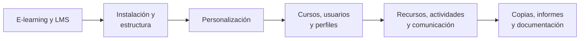

# 🎓 RA2 · Instalación y administración de entornos virtuales de aprendizaje

<ExportPDF />

::: accent-box 🎯 Resultado de aprendizaje
**RA2.** Instala sistemas de gestión de aprendizaje a distancia, describiendo la estructura del sitio y la jerarquía de directorios generada.
:::

Las plataformas de aprendizaje (LMS, *Learning Management System*) o **entornos virtuales de aprendizaje (EVA)** son la base de la formación a distancia y semipresencial, como la de este módulo. En la Comunitat Valenciana, la plataforma **Aules** de la Conselleria está construida sobre **Moodle**, el LMS libre más usado del mundo. En esta unidad pasarás al otro lado: **instalarás y administrarás tu propio Moodle**.

## Criterios de evaluación

| CE | Descripción | Dónde se trabaja |
|:--:|-------------|------------------|
| a | Se ha reconocido la estructura del sitio y la jerarquía de directorios generada. | [Apuntes 2](./contenidos/2-instalacion-estructura) · P1 |
| b | Se han realizado modificaciones en la estética o aspecto del sitio. | [Apuntes 3](./contenidos/3-personalizacion) · P2 |
| c | Se han manipulado y generado perfiles personalizados. | [Apuntes 4](./contenidos/4-cursos-usuarios) · P2 |
| d | Se ha comprobado la funcionalidad de las comunicaciones mediante foros, consultas, entre otros. | [Apuntes 5](./contenidos/5-recursos-actividades) · P3 |
| e | Se han importado y exportado contenidos en distintos formatos. | [Apuntes 5](./contenidos/5-recursos-actividades) · P3 |
| f | Se han realizado copias de seguridad y restauraciones. | [Apuntes 6](./contenidos/6-administracion) · P3 |
| g | Se han realizado informes de acceso y utilización del sitio. | [Apuntes 6](./contenidos/6-administracion) · P3 |

## Contenidos

1. [Conceptos básicos. Tipos y características. Elementos lógicos](./contenidos/1-conceptos-tipos)
2. [Instalación en sistemas libres y propietarios. Estructura de directorios](./contenidos/2-instalacion-estructura)
3. [Personalización del entorno. Navegación y edición](./contenidos/3-personalizacion)
4. [Creación de cursos. Gestión de usuarios, grupos, roles y perfiles. Modos de registro](./contenidos/4-cursos-usuarios)
5. [Recursos, actividades, comunicación. Importación y exportación](./contenidos/5-recursos-actividades)
6. [Copias de seguridad, informes, seguridad y documentación para usuarios](./contenidos/6-administracion)

🎞️ [Diapositivas de la unidad](./contenidos/diapositivas) · 🛠️ [Prácticas y rúbricas](./ejercicios/)

## Qué necesitas

- La máquina virtual Ubuntu Server de la unidad RA1 (o una nueva) con al menos **2 GB de RAM** y **20 GB de disco**.
- Opcionalmente, un equipo Windows con **XAMPP** para la instalación en sistema propietario.
- Tu cuenta de **Aules** como alumno, para comparar tu instalación con una plataforma en producción.
