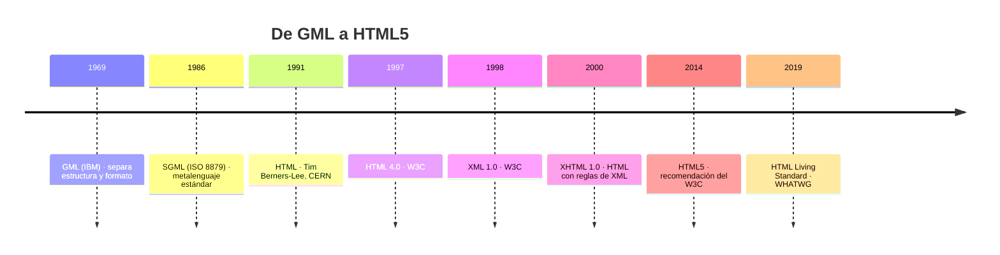

# 1. Lenguajes de marcas: concepto, clasificación y versiones

<ExportPDF />

::: accent-box purple 🎯 Objetivos
- Definir qué es un lenguaje de marcas y diferenciarlo de un lenguaje de programación.
- Clasificar los lenguajes de marcas relacionados con la web (CE a).
- Conocer la evolución y las versiones de HTML.
:::

## 1.1 ¿Qué es un lenguaje de marcas?

::: accent-box 📖 Definición
Un **lenguaje de marcas** es una forma de codificar un documento en la que, junto al texto, se incluyen **etiquetas o marcas** que aportan información adicional sobre su **estructura**, su **presentación** o su **significado**. Las marcas se distinguen del contenido mediante una sintaxis especial, normalmente los signos `<` y `>`.
:::

```html
<h1>Aplicaciones Web</h1>
<p>Módulo de <strong>2º de SMR</strong>.</p>
```

El navegador no muestra las etiquetas: las **interpreta** (un título grande, un párrafo, un texto destacado).

::: info-box Marcas ≠ programación
Un lenguaje de marcas **describe** un documento; no tiene variables, condiciones ni bucles. Por eso HTML no es un lenguaje de programación. Para dar comportamiento a una página web se usa un lenguaje de *script* como **JavaScript** (lo verás en el RA3.2).
:::

## 1.2 Un poco de historia



- **GML** (*Generalized Markup Language*): IBM lo creó para que sus documentos pudieran pasar de un sistema a otro sin perder el formato.
- **SGML**: GML se estandarizó como norma ISO. Es un **metalenguaje**: un lenguaje para definir otros lenguajes de marcas.
- **HTML** (*HyperText Markup Language*): Tim Berners-Lee lo definió a partir de SGML para crear la *World Wide Web*.
- **XML** (*eXtensible Markup Language*): versión simplificada de SGML para describir y transportar **datos**.
- **XHTML**: reformulación de HTML con las reglas estrictas de XML.
- **HTML5** y el **HTML Living Standard**: la versión actual, que evoluciona de forma continua.

## 1.3 Clasificación de los lenguajes de marcas

### Según el tipo de marcas

| Tipo | Las marcas indican… | Ejemplos |
|------|---------------------|----------|
| **De presentación** | Cómo se ve el texto (negrita, tamaño) | Formato RTF, marcas internas de un procesador de textos |
| **De procedimiento** | Instrucciones de composición que ejecuta un programa | TeX, LaTeX, PostScript |
| **Descriptivos o semánticos** | Qué es cada parte (título, párrafo, autor), sin decir cómo se ve | HTML5, XML, DocBook |

### Lenguajes de marcas relacionados con la web

| Lenguaje | Para qué se usa |
|----------|-----------------|
| **HTML** | Estructura y contenido de las páginas web |
| **XHTML** | HTML con sintaxis XML (hoy en desuso como formato de publicación) |
| **XML** | Intercambio de datos y configuración (feeds, ficheros `.docx`/`.odt` internamente, `sitemap.xml`) |
| **RSS / Atom** | Sindicación de contenidos (basados en XML) |
| **SVG** | Gráficos vectoriales dentro de la web |
| **MathML** | Fórmulas matemáticas |
| **Markdown** | Escritura ligera que se convierte en HTML (**esta web está escrita en Markdown**) |

::: tip-box ¿Y CSS, JSON o JavaScript?
**CSS** es un lenguaje de **hojas de estilo** (dice cómo se presentan los elementos). **JSON** es un **formato de datos**. **JavaScript** es un **lenguaje de programación**. Ninguno de los tres es un lenguaje de marcas, aunque los tres trabajan junto a HTML.
:::

## 1.4 Versiones de HTML

| Versión | Año | Novedades principales |
|---------|-----|----------------------|
| HTML 2.0 | 1995 | Primer estándar: formularios, imágenes |
| HTML 3.2 | 1997 | Tablas, applets, atributos de presentación (`<font>`, `bgcolor`) |
| **HTML 4.01** | 1999 | Hojas de estilo, *frames*, versiones *Strict*, *Transitional* y *Frameset* |
| **XHTML 1.0 / 1.1** | 2000 / 2001 | Sintaxis XML: minúsculas, cierre obligatorio, atributos entre comillas |
| **HTML5** | 2014 | Etiquetas semánticas, audio y vídeo nativos, nuevos tipos de formulario, `canvas`, APIs |
| **HTML Living Standard** | 2019 → | El WHATWG mantiene una única versión "viva" que se actualiza continuamente |

::: info-box ¿Quién define HTML?
- El **W3C** (*World Wide Web Consortium*) publicó los estándares hasta HTML5.
- El **WHATWG** (formado por Apple, Google, Mozilla y Microsoft) mantiene el **HTML Living Standard**, que desde 2019 es la referencia oficial también para el W3C.
:::

## 1.5 Reglas sintácticas comunes

- Las etiquetas se escriben entre `<` y `>` y suelen ir **por parejas**: apertura `<p>` y cierre `</p>`.
- Algunas son **vacías** (no tienen contenido ni cierre): `<br>`, ``, `<meta>`.
- Las etiquetas pueden tener **atributos** con valores: `<a href="https://fp.gva.es">`.
- Las etiquetas **se anidan correctamente**: lo último que se abre es lo primero que se cierra.

```html
<p>Correcto: <strong><em>texto</em></strong></p>
<p>Incorrecto: <strong><em>texto</strong></em></p>
```

::: details 🔁 Autoevaluación rápida
1. ¿Por qué HTML no es un lenguaje de programación?
2. Clasifica: LaTeX, HTML5, RTF, XML, SVG.
3. ¿Qué organismo mantiene hoy la especificación de HTML?
4. Indica tres usos de XML en aplicaciones web.
:::

---

**Siguiente:** [2. Estructura de un documento HTML →](./2-estructura-html)
