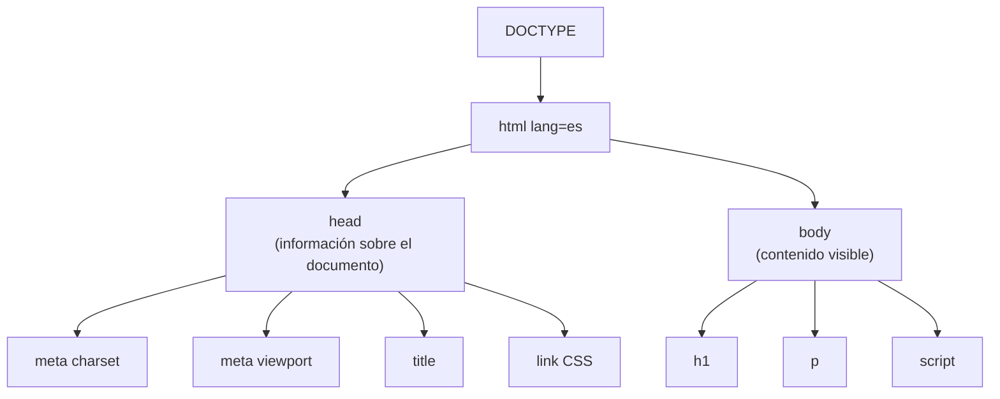
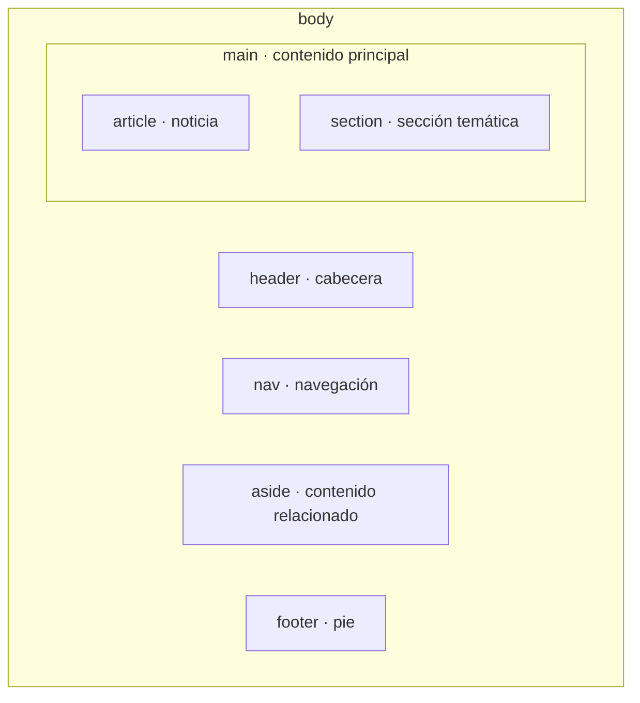

# 2. Estructura de un documento HTML. Etiquetas y atributos

<ExportPDF />

::: accent-box purple 🎯 Objetivos
- Analizar la estructura de un documento HTML e identificar sus secciones (CE b).
- Reconocer la funcionalidad de las principales etiquetas y atributos (CE c).
- Validar un documento HTML.
:::

## 2.1 Estructura mínima de un documento HTML5

```html
<!DOCTYPE html>
<html lang="es">
  <head>
    <meta charset="UTF-8">
    <meta name="viewport" content="width=device-width, initial-scale=1">
    <meta name="description" content="Web del ciclo de SMR">
    <title>Aplicaciones Web · 2º SMR</title>
    <link rel="stylesheet" href="css/estilos.css">
  </head>
  <body>
    <h1>Aplicaciones Web</h1>
    <p>Bienvenidos al módulo.</p>
    <script src="js/app.js"></script>
  </body>
</html>
```



| Sección | Función |
|---------|---------|
| `<!DOCTYPE html>` | Indica al navegador que es un documento HTML5 y que debe usar el **modo estándar** |
| `<html lang="es">` | Elemento raíz. `lang` ayuda a lectores de pantalla, traductores y buscadores |
| `<head>` | **Metadatos**: codificación, título de la pestaña, descripción, estilos, iconos. No se muestra en la página |
| `<body>` | **Contenido visible** del documento |

### Metadatos importantes del `head`

| Elemento | Para qué sirve |
|----------|----------------|
| `<meta charset="UTF-8">` | Codificación: evita que salgan mal las tildes y la ñ |
| `<meta name="viewport" …>` | Adapta la página al ancho del móvil (diseño adaptable) |
| `<title>` | Título de la pestaña, de los marcadores y de los resultados de búsqueda |
| `<meta name="description">` | Descripción que muestran los buscadores |
| `<link rel="stylesheet">` | Enlaza una hoja de estilo CSS |
| `<link rel="icon">` | Icono de la pestaña (*favicon*) |
| `<script>` | Enlaza o incluye código JavaScript |

## 2.2 Etiquetas y atributos

Un **elemento** HTML está formado por la etiqueta de apertura (con sus atributos), el contenido y la etiqueta de cierre:

```html
<a href="https://ceice.gva.es" target="_blank" title="Conselleria">Conselleria</a>
<!-- ^ etiqueta   ^ atributo = "valor"                                  ^ cierre -->
```

### Atributos globales

Se pueden usar en **cualquier** elemento:

| Atributo | Uso |
|----------|-----|
| `id` | Identificador **único** en la página (anclas, CSS, JavaScript) |
| `class` | Una o varias clases para aplicar estilos o seleccionar con JavaScript |
| `style` | Estilos en línea (mejor evitarlo) |
| `title` | Texto de ayuda al pasar el ratón |
| `lang` | Idioma de ese fragmento |
| `hidden` | Oculta el elemento |
| `data-*` | Datos propios para JavaScript (`data-precio="12"`) |

## 2.3 Etiquetas principales por categorías

### Texto

| Etiqueta | Función |
|----------|---------|
| `<h1>` … `<h6>` | Encabezados (solo un `h1` por página, y sin saltarse niveles) |
| `<p>` | Párrafo |
| `<br>` | Salto de línea |
| `<hr>` | Separación temática |
| `<strong>` / `<em>` | Importancia / énfasis (semánticos) |
| `<b>` / `<i>` | Negrita / cursiva sin significado especial |
| `<mark>`, `<small>`, `<sub>`, `<sup>` | Resaltado, letra pequeña, subíndice, superíndice |
| `<blockquote>`, `<q>`, `<cite>` | Citas |
| `<code>`, `<pre>`, `<kbd>` | Código, texto preformateado, teclas |

### Listas

```html
<ul>                       <!-- desordenada -->
  <li>HTML</li><li>CSS</li>
</ul>
<ol start="3">             <!-- ordenada, empieza en 3 -->
  <li>Instalar</li><li>Configurar</li>
</ol>
<dl>                       <!-- de definiciones -->
  <dt>CMS</dt><dd>Gestor de contenidos</dd>
</dl>
```

### Enlaces

```html
<a href="contacto.html">Contacto</a>                   <!-- relativo -->
<a href="https://www.w3.org" target="_blank" rel="noopener">W3C</a>  <!-- absoluto, nueva pestaña -->
<a href="#horario">Ir al horario</a>                    <!-- ancla interna (id="horario") -->
<a href="mailto:secretaria@centro.es">Escribir</a>     <!-- correo -->
<a href="apuntes.pdf" download>Descargar apuntes</a>   <!-- descarga -->
```

### Imágenes y multimedia

```html


<figure>
  
  <figcaption>Aula 12 del departamento de Informática</figcaption>
</figure>

<video src="media/intro.mp4" controls width="640" poster="img/portada.jpg"></video>
<audio src="media/podcast.mp3" controls></audio>
<iframe src="https://www.openstreetmap.org/export/embed.html" title="Mapa"></iframe>
```

::: warning-box El atributo alt es obligatorio
`alt` describe la imagen para quien no puede verla (lectores de pantalla, imagen que no carga). Si la imagen es decorativa, se deja vacío: `alt=""`.
:::

### Tablas

```html
<table>
  <caption>Horario de Aplicaciones Web</caption>
  <thead>
    <tr><th scope="col">Día</th><th scope="col">Hora</th></tr>
  </thead>
  <tbody>
    <tr><td>Lunes</td><td>16:00–18:00</td></tr>
    <tr><td colspan="2">Martes: tutoría online</td></tr>
  </tbody>
</table>
```

| Elemento | Función |
|----------|---------|
| `<table>`, `<caption>` | Tabla y su título |
| `<thead>`, `<tbody>`, `<tfoot>` | Cabecera, cuerpo y pie |
| `<tr>`, `<th>`, `<td>` | Fila, celda de encabezado, celda de datos |
| `colspan`, `rowspan` | Combinar columnas o filas |

::: tip-box Tablas para datos, no para maquetar
Antes se maquetaban páginas completas con tablas. Hoy las tablas son **solo para datos tabulares**; la disposición se hace con CSS (Flexbox y Grid).
:::

### Formularios

```html
<form action="/enviar" method="post">
  <label for="nombre">Nombre</label>
  <input type="text" id="nombre" name="nombre" required>

  <label for="email">Correo</label>
  <input type="email" id="email" name="email" placeholder="tu@correo.es" required>

  <label for="ciclo">Ciclo</label>
  <select id="ciclo" name="ciclo">
    <option value="smr">SMR</option>
    <option value="asir">ASIR</option>
  </select>

  <fieldset>
    <legend>Turno</legend>
    <input type="radio" id="m" name="turno" value="manana"><label for="m">Mañana</label>
    <input type="radio" id="t" name="turno" value="tarde"><label for="t">Tarde</label>
  </fieldset>

  <label><input type="checkbox" name="rgpd" required> Acepto la política de privacidad</label>

  <label for="msg">Mensaje</label>
  <textarea id="msg" name="mensaje" rows="4"></textarea>

  <button type="submit">Enviar</button>
</form>
```

| Atributo del `form` | Significado |
|---------------------|-------------|
| `action` | URL que recibe los datos |
| `method` | `get` (datos en la URL, para búsquedas) o `post` (datos en el cuerpo de la petición, para envíos) |

## 2.4 Estructura semántica del `body`

HTML5 añadió etiquetas que indican **qué papel** cumple cada zona de la página:



```html
<body>
  <header>
    <h1>IES Ejemplo</h1>
    <nav>
      <ul><li><a href="/">Inicio</a></li><li><a href="/ciclos">Ciclos</a></li></ul>
    </nav>
  </header>
  <main>
    <article>
      <h2>Jornada de puertas abiertas</h2>
      <p><time datetime="2026-11-20">20 de noviembre</time>…</p>
    </article>
  </main>
  <aside><h2>Enlaces de interés</h2>…</aside>
  <footer><p>&copy; 2026 IES Ejemplo</p></footer>
</body>
```

| Elemento | Uso |
|----------|-----|
| `<header>` | Cabecera de la página o de un artículo |
| `<nav>` | Bloque de enlaces de navegación principal |
| `<main>` | Contenido principal (uno por página) |
| `<article>` | Contenido independiente que tiene sentido por sí solo (noticia, entrada, comentario) |
| `<section>` | Agrupación temática con su propio encabezado |
| `<aside>` | Contenido relacionado pero secundario |
| `<footer>` | Pie de página o de un artículo |
| `<div>` / `<span>` | Contenedores **sin significado** (bloque / en línea) para cuando ninguna etiqueta semántica encaja |

## 2.5 Entidades y comentarios

```html
<!-- Esto es un comentario: no se muestra -->
&lt; &gt; &amp; &copy; &nbsp; &euro;   →   < > & © (espacio duro) €
```

## 2.6 Validar el documento

1. Abre [validator.w3.org](https://validator.w3.org/).
2. Valida por URL, subiendo el fichero o pegando el código.
3. Corrige los **errores** (etiquetas mal cerradas, atributos inexistentes, falta de `alt`…) y revisa los **avisos**.

::: note-box 📷 Captura sugerida
Resultado del validador del W3C con el mensaje "Document checking completed. No errors or warnings to show."
:::

::: details 🔁 Autoevaluación rápida
1. ¿Qué va en `head` y qué va en `body`?
2. ¿Para qué sirve `<meta name="viewport">`?
3. ¿Qué diferencia hay entre `<strong>` y `<b>`?
4. Elige la etiqueta semántica adecuada: menú principal, una noticia, la información de contacto del pie, una barra lateral de enlaces.
5. ¿Cuándo usarías `method="get"` y cuándo `method="post"`?
:::

---

**Anterior:** [← 1. Lenguajes de marcas](./1-lenguajes-marcas) · **Siguiente:** [3. HTML frente a HTML5 →](./3-html-vs-html5)
