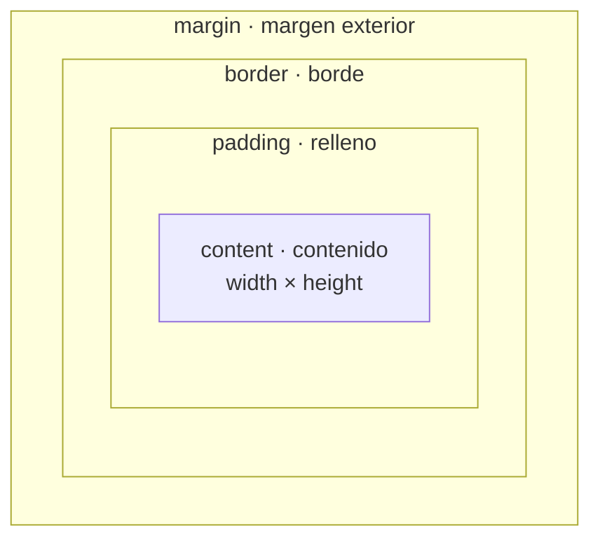

# 4. Hojas de estilo CSS y mejoras de CSS3

<ExportPDF />

::: accent-box purple 🎯 Objetivos
- Identificar las ventajas de las hojas de estilo (CE f).
- Aplicar hojas de estilo CSS: selectores, propiedades, modelo de caja y maquetación (CE g).
- Conocer las principales mejoras de CSS3: Flexbox, Grid, diseño adaptable, variables, transiciones.
:::

## 4.1 ¿Por qué CSS?

**CSS** (*Cascading Style Sheets*) describe **cómo se presentan** los elementos HTML: colores, tipografías, tamaños, posiciones, animaciones…

| Ventaja | Explicación |
|---------|-------------|
| **Separación contenido / presentación** | El HTML describe qué es cada cosa; el CSS, cómo se ve |
| **Mantenimiento centralizado** | Una hoja de estilo para todo el sitio: cambias un color una vez y se aplica en cien páginas |
| **Coherencia visual** | Todas las páginas comparten el mismo aspecto |
| **Ficheros más ligeros** | El HTML no repite atributos de presentación y el navegador guarda el CSS en caché |
| **Adaptación a dispositivos** | Distintos estilos para móvil, tableta, escritorio o impresión |
| **Accesibilidad** | El usuario puede aplicar sus propios estilos (alto contraste, letra grande) |
| **Temas intercambiables** | Los temas de WordPress o Moodle son, sobre todo, hojas de estilo |

## 4.2 Sintaxis de una regla

```css
/* selector  { propiedad: valor; } */
h1 {
  color: #1C375B;
  font-size: 2rem;
  text-align: center;
}
```

- **Selector:** a qué elementos se aplica.
- **Declaración:** pareja `propiedad: valor;` dentro de las llaves.
- Los comentarios se escriben entre `/*` y `*/`.

## 4.3 Formas de aplicar CSS

| Forma | Ejemplo | Cuándo |
|-------|---------|--------|
| **Externa** (recomendada) | `<link rel="stylesheet" href="css/estilos.css">` | Siempre que sea posible |
| **Interna** | `<style> p { color: gray; } </style>` en el `head` | Estilos de una sola página |
| **En línea** | `<p style="color: red">` | Excepciones puntuales (evitar) |

### La cascada y la especificidad

Si varias reglas afectan al mismo elemento, gana:

1. La que tiene `!important` (úsalo lo menos posible).
2. La de **mayor especificidad**: estilo en línea > `#id` > `.clase`, `[atributo]`, `:pseudoclase` > `etiqueta`.
3. A igual especificidad, **la última** que aparece.

Además, algunas propiedades (color, fuente) **se heredan** de los elementos padre.

## 4.4 Selectores

| Selector | Ejemplo | Selecciona |
|----------|---------|------------|
| Universal | `*` | Todos los elementos |
| Etiqueta | `p` | Todos los párrafos |
| Clase | `.destacado` | Elementos con `class="destacado"` |
| ID | `#cabecera` | El elemento con `id="cabecera"` |
| Descendiente | `nav a` | Enlaces dentro de `nav` |
| Hijo directo | `ul > li` | `li` hijos directos de `ul` |
| Agrupación | `h1, h2, h3` | Los tres |
| Atributo | `input[type="email"]` | Campos de correo |
| Pseudoclase | `a:hover`, `li:nth-child(odd)`, `input:focus` | Estados y posiciones |
| Pseudoelemento | `p::first-line`, `.nota::before` | Partes de un elemento |

## 4.5 Propiedades más usadas

| Grupo | Propiedades |
|-------|-------------|
| **Texto** | `color`, `font-family`, `font-size`, `font-weight`, `line-height`, `text-align`, `text-decoration`, `text-transform` |
| **Fondo** | `background-color`, `background-image`, `background-size`, `background` |
| **Caja** | `width`, `height`, `max-width`, `margin`, `padding`, `border`, `border-radius`, `box-shadow`, `box-sizing` |
| **Visualización** | `display` (`block`, `inline`, `inline-block`, `flex`, `grid`, `none`), `visibility`, `opacity` |
| **Posición** | `position` (`static`, `relative`, `absolute`, `fixed`, `sticky`), `top`, `left`, `z-index` |
| **Listas** | `list-style` |

### Unidades

- **Absolutas:** `px`.
- **Relativas:** `%`, `em` (respecto al tamaño de letra del padre), `rem` (respecto al del documento), `vw`/`vh` (porcentaje del ancho/alto de la ventana).
- **Colores:** nombres (`navy`), hexadecimal (`#1C375B`), `rgb(28 55 91)`, `hsl(214 53% 23%)`, con transparencia (`rgb(0 0 0 / 50%)`).

## 4.6 El modelo de caja

Todo elemento es una **caja** formada por contenido, relleno, borde y margen:



```css
.tarjeta {
  width: 300px;
  padding: 1rem 2rem;      /* arriba-abajo 1rem, izquierda-derecha 2rem */
  border: 1px solid #6F8197;
  margin: 0 auto 1.5rem;   /* arriba 0, lados auto (centra), abajo 1.5rem */
  box-sizing: border-box;  /* width incluye padding y borde */
}
```

::: tip-box Truco imprescindible
Añade al principio de tu hoja `*, *::before, *::after { box-sizing: border-box; }`. Así el ancho que declaras es el ancho real de la caja.
:::

## 4.7 Mejoras de CSS3

### Decoración sin imágenes

```css
.boton {
  border-radius: 8px;                         /* esquinas redondeadas */
  box-shadow: 0 2px 6px rgb(0 0 0 / 20%);     /* sombra */
  background: linear-gradient(90deg, #ED6E51, #F29B6B);  /* degradado */
  transition: transform 0.2s ease;            /* animación suave */
}
.boton:hover { transform: scale(1.05); }
```

### Tipografías web

```css
@import url('https://fonts.googleapis.com/css2?family=Noto+Sans:wght@400;700&display=swap');
body { font-family: 'Noto Sans', system-ui, sans-serif; }
```

### Variables (propiedades personalizadas)

```css
:root {
  --color-primario: #1C375B;
  --color-acento: #ED6E51;
  --espacio: 1rem;
}
header { background: var(--color-primario); padding: var(--espacio); }
.boton { background: var(--color-acento); }
```

### Flexbox: distribuir en una dimensión

```css
nav ul {
  display: flex;
  justify-content: space-between;  /* reparto horizontal */
  align-items: center;             /* alineación vertical */
  gap: 1rem;
}
```

### Grid: maquetar en dos dimensiones

```css
body {
  display: grid;
  grid-template-columns: 1fr 250px;
  grid-template-areas:
    "cabecera cabecera"
    "menu     menu"
    "principal lateral"
    "pie      pie";
  gap: 1rem;
}
header { grid-area: cabecera; }
nav    { grid-area: menu; }
main   { grid-area: principal; }
aside  { grid-area: lateral; }
footer { grid-area: pie; }
```

### Diseño adaptable (*responsive*) con media queries

```css
/* Primero el móvil: una columna */
body { grid-template-columns: 1fr;
       grid-template-areas: "cabecera" "menu" "principal" "lateral" "pie"; }

/* A partir de 768 px: dos columnas */
@media (min-width: 768px) {
  body { grid-template-columns: 1fr 250px;
         grid-template-areas: "cabecera cabecera" "menu menu" "principal lateral" "pie pie"; }
}

/* Al imprimir, ocultar menú y lateral */
@media print { nav, aside { display: none; } }
```

::: info-box Modo oscuro
Con `@media (prefers-color-scheme: dark) { … }` puedes adaptar los colores a la preferencia del sistema operativo del usuario, como hace esta misma web.
:::

## 4.8 Comprobar y depurar CSS

- **Herramientas de desarrollo** del navegador (`F12` → *Inspector*): ver qué reglas afectan a un elemento, cuáles se anulan (tachadas) y modificar valores en directo. El modo **diseño adaptable** (`Ctrl+Mayús+M`) simula pantallas de móvil.
- **Validador CSS del W3C**: [jigsaw.w3.org/css-validator](https://jigsaw.w3.org/css-validator/).

::: details 🔁 Autoevaluación rápida
1. Indica cuatro ventajas de usar una hoja de estilo externa.
2. Un párrafo tiene `class="aviso"` e `id="principal"`. Si hay una regla para `.aviso` y otra para `#principal` con colores distintos, ¿cuál gana?
3. Calcula el ancho total de una caja con `width: 200px; padding: 10px; border: 2px; margin: 5px` con y sin `box-sizing: border-box`.
4. ¿Cuándo usarías Flexbox y cuándo Grid?
5. Escribe una media query que cambie el color de fondo en pantallas de menos de 600 px.
:::

---

**Anterior:** [← 3. HTML frente a HTML5](./3-html-vs-html5) · **Siguiente:** [5. Plantillas y herramientas →](./5-plantillas-herramientas)
