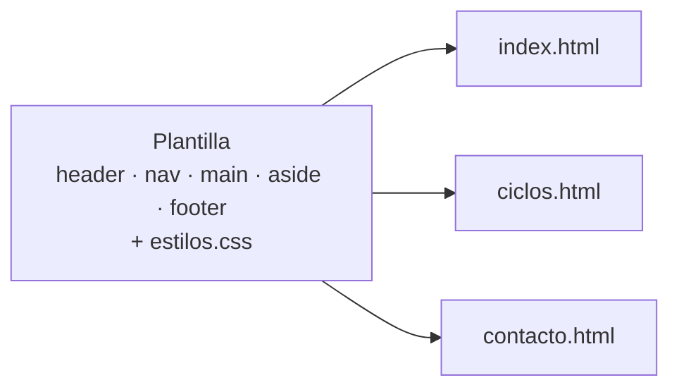

# 5. Elaboración de plantillas y herramientas de edición web

<ExportPDF />

::: accent-box purple 🎯 Objetivos
- Elaborar una plantilla web reutilizable.
- Utilizar herramientas en la creación de documentos web (CE e).
- Comparar tipos de herramientas de edición.
:::

## 5.1 ¿Qué es una plantilla web?

Una **plantilla** es un documento HTML + CSS que define la **estructura y el aspecto comunes** de todas las páginas de un sitio. Solo cambia el contenido de la zona principal.



### Pasos para elaborar una plantilla

1. **Boceto** (*wireframe*) de la disposición en papel o con una herramienta (Excalidraw, Penpot, Figma).
2. **Estructura HTML semántica** con las zonas comunes.
3. **Hoja de estilo externa** con variables para colores y tipografías.
4. **Diseño adaptable** (*mobile first*) y comprobación en varios tamaños.
5. **Validación** HTML y CSS.
6. **Duplicar** la plantilla para cada página cambiando solo el `main`, el `title` y la descripción.

### Estructura de carpetas recomendada

```text
mi-sitio/
├── index.html
├── ciclos.html
├── contacto.html
├── css/
│   └── estilos.css
├── img/
│   └── logo.svg
└── js/
    └── app.js
```

::: tip-box Nombres de archivo
Minúsculas, sin espacios ni tildes, palabras separadas por guiones: `jornada-puertas-abiertas.html`. Evitarás problemas en servidores Linux, que distinguen mayúsculas de minúsculas.
:::

### Plantillas y *frameworks* CSS

No siempre se parte de cero:

| Recurso | Qué ofrece |
|---------|-----------|
| **Bootstrap** | Rejilla, componentes (menús, tarjetas, formularios) y utilidades listas para usar |
| **Pico CSS**, **Water.css** | Estilos "sin clases": dan buen aspecto al HTML semántico sin añadir nada |
| **Tailwind CSS** | Clases de utilidad para construir el diseño desde el HTML |
| Plantillas libres (HTML5 UP, Start Bootstrap) | Sitios completos con licencia libre para adaptar |

En un CMS, la plantilla es el **tema**: en WordPress las plantillas de bloques definen cabecera, pie y zonas de contenido de la misma forma.

## 5.2 Herramientas de edición web

### Tipos de herramientas

| Tipo | Funcionamiento | Ejemplos |
|------|----------------|----------|
| **Editores de texto / código** | Escribes el código con ayudas: resaltado, autocompletado, Emmet, vista previa | **Visual Studio Code**, VSCodium, Sublime Text, Notepad++, Brackets |
| **Editores WYSIWYG** (*What You See Is What You Get*) | Diseñas visualmente y la herramienta genera el código | BlueGriffon, Pinegrow, Adobe Dreamweaver (modo diseño) |
| **Editores online** | Código y resultado en el navegador, sin instalar nada | CodePen, JSFiddle, StackBlitz |
| **Constructores web en la nube** | Arrastrar y soltar, alojamiento incluido | Google Sites, Weebly, Wix → **RA4** |
| **Gestores de contenidos** | Editor de bloques sobre un CMS | WordPress → **RA1** |
| **Generadores de sitios estáticos** | Markdown + plantillas → HTML | VitePress (esta web), Hugo, Jekyll |

::: info-box ¿Código o visual?
Los editores visuales son rápidos, pero suelen generar código innecesario y difícil de mantener. Escribir el código con un buen editor te da **control total** y es lo que necesitas para personalizar temas o diagnosticar errores.
:::

### Visual Studio Code para web

| Función | Cómo |
|---------|------|
| Estructura HTML5 en un segundo | Escribe `!` y pulsa `Tab` (Emmet) |
| Abreviaturas Emmet | `nav>ul>li*4>a` + `Tab` genera un menú de 4 enlaces |
| Vista previa en vivo | Extensión **Live Server** → *Go Live* |
| Formatear el código | `Mayús + Alt + F` |
| Extensiones útiles | Live Server, Prettier, HTMLHint, Auto Rename Tag, Color Highlight |

### Herramientas del navegador

- **Inspector** (`F12`): estructura HTML real (DOM), estilos aplicados, modelo de caja.
- **Diseño adaptable**: simula móviles y tabletas.
- **Lighthouse** (Chrome) / **Accesibilidad** (Firefox): auditorías de rendimiento, accesibilidad, buenas prácticas y SEO.

### Validadores y accesibilidad

| Herramienta | Comprueba |
|-------------|-----------|
| [validator.w3.org](https://validator.w3.org/) | HTML |
| [jigsaw.w3.org/css-validator](https://jigsaw.w3.org/css-validator/) | CSS |
| [wave.webaim.org](https://wave.webaim.org/) | Accesibilidad |
| [webaim.org/resources/contrastchecker](https://webaim.org/resources/contrastchecker/) | Contraste de colores |

## 5.3 Publicar las páginas

Para que otros vean tu sitio necesitas un **servidor web** (lo instalarás en el RA5) o un servicio de alojamiento estático gratuito:

- **GitHub Pages** (esta web se publica así), **Netlify**, **Cloudflare Pages**.
- Un alojamiento con acceso **SFTP** donde subes los ficheros con FileZilla o WinSCP.

::: details 🔁 Autoevaluación rápida
1. ¿Qué partes de una página suelen formar parte de la plantilla y cuáles cambian?
2. Escribe la abreviatura Emmet para generar una lista desordenada con 5 elementos.
3. Indica una ventaja y un inconveniente de un editor WYSIWYG frente a VS Code.
4. ¿Qué herramienta usarías para comprobar si los colores de tu plantilla tienen contraste suficiente?
:::

---

**Anterior:** [← 4. Hojas de estilo CSS](./4-css) · **Siguiente:** [6. Ampliación: HTML5 y CSS3 paso a paso →](./6-ampliacion-html5-css3)
