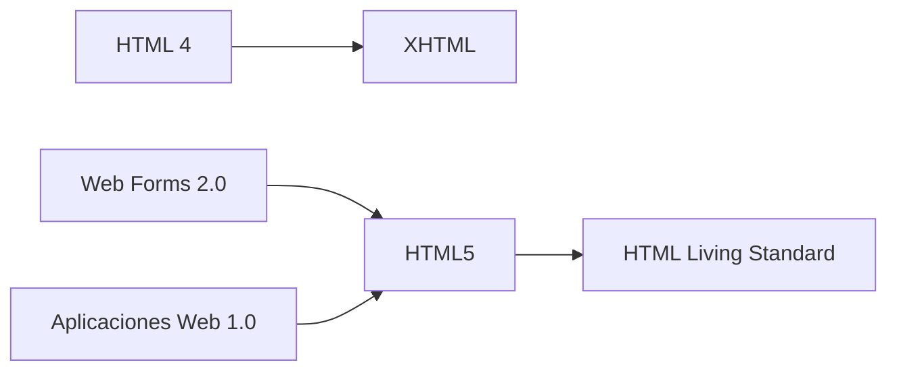

<ExportPDF />

# 6. Ampliación: HTML5 y CSS3 paso a paso

::: info-box Material de ampliación
Este apartado recorre HTML5 y CSS3 con más detalle y ejemplos, y termina construyendo una página completa. Úsalo para repasar y profundizar en los apartados 2, 3 y 4 de la unidad.
:::

## Objetivos

En este primer tema se pretenden conseguir los siguientes objetivos:

- Conocer qué es y para qué sirve HTML5 y CSS3.
- Ver las diferencias entre HTML5 y sus antecesores HTML4 y XHTML.
- Repasar las características de HTML4 que son similares o iguales a la nueva versión HTML5.
- Repasar las características de CSS2.1 que son similares o iguales a la nueva versión CSS3.
- Aplicar estilos CSS a un documento HTML para lograr el diseño deseado.

## Introducción

Este tema ofrece una visión general de cómo hemos llegado a donde estamos hoy en día, por qué HTML5 y CSS3 son tan importantes para las aplicaciones web modernas y cómo el uso de estas tecnologías nos va a facilitar ampliamente nuestra labor como desarrolladores web.

### ¿Qué es HTML5?

Lo que hoy conocemos por HTML5 ha tenido una historia relativamente turbulenta. Como ya sabemos, HTML es el lenguaje de marcado predominante para describir el contenido o los datos en la World Wide Web. HTML5 es el nombre con el que se conoce la versión actual de este lenguaje, que incorporó nuevas características, mejoras en las características existentes, y scripting basado en APIs.

Dicho esto, HTML5 no es una reformulación de las versiones anteriores del lenguaje, de hecho, incluye todos los elementos válidos tanto en HTML 4 como en XHTML 1.0. Por otra parte, ha sido diseñado con unos principios fundamentales en mente para asegurarse de que funciona en la mayoría de las plataformas existentes en el mercado, es compatible con los navegadores antiguos y se ocupa de los errores de una forma amigable.

En primer lugar, HTML5 incluye nuevos elementos de marcado cuya semántica está asociada con el significado de los contenidos que vamos a introducir en ellos. Por ejemplo, en un blog solemos tener entradas o artículos del mismo, normalmente estas entradas las introduciremos mediante la etiqueta `<div>`, a la cual le asociaremos una clase. ¿No sería mejor introducir esos artículos mediante una etiqueta específica para ello, por ejemplo, una etiqueta `<article>`? HTML5 nos proporciona nuevos elementos cuya semántica está asociada a los elementos más utilizados en el diseño web.

El término "HTML5", además, ha sido utilizado para referirse a una serie de nuevas tecnologías y APIs, como son: el dibujo con el elemento `<canvas>`, almacenamiento fuera de línea, el nuevo `<video>` y `<audio>`, funcionalidades de arrastrar y soltar, microdatos, etc. A lo largo del curso, veremos algunas de estas tecnologías.

::: info-box HTML es hoy un «estándar vivo»
Desde 2019, el W3C y el WHATWG mantienen una única especificación, el *HTML Living Standard*, que se actualiza de forma continua: ya no se publican versiones numeradas, así que no habrá un «HTML6». El término «HTML5» se sigue utilizando para referirse al HTML moderno.
:::

### ¿Cómo hemos llegado hasta aquí?

La industria del diseño web se ha desarrollado en un periodo de tiempo relativamente corto. A finales de los años noventa, un sitio web que incluía imágenes y un diseño llamativo era considerado "de primera línea" en términos de contenido web.

Ahora, el panorama es muy diferente. Son habituales las aplicaciones web que muestran datos obtenidos mediante peticiones asíncronas (Ajax) y que dependen de scripting del lado del cliente para la funcionalidad crítica. Muchos sitios web son, en realidad, aplicaciones equiparables a las de escritorio: el correo, la ofimática, la edición de imágenes o las videoconferencias funcionan directamente en el navegador.

En la evolución del lenguaje HTML, HTML4, finalmente, dio paso a XHTML, que es en realidad HTML 4 con una sintaxis estricta de estilo XML. Ambos convivieron durante años, hasta que HTML5 los sustituyó.

HTML5 comenzó originalmente como dos especificaciones diferentes: Web Forms 2.0 y Aplicaciones Web 1.0. Ambas eran consecuencia de los cambios que se dieron en el paisaje web y la necesidad de que las aplicaciones web fueran fáciles de mantener y más eficientes. Finalmente, las dos especificaciones se fusionaron para formar lo que hoy conocemos como HTML5, que se publicó como recomendación oficial del W3C en octubre de 2014.



### ¿Por qué debería interesarme HTML5?

Como se ha mencionado, el núcleo de HTML5 son una serie de nuevos elementos semánticos, así como varias tecnologías y APIs relacionadas. Estos añadidos y cambios en el lenguaje, se han introducido con el objetivo de que las páginas web sean más sencillas de codificar, usar y acceder.

Estos nuevos elementos semánticos, junto con otros estándares como WAI-ARIA y Microdatos, ayudan a que nuestros documentos sean más accesibles para los seres humanos y las máquinas, lo cual, resulta beneficioso tanto para la accesibilidad como para el SEO (Search Engine Optimization).

Los elementos semánticos en particular, han sido diseñados con la web dinámica en mente, con la idea de hacer páginas más modulares y portables.

Por último, las API asociadas con HTML5 ayudan a mejorar una serie de técnicas que los desarrolladores web han estado utilizando durante años. Muchas tareas comunes se han simplificado, poniendo más poder en manos de los desarrolladores. Por otra parte, la introducción de audio y vídeo nativos en HTML5 eliminó la dependencia de software de terceros y plugins al publicar contenido multimedia en la Web: Flash, el plugin más extendido, dejó de tener soporte a finales de 2020. Hoy, las características de HTML5 y sus APIs asociadas son la base de cualquier desarrollo web. Hablaremos más de ellas a medida que avancemos en el curso.

### ¿Qué es CSS3?

Otra parte separada (pero no menos importante) de la creación de páginas web, son las hojas de estilo en cascada (Cascading Style Sheets (CSS)). CSS es un lenguaje de estilo que describe cómo se realiza la presentación de los contenidos HTML, y CSS3 es el nombre con el que se conoce al CSS moderno.

CSS3 contiene casi todo lo que se incluye en CSS 2.1 (la versión anterior de la especificación) y, además, agrega nuevas características para ayudar a los desarrolladores a resolver una serie de problemas sin necesidad de marcado no semántico, complejos scripts o imágenes adicionales.

Las nuevas características de CSS3 incluyen soporte para selectores adicionales, sombras, esquinas redondeadas, múltiples fondos, animaciones, transparencias y mucho más.

::: info CSS3 es distinto de HTML5
En este curso, vamos a utilizar el término CSS3 para referirnos al tercer nivel de la especificación CSS, con un enfoque particular en las novedades de CSS3. Por lo tanto, CSS3 es independiente de HTML5 y sus API relacionadas.
:::

::: info-box No habrá un «CSS4»
A partir de CSS3, la especificación se dividió en módulos (selectores, colores, fondos, Flexbox, Grid…) que evolucionan por separado y tienen su propio número de nivel. Por eso no existe un «CSS4» como tal: CSS, igual que HTML, se actualiza de forma continua, y se sigue hablando de «CSS3» para referirse al CSS moderno.
:::

### ¿Por qué debería interesarme CSS3?

Más adelante, veremos con detalle las nuevas características de CSS3, mientras tanto, pondremos un par de ejemplos para poder hacernos una idea de por qué las nuevas técnicas de CSS3 son tan interesantes para los diseñadores web.

Si revisamos unos cuantos proyectos web, veremos que la mayoría de ellos utilizan técnicas o "trucos" para mejorar el aspecto de los mismos. Sombras, degradados y esquinas redondeadas son tres buenos ejemplos. Los vemos en todas partes.

Cuando se usa apropiadamente, y en armonía con el tema y el propósito general de un sitio, estas técnicas pueden mejorar bastante nuestro diseño.

En el pasado, con el fin de crear gradientes, sombras y esquinas redondeadas, los diseñadores de páginas web han tenido que recurrir a una serie de técnicas complicadas. A veces, se requieren elementos HTML adicionales. En el caso de los gradientes, el uso de imágenes adicionales era inevitable. Utilizábamos estas soluciones, porque no había otra manera de lograr esos diseños.

CSS3 permite incluir estos y otros elementos de diseño de una manera sencilla y sin necesidad de "trucos". Esto conlleva una serie de beneficios: código HTML limpio que es accesible a los seres humanos y máquinas, código mantenible, menos imágenes extra y una carga más rápida. Hoy, todos los navegadores actuales soportan estas características.

### El variado mercado de los navegadores

Hoy, la inmensa mayoría de los usuarios navega con Chrome, Safari, Edge, Firefox u otros navegadores basados en sus mismos motores, que se actualizan de forma automática cada pocas semanas. Internet Explorer, que durante años obligó a los desarrolladores a buscar soluciones alternativas, fue retirado definitivamente por Microsoft en junio de 2022.

Los cambios y mejoras de HTML5 se implementaron en el lenguaje de tal manera que se asegura la compatibilidad hacia atrás. Lo que esto significa es que podemos tomar cualquier proyecto antiguo que contenga HTML 4 válido o XHTML, y cambiando el tipo de documento (DOCTYPE) a HTML5, la página seguirá validando y su aspecto será el mismo que antes.

Pero eso es sólo el marcado. HTML y CSS siguen incorporando características nuevas, y no todos los navegadores las implementan al mismo tiempo. Antes de utilizar una característica reciente conviene comprobar qué navegadores la soportan.

::: tip-box ¿Puedo usar esta característica?
- [Can I use](https://caniuse.com/) muestra, para cada característica de HTML, CSS y JavaScript, las versiones de cada navegador que la soportan.
- Las páginas de referencia de [MDN Web Docs](https://developer.mozilla.org/es/) incluyen una tabla de compatibilidad con navegadores.
:::

Cuando una característica todavía no está disponible en todos los navegadores, los desarrolladores recurren a varias soluciones para proporcionar una experiencia equivalente a todos los usuarios. A veces, es tan simple como proporcionar contenido de reserva. En otras ocasiones, sin embargo, se hace necesario el uso de scripts que imiten el comportamiento de estas nuevas características. Estas técnicas se conocen como `polyfills`.

Por supuesto, vale la pena señalar que a veces no se requieren este tipo de técnicas: si un efecto puramente decorativo no se muestra en un navegador antiguo, la funcionalidad de la página no se ve afectada, y los usuarios no se enterarán de lo que se pierden. Esta forma de trabajar se conoce como mejora progresiva.

A medida que vayamos avanzando, iremos señalando qué cosas pueden ser problemáticas en qué navegadores.

## Una plantilla HTML5 básica

Veamos, a continuación, el esqueleto de un documento HTML5 y estudiemos las diferencias existentes con las versiones HTML4 y/o XHTML:

```html
<!doctype html>
<html lang="es">
<head>
  <meta charset="utf-8">
  <meta name="viewport" content="width=device-width, initial-scale=1">
  <title>Plantilla HTML5</title>
  <meta name="description" content="HTML5">
  <meta name="author" content="Alejandro Amat">
  <link rel="stylesheet" href="css/estilos.css">
</head>
<body>
  <script src="js/scripts.js"></script>
</body>
</html>
```

Si estamos haciendo la transición a HTML5 de XHTML o HTML 4, enseguida nos damos cuenta de un buen número de áreas en las que HTML5 difiere.

### El doctype

En primer lugar, tenemos el tipo de declaración de documento o `doctype`. Esto es, simplemente, una manera de decirle al navegador, o cualquier otro software que analice nuestro código, de qué tipo de documento se trata. En el caso de los archivos HTML, indica la versión específica.

::: warning Siempre en primer lugar
El tipo de documento debe ser siempre el primer punto en la parte superior de todos los archivos HTML.
:::

Anteriormente, la declaración de tipo de documento era farragosa y difícil de recordar:

::: tabs

== XHTML 1.0 Strict
```html
<!DOCTYPE HTML PUBLIC "-//W3C//DTD XHTML 1.0 Strict//EN"
"http://www.w3.org/TR/xhtml1/DTD/xhtml1-strict.dtd">
```

== HTML4 Transitional
```html
<!DOCTYPE HTML PUBLIC "-//W3C//DTD HTML 4.01 Transitional//EN"
"http://www.w3.org/TR/html4/loose.dtd">
```

:::

HTML5 ha acabado con esa monstruosidad indescifrable. Ahora todo lo que indicamos es lo siguiente:

```html
<!DOCTYPE html>
```

Lo primero que podemos observar es que el 5 está ausente de la declaración. Aunque la iteración actual del lenguaje de marcado se conoce como "HTML5", en realidad es sólo una evolución de los estándares anteriores, y las futuras especificaciones serán, simplemente, un desarrollo de lo que tenemos hoy. Dado que los navegadores tienen que soportar todo el contenido existente en la web, no se confía en el tipo de documento para indicar qué características deben soportarse en un documento dado.

::: tip-box Validación
La validación es el proceso que asegura que un documento escrito en un determinado lenguaje, por ejemplo HTML5, cumple con las normas y restricciones de ese lenguaje.

El proceso de validación consiste en probar página a página si el código HTML5 pasa la prueba de validación. Los validadores son las herramientas que se utilizan para validar cada página. El organismo W3C ha creado una herramienta que se puede utilizar gratuitamente a través de Internet ([https://validator.w3.org/](https://validator.w3.org/)).
:::

### El elemento html

El siguiente paso en cualquier documento HTML es el elemento `<html>`, que no ha cambiado significativamente con HTML5. En nuestro ejemplo, hemos incluido el atributo `lang` con un valor de `es`, que especifica que el documento está en español. En la sintaxis basada en XHTML, estaríamos obligados a incluir un atributo `xmlns`. En HTML5, esto ya no es necesario, e incluso podríamos prescindir del atributo `lang` y el documento validaría y funcionaría correctamente. Aun así, es recomendable indicarlo siempre: lo utilizan los lectores de pantalla, los buscadores y los traductores automáticos.

### El elemento head

La siguiente parte de nuestro documento es la sección `<head>`. La primera línea dentro de la cabecera es la que define la codificación de caracteres que se utiliza en el documento. Este es otro elemento que se ha simplificado. Anteriormente, hacíamos esto:

```html
<meta http-equiv="Content-Type" content="text/html; charset=utf-8">
```

HTML5 reduce este meta a la mínima expresión:

```html
<meta charset="utf-8">
```

::: warning Posición de la codificación
Es importante que la declaración de la codificación del documento esté incluida dentro de los primeros 1024 bytes del documento. También es imprescindible que esté antes de la aparición de cualquier elemento de contenido (como el elemento `<title>` que le sigue en nuestro ejemplo).
:::

A continuación encontramos la etiqueta que configura el *viewport*, el área de la ventana en la que se muestra la página:

```html
<meta name="viewport" content="width=device-width, initial-scale=1">
```

Esta línea es imprescindible hoy en día: sin ella, los navegadores de los dispositivos móviles muestran la página como si la pantalla tuviera el ancho de un monitor de escritorio y la reducen hasta que cabe, de modo que el texto resulta ilegible. Con ella, la página utiliza el ancho real del dispositivo.

La siguiente parte de nuestro `head` es la siguiente:

```html
<title>Plantilla HTML5</title>
<meta name="description" content="HTML5">
<meta name="author" content="Alejandro Amat">
<link rel="stylesheet" href="css/estilos.css">
```

En estas líneas, HTML5 apenas se diferencia de sintaxis anteriores. El título permanece igual que antes, y las etiquetas `<meta>` que hemos incluido no son más que ejemplos opcionales.

Sí que vemos una sutil diferencia a la hora de incluir la hoja de estilo. A primera vista, es probable que no hayas notado nada diferente, pero habitualmente, elementos de enlace incluirían un atributo `type` con un valor de `text/css`. Curiosamente, esto nunca fue necesario en XHTML o HTML 4, incluso cuando utilizábamos `doctype strict`. La sintaxis basada en HTML5 nos anima a omitir el atributo de tipo, ya que todos los navegadores reconocen el tipo de contenido de las hojas de estilo vinculadas sin requerir del atributo extra.

### El resto no cambia

Mirando el resto del documento básico, vemos que tenemos el elemento `<body>` y la etiqueta de cierre `</html>`, las cuales, no varían en relación a versiones anteriores del HTML.

Al igual que se señaló anteriormente con el elemento `link`, la etiqueta `<script>` no requiere que se declare un atributo `type`. En XHTML, para validar una página que contiene scripts externos, su etiqueta `<script>` debería tener este aspecto:

```html
<script src="js/scripts.js" type="text/javascript"></script>
```

Dado que, a todos los efectos prácticos, JavaScript es el único lenguaje de programación real utilizado en la Web, todos los navegadores asumirán que estamos usando JavaScript, incluso cuando no lo declaremos explícitamente, por lo tanto, el atributo de tipo es innecesario en los documentos HTML5:

```html
<script src="js/scripts.js"></script>
```

::: tip Los scripts, al final de la página
El motivo de poner el elemento `script` en la parte inferior de nuestra página, es seguir las buenas prácticas de incrustación de código javascript. Esto tiene que ver con la velocidad de carga de la página, cuando el navegador encuentra un `script`, se hará una pausa en la descarga mientras se ejecuta el código javascript, haciendo que el resto de la página no se descargue hasta que termine la ejecución. Esto se traduce en que la página tarda más en cargar cuando incluimos scripts grandes en la parte superior de la misma.

Esta es la razón por la que la mayoría de los scripts deben ser colocados en la parte inferior de la página, de modo que sólo serán ejecutados después de que el resto de la página se haya cargado.
:::

En algunos casos, puede ser necesario colocar el script en la cabecera del documento, ya que deseamos que se ejecute antes de que el explorador inicie la presentación de la página.

Hoy existe una alternativa más cómoda: el atributo `defer`. Un script con este atributo se descarga en paralelo, sin detener la carga de la página, y se ejecuta cuando el documento ya se ha procesado, por lo que puede colocarse en la cabecera:

```html
<script src="js/scripts.js" defer></script>
```

### Diferencias con XHTML

En XHTML todos los elementos deben ser cerrados, ya sea con la etiqueta de cierre correspondiente (como `</html>`) o, en el caso de elementos vacíos, una barra al final de la etiqueta. Estos últimos son elementos que no pueden contener elementos secundarios (tales como `input`, `img` o `link`). En HTML5, ya no es necesario agregar esta barra.

El validador de HTML 5 sólo dará error para las cuestiones de código que amenazan con afectar al documento de alguna manera.

Por ejemplo, para el validador, las siguientes cinco líneas son idénticas:

```html
<link rel="stylesheet" href="css/styles.css" />
<link rel="stylesheet" href="css/styles.css">
<LINK REL="stylesheet" HREF="css/styles.css">
<Link Rel="stylesheet" Href="css/styles.css">
<link rel=stylesheet href=css/styles.css>
```

En HTML5, podemos usar minúsculas, mayúsculas, o mayúsculas y minúsculas en los nombres o atributos de etiqueta, así como introducir valores de atributos sin comillas (siempre y cuando estos valores no contengan espacios u otros caracteres reservados), y todo será correcto para el validador.

En HTML5, los atributos booleanos (aquellos que sólo indican si una opción está activada o no, como `disabled` o `checked`), simplemente, se pueden especificar sin valor. Por lo tanto, este código XHTML:

```html
<input type="text" disabled="disabled" />
```

se puede escribir de la siguiente manera:

```html
<input type="text" disabled>
```

::: tip Buena práctica
En cualquier caso, es muy recomendable seguir unas directrices a la hora de codificar nuestras páginas, por ejemplo, sería una buena práctica mantener las restricciones en cuanto a mayúsculas y minúsculas y/o seguir poniendo los valores de los atributos entre comillas.
:::

## Etiquetas básicas

Antes de hablar de los nuevos elementos que incorpora HTML5, haremos un repaso de los principales elementos básicos ya existentes en HTML4 y XHTML, y que no varían en HTML5.

### Cabeceras

Las cabeceras en HTML5 están definidas con los elementos `<h1>` hasta `<h6>`.

```html
<h1>Cabecera de nivel 1</h1>
<h2>Cabecera de nivel 2</h2>
<h3>Cabecera de nivel 3</h3>
…
```

Las cabeceras van a definir el esquema del documento, por lo tanto, debemos utilizarlas de forma coherente. No tiene sentido tener un `<h2>` si no tenemos antes un `<h1>`, por ejemplo.

### Párrafos

Los párrafos de texto los introduciremos mediante la etiqueta `<p>`.

```html
<p>Esto es un párrafo</p>
<p>Esto es otro párrafo</p>
```

No debemos utilizar los párrafos para introducir saltos de línea, para eso ya disponemos del elemento `<br>`.

### Etiquetas para formatear textos

HTML utiliza etiquetas como `<strong>` para formatear textos, las más importantes son las siguientes:

**Etiquetas de formato de texto**

| Etiqueta | Descripción |
|----------|-------------|
| `<b>` | Define texto en negrita |
| `<em>` | Define texto enfatizado |
| `<i>` | Define una parte del texto con otra voz o tono |
| `<small>` | Define texto más pequeño |
| `<strong>` | Define texto importante |
| `<sub>` | Define texto en subíndice |
| `<sup>` | Define texto en superíndice |
| `<ins>` | Define texto insertado |
| `<del>` | Define texto eliminado |
| `<mark>` | Define texto marcado o resaltado |

**Etiquetas de "salida de ordenador"**

| Etiqueta | Descripción |
|----------|-------------|
| `<code>` | Define texto de código informático |
| `<kbd>` | Define texto de teclado |
| `<samp>` | Define un ejemplo de código informático |
| `<var>` | Define una variable |
| `<pre>` | Define texto preformateado |

**Etiquetas de citas y definiciones**

| Etiqueta | Descripción |
|----------|-------------|
| `<abbr>` | Define una abreviatura o un acrónimo |
| `<address>` | Define la información de contacto del autor o propietario de un documento |
| `<bdo>` | Define la dirección del texto |
| `<blockquote>` | Define una sección citada de otra fuente |
| `<q>` | Define una cita corta en línea |
| `<cite>` | Define el título de una obra |
| `<dfn>` | Define un término de definición |

### Enlaces

Para crear enlaces, utilizaremos la etiqueta `<a>` con su atributo `href` para indicar la url de destino del enlace.

```html
<a href="url">Texto del enlace</a>
```

Si queremos crear un enlace que se dirija a un sitio determinado del documento actual, haremos lo siguiente:

1. Pondremos un atributo `id` al elemento al que nos queremos dirigir:

   ```html
   <h2 id="contacto">Contacto</h2>
   ```

2. En el enlace pondremos como `href` el símbolo `#` seguido del `id` que le hemos puesto a ese elemento:

   ```html
   <a href="#contacto">Ir a contacto</a>
   ```

### Imágenes

Para vincular imágenes a nuestro documento, utilizaremos la etiqueta `` con su atributo `src` para indicar el origen de la imagen. `` es un elemento vacío, por lo tanto, no es necesario que introduzcamos la etiqueta de cierre.

::: tip Texto alternativo
Debemos de poner el atributo `alt` a todas las imágenes para indicar un texto alternativo.
:::

```html

```

### Tablas

Las tablas se definen con la etiqueta `<table>` y está dividida en filas con la etiqueta `<tr>`. Una fila se divide en celdas de datos con la etiqueta `<td>`, aunque también se puede dividir en celdas de cabecera con la etiqueta `<th>`.

Los elementos `<td>` son los contenedores de datos en la tabla y pueden contener todo tipo de elementos HTML, como texto, imágenes, listas, otras tablas, etc.

Para crear una tabla como la siguiente:


Introduciríamos el siguiente código html:

```html
<table>
  <tr><th>Firstname</th><th>Lastname</th><th>Points</th></tr>
  <tr><td>Jill</td><td>Smith</td><td>50</td></tr>
  <tr><td>Eve</td><td>Jackson</td><td>94</td></tr>
  <tr><td>John</td><td>Doe</td><td>80</td></tr>
  <tr><td>Adam</td><td>Johnson</td><td>67</td></tr>
</table>
```

Evidentemente, con esto sólo conseguimos la estructura de la tabla, si queremos que nuestra tabla tenga el mismo aspecto que aparece en la imagen, tenemos que aplicar los estilos CSS correspondientes.

### Listas

En HTML disponemos de dos tipos de listas: listas desordenadas, cuyos elementos no están numerados, y listas ordenadas, cuyos elementos están numerados de alguna forma, ya sea con números, letras, números romanos, etc.

#### Listas desordenadas

Una lista desordenada comienza con la etiqueta `<ul>`, y cada elemento de la lista comienza con la etiqueta `<li>`.

Los elementos de la lista están marcados con viñetas, normalmente, pequeños círculos negros.

```html
<ul>
  <li>Coffee</li>
  <li>Milk</li>
</ul>
```

El código anterior se vería así:

- Coffee
- Milk

#### Listas ordenadas

La única diferencia entre una lista desordenada y una ordenada es que la ordenada comienza con la etiqueta `<ol>`, en lugar de la etiqueta `<ul>`.

```html
<ol>
  <li>Coffee</li>
  <li>Milk</li>
</ol>
```

Se vería así:

1. Coffee
2. Milk

### Elementos contenedores

En HTML disponemos de elementos en bloque y elementos en línea. Un elemento en bloque es aquel que incorpora un salto de línea antes y después del mismo, mientras que un elemento en línea se colocará a continuación del elemento anterior, sin introducir ningún salto de línea.

En base a esto, tenemos dos tipos de contenedores: `<div>` elemento en bloque y `<span>` elemento en línea.

El elemento `<div>` se puede utilizar como un contenedor para agrupar otros elementos HTML. Este elemento no tiene ningún significado especial, salvo que, por tratarse de un elemento a nivel de bloque, el navegador mostrará un salto de línea antes y después de él, pero semánticamente no aporta nada al documento.

Cuando se utiliza junto con CSS, el elemento `<div>` se puede utilizar para establecer atributos de estilo para grandes bloques de contenido.

Otro uso común del elemento `<div>` es para el diseño del documento. Sustituyendo al anterior método, que utilizaba tablas para definir el diseño de la página.

El elemento `<span>` puede utilizarse como un contenedor para texto. Al igual que `<div>`, no tiene ningún significado especial. Cuando se utiliza junto con CSS, se puede utilizar para establecer los atributos de estilo a partes del texto.

### Formularios

Los formularios HTML se utilizan para pasar datos a un servidor. Un formulario HTML puede contener elementos de entrada como campos de texto, casillas de verificación, radio botones, etc.

Para crear un formulario HTML utilizamos la etiqueta `<form>` y dentro del `<form>` introduciremos los campos que nos interesen: `<input>`, `<select>`, etc.

En la siguiente tabla podemos ver los principales campos que podemos introducir en un formulario.

| Etiqueta | Descripción |
|----------|-------------|
| `<form>` | Define un formulario HTML para la entrada de datos del usuario |
| `<input>` | Define un control de entrada |
| `<textarea>` | Define un control de entrada de varias líneas (área de texto) |
| `<label>` | Define una etiqueta para un elemento `<input>` |
| `<fieldset>` | Agrupa elementos relacionados de un formulario |
| `<legend>` | Define un título para un elemento `<fieldset>` |
| `<select>` | Define una lista desplegable |
| `<optgroup>` | Define un grupo de opciones relacionadas en una lista desplegable |
| `<option>` | Define una opción de una lista desplegable |

::: info Ejemplos de formularios
Para ver ejemplos de código que utilice formularios se puede consultar la guía [Pilares de los formularios web](https://developer.mozilla.org/es/docs/Learn_web_development/Extensions/Forms) de MDN Web Docs.
:::

### Una página web dentro de otra

Para introducir una página web dentro de otra, utilizamos el elemento `<iframe>`:

```html
<iframe src="URL"></iframe>
```

La URL apunta a la dirección de la página que queremos mostrar dentro de esta.

Podemos indicar el alto y ancho del `<iframe>` mediante los atributos `height` y `width`, normalmente expresados en píxeles, aunque también podemos utilizar porcentajes. Es recomendable añadir también el atributo `title`, que describe el contenido del `<iframe>` a los lectores de pantalla.

```html
<iframe src="demo_iframe.htm" width="200" height="200" title="Página de demostración"></iframe>
```

Un `<iframe>` puede ser utilizado como destino de un enlace, para ello, sólo tenemos que indicar el nombre del `<iframe>` en el atributo `target` del enlace.

```html
<iframe src="demo_iframe.htm" name="iframe_a"></iframe>
<p><a href="https://www.w3schools.com" target="iframe_a">W3Schools.com</a></p>
```

## Definiendo la estructura del cuerpo

La estructura del cuerpo (el código entre las etiquetas `<body>`) generará la parte visible del documento. Este es el código que producirá nuestra página web.

HTML siempre ofreció diferentes formas de construir y organizar la información dentro del cuerpo de un documento. Uno de los primeros elementos provistos para este propósito fue `<table>`. Las tablas permitían a los diseñadores acomodar datos, texto, imágenes y herramientas dentro de filas y columnas de celdas, incluso sin que hayan sido concebidas para este propósito.

En los primeros días de la web, las tablas fueron una revolución, un gran paso hacia adelante con respecto a la visualización de los documentos y la experiencia ofrecida a los usuarios. Más adelante, gradualmente, otros elementos reemplazaron su función, permitiendo lograr lo mismo con menos código, facilitando de este modo la creación, permitiendo portabilidad y ayudando al mantenimiento de los sitios web.

El elemento `<div>` comenzó a dominar la escena. Con el surgimiento de webs más interactivas y la integración de HTML, CSS y Javascript, el uso de `<div>` se volvió una práctica común. Pero este elemento, así como `<table>`, no provee demasiada información acerca de las parte del cuerpo que está representando. Desde imágenes a menús, textos, enlaces, códigos, formularios, cualquier cosa puede ir entre las etiquetas de apertura y cierre de un elemento `<div>`. En otras palabras, el elemento `<div>` sólo especifica una división en el cuerpo, como la celda de una tabla, pero no ofrece indicio alguno sobre qué clase de división es, cuál es su propósito o qué contiene.

Para los usuarios estas claves o indicios no son importantes, pero para los navegadores la correcta interpretación de qué hay dentro del documento que se está procesando puede ser crucial en muchos casos. Después de la revolución de los dispositivos móviles y el surgimiento de diferentes formas en que la gente accede a la web, la identificación de cada parte del documento es una tarea que se ha vuelto más relevante que nunca.

En el tema siguiente, veremos que HTML5 incorpora nuevos elementos que ayudan a identificar cada sección del documento y organizar el cuerpo del mismo, pero de momento vamos a ver cómo organizar el diseño de nuestra página utilizando elementos `<div>`.

### Organizando el diseño de la página


*Imagen 1: diseño web clásico*

En la imagen anterior podemos ver un diseño común encontrado en la mayoría de los sitios webs. A pesar del hecho de que cada diseñador crea sus propios diseños, en general, podremos identificar las siguientes secciones en cada sitio web estudiado.

En la parte superior, descrito como **Cabecera**, se encuentra el espacio donde usualmente se ubica el logo, título, subtítulos y una corta descripción del sitio web o la página.

Inmediatamente debajo, podemos ver la **Barra de Navegación**, en la cual, casi todos los desarrolladores ofrecen un menú o lista de enlaces con el propósito de facilitar la navegación a través del sitio. Los usuarios son guiados desde esta barra hacia las diferentes páginas o documentos, normalmente pertenecientes al mismo sitio web.

El contenido más relevante de una página web se encuentra, en casi todo diseño, ubicado en su centro. Esta sección presenta la información principal de la página y la mayoría de las veces está dividida en varias filas y columnas. En el ejemplo de la imagen se utilizaron sólo dos columnas: **Información Principal** y **Barra Lateral**, pero esta sección es extremadamente flexible y cada diseñador la adapta a sus necesidades. El contenido presentado en esta parte del diseño es, normalmente, de alta prioridad. En el diseño de ejemplo, **Información Principal** podría contener una lista de artículos, descripción de productos, entradas de un blog o cualquier otra información importante, y la **Barra Lateral** podría mostrar una lista de enlaces apuntando hacia cada uno de esos ítems. En un blog, por ejemplo, esta última columna ofrecerá una lista de enlaces apuntando a cada entrada del blog, información acerca del autor, etc…

En la parte inferior de un diseño web clásico, siempre nos encontramos con una barra más, que aquí llamamos **Institucional**. La nombramos de esta manera porque esta es el área donde, normalmente, se muestra información acerca del sitio web, el autor o la empresa, además de algunos enlaces con respecto a reglas, términos y condiciones y toda información adicional que el desarrollador considere importante compartir. La barra **Institucional** es un complemento de la **Cabecera**, y es parte de lo que se considera estos días la estructura esencial de una página web.

El código html que utilizaremos para crear esta disposición podría ser similar al siguiente:

```html
<!doctype html>
<html lang="es">
<head>
  <meta charset="utf-8">
  <meta name="viewport" content="width=device-width, initial-scale=1">
  <title>Diseño web típico</title>
  <meta name="description" content="HTML5">
  <meta name="author" content="Alejandro Amat">
  <link rel="stylesheet" href="css/estilos.css">
</head>
<body>
  <div id="page">
    <div id="header">Cabecera</div>
    <div id="nav">Barra de navegación</div>
    <div id="content">Información principal</div>
    <div id="aside">Barra lateral</div>
    <div id="footer">Institucional</div>
  </div>
  <script src="js/scripts.js"></script>
</body>
</html>
```

::: warning El resultado todavía no es el esperado
Evidentemente, si mostramos la página anterior en el navegador, el resultado obtenido no será el esperado, ya que, cada elemento aparecerá uno debajo del otro. Para solucionar este problema tenemos que crear nuestra hoja de estilos CSS que le dé a la página el aspecto que nos interese.
:::

## CSS y HTML

Ya hemos visto cómo organizar la estructura del documento mediante html. Ahora es momento de analizar CSS, su relevancia dentro de esta unión estratégica y su influencia sobre la presentación de documentos HTML.

Oficialmente CSS nada tiene que ver con HTML5. CSS no es parte de la especificación y nunca lo fue. Este lenguaje es, de hecho, un complemento desarrollado para superar las limitaciones y reducir la complejidad de HTML. Al comienzo, atributos dentro de las etiquetas HTML proveían estilos esenciales para cada elemento, pero a medida que el lenguaje evolucionó, las páginas se volvieron más complejas y HTML por sí mismo, no pudo satisfacer las demandas de los diseñadores. En consecuencia, CSS pronto fue adoptado como la forma de separar la estructura de la presentación. Desde entonces, CSS ha crecido y ganado importancia, pero siempre desarrollado en paralelo, enfocado en las necesidades de los diseñadores y apartado del proceso de evolución de HTML.

La versión 3 de CSS sigue el mismo camino, pero esta vez con un mayor compromiso. La especificación de HTML5 fue desarrollada considerando que CSS se haría cargo del diseño. Debido a esta consideración, la integración entre HTML y CSS es vital para el desarrollo web y esta es la razón por la que cada vez que mencionamos HTML5, también estamos haciendo referencia a CSS3, aunque oficialmente se trate de dos tecnologías completamente separadas.

Hoy, las características incorporadas en CSS3 están implementadas en todos los navegadores actuales.

### Incorporar estilos al documento

Aplicar estilos a los elementos HTML cambia la forma en que estos son presentados en pantalla. Los navegadores proveen estilos por defecto que, en la mayoría de los casos, no son suficientes para satisfacer las necesidades de los diseñadores. Para cambiar esto, podemos sobrescribir estos estilos con los nuestros usando diferentes técnicas:

- **Estilos en línea:** Una de las técnicas más simples para incorporar estilos CSS a un documento HTML es la de asignar los estilos dentro de las etiquetas por medio del atributo `style`.

  ```html
  <p style="font-size: 20px">Mi texto</p>
  ```

  Este método es una buena manera de probar estilos y obtener una vista rápida de sus efectos, pero no es recomendable para aplicar estilos a todo el documento.

- **Estilos embebidos:** Una mejor alternativa es insertar los estilos en la cabecera del documento y luego usar referencias para afectar los elementos HTML correspondientes.

  ```html
  <style>
    p { font-size: 20px }
  </style>
  ```

  El elemento `<style>` permite a los desarrolladores agrupar estilos CSS dentro del documento. En versiones previas de HTML era necesario especificar qué tipo de estilos serían insertados. En HTML5 los estilos por defecto son CSS, por lo tanto, no necesitamos agregar ningún atributo en la etiqueta de apertura `<style>`.

  Este método sería bueno si sólo tuviéramos un documento en nuestra página, pero como habitualmente tendremos páginas formadas por varios documentos, el método siguiente es el más recomendable.

- **Archivos externos:** La solución es mover todos los estilos a un archivo externo, y luego utilizar el elemento `<link>` para insertar este archivo dentro de cada documento que los necesite. Este método nos permite cambiar los estilos por completo, simplemente, incluyendo un archivo diferente. También nos permite modificar o adaptar nuestros documentos a cada circunstancia o dispositivo.

  ```html
  <link rel="stylesheet" href="misestilos.css">
  ```

  Con la línea anterior le decimos al navegador que cargue el archivo `misestilos.css`, que contendrá todos los estilos necesarios para presentar el documento en pantalla.

### Funcionamiento básico de las reglas CSS

CSS define una serie de términos que permiten describir cada una de las partes que componen los estilos CSS. El siguiente esquema muestra las partes que forman un estilo CSS muy básico:


*Imagen 2: Regla CSS*

Los diferentes términos se definen a continuación:

- **Regla:** cada uno de los estilos que componen una hoja de estilos CSS. Cada regla está compuesta por una parte denominada _"selectores"_, un símbolo de _"llave de apertura"_ (`{`), otra parte denominada _"declaraciones"_ y, por último, un símbolo de _"llave de cierre"_ (`}`).
- **Selector:** indica el elemento o elementos HTML a los que se aplica la regla CSS.
- **Declaración:** especifica los estilos que se aplican a los elementos. Está compuesta por una o más propiedades CSS.
- **Propiedad:** permite modificar el aspecto de una característica del elemento.
- **Valor:** indica el nuevo valor de la característica modificada en el elemento.

Un archivo CSS puede contener infinitas reglas CSS, cada regla puede contener infinitos selectores y cada declaración puede estar formada por un número infinito de pares propiedad/valor.

### Selectores

Para crear diseños web profesionales, es imprescindible conocer y dominar los selectores de CSS. Como ya hemos comentado, una regla de CSS está formada por una parte llamada "selector" y otra parte llamada "declaración".

La declaración indica "qué hay que hacer" y el selector indica "a quién hay que hacérselo". Por lo tanto, los selectores son imprescindibles para aplicar de forma correcta los estilos CSS en una página.

A un mismo elemento HTML se le pueden asignar infinitas reglas CSS y cada regla CSS puede aplicarse a un número infinito de elementos. En otras palabras, una misma regla puede aplicarse sobre varios selectores y un mismo selector se puede utilizar en varias reglas.

::: info-box Para saber más sobre selectores
Para no extendernos demasiado, en este punto, veremos el uso de los selectores CSS más importantes, pero no vamos a hacer una descripción detallada de todos los selectores. Si necesitas una explicación más detallada sobre este tema, puedes consultar la guía [Selectores CSS](https://developer.mozilla.org/es/docs/Web/CSS/Guides/Selectors) de MDN Web Docs.
:::

A continuación, veremos los selectores básicos de CSS.

#### Selector universal `*`

Comencemos con algunas reglas básicas que nos ayudarán a proveer consistencia al diseño:

```css
* { margin: 0px; padding: 0px; }
```

Normalmente, para la mayoría de los elementos, necesitamos personalizar los márgenes o, simplemente, mantenerlos al mínimo. Algunos elementos, por defecto, tienen márgenes que son diferentes de cero y, en la mayoría de los casos, demasiado amplios. A medida que avanzamos en la creación de nuestro diseño, encontraremos que la mayoría de los elementos utilizados deben tener un margen de 0 píxeles. Para evitar tener que repetir estilos constantemente, podemos utilizar el selector universal.

Con la regla indicada anteriormente, nos aseguramos de que todo elemento tendrá un margen interno y externo de 0 píxeles. De ahora en adelante, sólo necesitaremos modificar los márgenes de los elementos que queremos que sean mayores que cero.

#### Selector de tipo o etiqueta

Selecciona todos los elementos de la página cuya etiqueta HTML coincide con el valor del selector. El siguiente ejemplo selecciona todos los párrafos de la página:

```css
p { ... }
```

Si se quiere aplicar los mismos estilos a dos etiquetas diferentes, se pueden encadenar los selectores. Para ello, se incluyen todos los selectores separados por una coma (`,`).

```css
h1, h2, h3 { color: #8A8E27; font-weight: normal; }
```

#### Selector descendente

Selecciona los elementos que se encuentran dentro de otros elementos. Un elemento es descendiente de otro cuando se encuentra entre las etiquetas de apertura y de cierre del otro elemento.

El selector del siguiente ejemplo selecciona todos los elementos `<span>` de la página que se encuentren dentro de un elemento `<p>`:

```css
p span { color: red; }
```

Si el código HTML de la página es el siguiente:

```html
<p>
  <span>texto1</span>
  <a href=""><span>texto2</span></a>
</p>
```

El selector `p span` selecciona tanto `texto1` como `texto2`. El motivo es que en el selector descendente, un elemento no tiene que ser "hijo directo" de otro. La única condición es que un elemento debe estar dentro de otro elemento.

A los elementos `<span>` de la página que no están dentro de un elemento `<p>`, no se les aplica la regla CSS anterior.

#### Selector de clase `.`

Una de las soluciones más sencillas para aplicar estilos a un solo elemento de la página, consiste en utilizar el atributo `class` de HTML sobre ese elemento para indicar directamente la regla CSS que se le debe aplicar.

```html
<p class="destacado">Lorem ipsum dolor sit amet...</p>
```

A continuación, se crea en el archivo CSS una nueva regla llamada `destacado` con todos los estilos que se van a aplicar al elemento. Para que el navegador no confunda este selector con los otros tipos de selectores, se prefija el valor del atributo `class` con un punto (`.`), tal y como muestra el siguiente ejemplo:

```css
.destacado { color: red; }
```

En ocasiones, es necesario restringir el alcance del selector de clase.

```html
<p class="destacado">Lorem ipsum dolor sit amet...</p>
<p>sed lacus et <a href="#" class="destacado">est adipiscing</a> accumsan</p>
```

¿Cómo es posible aplicar estilos solamente al párrafo cuyo atributo `class` sea igual a `destacado`? Combinando el selector de tipo y el selector de clase, se obtiene un selector mucho más específico:

```css
p.destacado { color: red }
```

El selector `p.destacado` se interpreta como "aquellos elementos de tipo `<p>` que dispongan de un atributo `class` con valor `destacado`".

Es posible aplicar los estilos de varias clases CSS sobre un mismo elemento. La sintaxis es similar, pero los diferentes valores del atributo `class` se separan con espacios en blanco. En el siguiente ejemplo:

```html
<p class="especial destacado error">Párrafo de texto...</p>
```

Al párrafo anterior se le aplican los estilos definidos en las reglas `.especial`, `.destacado` y `.error`.

#### Selector de ID `#`

En ocasiones, es necesario aplicar estilos CSS a un único elemento de la página. Aunque puede utilizarse un selector de clase para aplicar estilos a un único elemento, existe otro selector más eficiente en este caso.

El selector de ID permite seleccionar un elemento de la página a través del valor de su atributo `id`. Este tipo de selectores sólo seleccionan un elemento de la página, ya que el valor del atributo `id` no se puede repetir en dos elementos diferentes de una misma página.

La sintaxis de los selectores de ID es muy parecida a la de los selectores de clase, salvo que se utiliza el símbolo de la almohadilla (`#`), en lugar del punto (`.`), como prefijo del nombre de la regla CSS:

```css
#destacado { color: red; }
```

```html
<p>Primer párrafo</p>
<p id="destacado">Segundo párrafo</p>
<p>Tercer párrafo</p>
```

En el ejemplo anterior, el selector `#destacado`, solamente selecciona el segundo párrafo (cuyo atributo `id` es igual a `destacado`).

::: tip Recomendación general
La recomendación general es la de utilizar el selector de ID cuando se quiere aplicar un estilo a un solo elemento específico de la página, y utilizar el selector de clase cuando se quiere aplicar un estilo a varios elementos diferentes de la página HTML.
:::

#### Selector de hijos `>`

Se trata de un selector similar al selector descendente, pero muy diferente en su funcionamiento. Se utiliza para seleccionar un elemento que es hijo directo de otro elemento y se indica mediante el "signo de mayor que" (`>`):

```css
p > span { color: blue; }
```

```html
<p><span>Texto1</span></p>
<p><a href="#"><span>Texto2</span></a></p>
```

En el ejemplo anterior, el selector `p > span` se interpreta como "cualquier elemento `<span>` que sea hijo directo de un elemento `<p>`", por lo que el primer elemento `<span>` cumple la condición del selector. Sin embargo, el segundo elemento `<span>` no la cumple porque es descendiente, pero no es hijo directo de un elemento `<p>`.

#### Selector adyacente `+`

El selector adyacente utiliza el signo `+` y su sintaxis es:

```css
elemento1 + elemento2 { ... }
```

La explicación del comportamiento de este selector no es sencilla, ya que selecciona todos los elementos de tipo `elemento2` que cumplan las dos siguientes condiciones:

- `elemento1` y `elemento2` deben ser hermanos, por lo que su elemento padre debe ser el mismo.
- `elemento2` debe aparecer inmediatamente después de `elemento1` en el código HTML de la página.

En el siguiente ejemplo:

```css
h1 + h2 { color: red }
```

```html
<body>
  <h1>Titulo1</h1>
  <h2>Subtítulo</h2>
  ...
  <h2>Otro subtítulo</h2>
  ...
</body>
```

Los estilos del selector `h1 + h2` se aplican al primer elemento `<h2>` de la página, pero no al segundo `<h2>`, ya que:

- El elemento padre de `<h1>` es `<body>`, el mismo padre que el de los dos elementos `<h2>`. Así, los dos elementos `<h2>` cumplen la primera condición del selector adyacente.
- El primer elemento `<h2>` aparece en el código HTML justo después del elemento `<h1>`, por lo que, este elemento `<h2>` también cumple la segunda condición del selector adyacente.
- Por el contrario, el segundo elemento `<h2>` no aparece justo después del elemento `<h1>`, por lo que no cumple la segunda condición del selector adyacente y, por tanto, no se le aplican los estilos de `h1 + h2`.

#### Selector de atributos

Los selectores de atributos permiten seleccionar elementos HTML en función de sus atributos y/o valores de esos atributos.

Los cuatro tipos de selectores de atributos son:

- `[nombre_atributo]`, selecciona los elementos que tienen establecido el atributo llamado `nombre_atributo` independientemente de su valor.
- `[nombre_atributo=valor]`, selecciona los elementos que tienen establecido un atributo llamado `nombre_atributo` con un valor igual a `valor`.
- `[nombre_atributo~=valor]`, selecciona los elementos que tienen establecido un atributo llamado `nombre_atributo` y al menos uno de los valores del atributo es `valor`.
- `[nombre_atributo|=valor]`, selecciona los elementos que tienen establecido un atributo llamado `nombre_atributo`, cuyo valor es una serie de palabras separadas con guiones, pero que comienza con `valor`. Este tipo de selector sólo es útil para los atributos de tipo `lang` que indican el idioma del contenido del elemento.

A continuación, se muestran algunos ejemplos de estos tipos de selectores:

```css
/* Se muestran de color azul todos los enlaces que tengan
   un atributo "class", independientemente de su valor */
a[class] { color: blue; }

/* Se muestran de color azul todos los enlaces que tengan
   un atributo "class" con el valor "externo" */
a[class="externo"] { color: blue; }

/* Se muestran de color azul todos los enlaces que apunten
   al sitio "http://www.ejemplo.com" */
a[href="http://www.ejemplo.com"] { color: blue; }

/* Se muestran de color azul todos los enlaces que tengan
   un atributo "class" en el que al menos uno de sus valores
   sea "externo" */
a[class~="externo"] { color: blue; }

/* Selecciona todos los elementos de la página cuyo atributo
   "lang" sea igual a "en", es decir, todos los elementos en inglés */
*[lang=en] { ... }

/* Selecciona todos los elementos de la página cuyo atributo
   "lang" empiece por "es", es decir, "es", "es-ES", "es-AR", etc. */
*[lang|="es"] { color : red }
```

#### Pseudo-clases

El concepto pseudo-clase se introdujo para permitir la selección de elementos sobre la base de la información que se encuentra fuera de la estructura del documento, o que no se puede expresar con los otros selectores simples.

Una pseudo-clase se compone siempre de "dos puntos" (`:`) seguido del nombre de la pseudo-clase y, opcionalmente, por un valor entre paréntesis.

Las pseudo-clases pueden ser dinámicas, es decir, un elemento puede adquirir o perder una pseudo-clase, mientras que un usuario interactúa con el documento.

Ya en CSS2 se definieron una serie de pseudo-clases dinámicas que nos permitían cambiar los estilos de los enlaces en función de su estado o de cómo interactuara el usuario con ellos:

- `:link` permite aplicar estilos para los enlaces que aún no han sido visitados.
- `:visited` aplica estilos a los enlaces que han sido visitados anteriormente.
- `:focus` estilos que se aplican al enlace cuando este tiene el foco (acepta eventos de ratón o de teclado).
- `:hover` estilos que muestra el enlace cuando el usuario posiciona el puntero del ratón sobre el enlace.
- `:active` estilos que se aplican al enlace cuando el usuario está pinchando sobre el enlace (el tiempo durante el que se aplica este estilo es muy breve).

Las pseudo-clases `:link` y `:visited` solamente están definidas para los enlaces, pero las pseudo-clases `:hover` y `:active` se definen para todos los elementos HTML.

```css
a:hover { text-decoration: none; }
```

En este ejemplo se elimina el subrayado del enlace cuando se sitúa el ratón sobre él.

#### Pseudo-elementos

Por último, CSS define unos elementos especiales llamados _"pseudo-elementos"_ que permiten aplicar estilos a ciertas partes de un texto. En concreto, CSS permite definir estilos especiales a la primera frase de un texto y a la primera letra de un texto:

- El pseudo-elemento `::first-line` permite aplicar estilos a la primera línea de un texto.
- El pseudo-elemento `::first-letter` permite aplicar estilos a la primera letra del texto.

CSS también define dos pseudo-elementos `::before` y `::after` que nos permiten insertar contenidos antes o después de un elemento determinado. Para ello utilizaremos la propiedad CSS `content`, en la que indicaremos los contenidos que serán insertados.

```css
a::after { content: " (" attr(href) ") "; }
```

El código CSS anterior añade después de cada enlace de la página un texto formado por la dirección a la que apunta el enlace mostrada entre paréntesis. Si se quiere añadir las direcciones antes de cada enlace, se puede utilizar el pseudo-elemento `::before`:

```css
a::before { content: " (" attr(href) ") "; }
```

::: info Uno o dos «dos puntos»
Desde CSS3, los pseudo-elementos se escriben con dos «dos puntos» (`::`) para distinguirlos de las pseudo-clases. Los navegadores siguen aceptando la sintaxis antigua con uno solo (`:before`, `:after`, `:first-line`, `:first-letter`), que encontrarás en muchas hojas de estilo.
:::

### Propiedades CSS

La potencia de CSS la encontramos en las propiedades disponibles para modificar el aspecto de los elementos a los que se las aplicamos. Evidentemente, no podemos ver en detalle todas las propiedades de CSS, pero sí que indicaremos a continuación, las propiedades de uso más habitual.

**CSS que afecta al texto**

| Propiedad (ejemplo) | Descripción |
|---------------------|-------------|
| `color: red;` | Color del texto. |
| `font-family: verdana;` | Tipografía utilizada. |
| `font-size: 20px;` | Tamaño del texto (expresado en píxeles "10px", en tamaño original de la fuente "2em"…). |
| `font-weight: bold;` | Grosor de la fuente ("bold", "normal"…). |
| `text-align: center;` | Alineación de un texto dentro de un bloque (center, left, right o justify). |
| `line-height: 50px;` | Altura de una línea de texto. Sirve para centrar un texto verticalmente, indicando como valor la altura del bloque. |
| `letter-spacing: 2px;` | Espacio que hay entre cada letra (se puede definir en píxeles "px" o en cantidades relativas "em"). |
| `word-spacing: 5px;` | Espacio que hay entre palabras (se puede definir en píxeles "px" o en cantidades relativas "em"). |

**CSS que afecta a los bloques**

| Propiedad (ejemplo) | Descripción |
|---------------------|-------------|
| `background-color: red;` | Color de fondo de un bloque. |
| `padding: 20px;` | Espacio que hay entre el contenido de un bloque y su borde (sería el espacio interno). |
| `margin: 20px;` | Espacio que hay entre bloques (espacio externo). |
| `display: block;` | Define cómo se muestra un elemento (block, inline, inline-block, flex, none…). |
| `position: relative;` | Define el tipo de posicionamiento de un bloque (relative, absolute, fixed o sticky). |
| `left: 10px;` | Posición horizontal de un elemento. |
| `top: 10px;` | Posición vertical de un elemento. |
| `float: left;` | Hace flotar un elemento a la izquierda (left) o a la derecha (right), de modo que el texto lo rodea. |
| `clear: both;` | Elimina los float declarados con anterioridad y que aún perduran. |

**CSS que afecta a los enlaces**

| Propiedad o selector | Descripción |
|----------------------|-------------|
| `text-decoration: none;` | Elimina el subrayado de los enlaces. |
| `cursor: pointer;` | Transforma el cursor en la mano con el dedo extendido (al usar junto a `a:hover`). |
| `a { … }` | Selector de CSS que identifica a los enlaces que contenga la página. |
| `a:hover { … }` | Selector de CSS que identifica el momento en el que el cursor se coloca encima de un enlace. |

*Propiedades CSS más utilizadas*

### Validador CSS

::: tip-box Validador CSS del W3C
Al igual que ocurre con html, disponemos de un validador para css que nos informará de los errores que tenemos en nuestros archivos de estilos. Este validador se encuentra en la url [https://jigsaw.w3.org/css-validator/](https://jigsaw.w3.org/css-validator/).

Es altamente recomendable pasar el validador antes de probar nuestro sitio web, ya que, muchas veces los estilos no se aplicarán como nosotros esperamos porque tenemos errores, y el validador nos puede ahorrar mucho tiempo a la hora de encontrar dónde está el problema.
:::

## Página web de ejemplo

Anteriormente, hemos visto un ejemplo de diseño web típico. Ahora ampliaremos este diseño para ver un ejemplo de página web real, a la cual le aplicaremos los estilos necesarios para que se visualice como nos interesa. En concreto, el ejemplo que veremos a continuación contiene el diseño de un blog muy simple. Respecto al diseño anterior, hemos añadido un contenedor `<div id="columns">` que agrupa las dos columnas, para poder colocarlas después una al lado de la otra.

```html
<!doctype html>
<html lang="es">
<head>
  <meta charset="utf-8">
  <meta name="viewport" content="width=device-width, initial-scale=1">
  <title>Blog</title>
  <meta name="description" content="HTML5">
  <meta name="author" content="Alejandro Amat">
  <link rel="stylesheet" href="css/estilos.css">
</head>
<body>
  <div id="page">
    <div id="header">
      <h1>Este es el título principal del sitio web</h1>
    </div>
    <div id="nav">
      <ul>
        <li>principal</li>
        <li><a href="#">fotos</a></li>
        <li><a href="#">videos</a></li>
        <li><a href="#">contacto</a></li>
      </ul>
    </div>
    <div id="columns">
      <div id="content">
        <div class="article">
          <div class="article_header">
            <h2>Título del mensaje uno</h2>
            <h3>Subtítulo del mensaje uno</h3>
            <p class="time">publicado 10-12-2013</p>
          </div>
          <p>Este es el texto de mi primer mensaje</p>
          <div class="figure">
            
            <p class="figcaption">Esta es la imagen del primer mensaje</p>
          </div>
          <div class="article_footer">
            <p>comentarios (0)</p>
          </div>
        </div>
        <div class="article">
          <div class="article_header">
            <h2>Título del mensaje dos</h2>
            <h3>Subtítulo del mensaje dos</h3>
            <p class="time">publicado 15-12-2013</p>
          </div>
          <p>Este es el texto de mi segundo mensaje</p>
          <div class="article_footer">
            <p>comentarios (0)</p>
          </div>
        </div>
      </div>
      <div id="aside">
        <blockquote>Mensaje número uno</blockquote>
        <blockquote>Mensaje número dos</blockquote>
      </div>
    </div>
    <div id="footer">
      <p>Derechos Reservados &copy; 2013-2014</p>
    </div>
  </div>
</body>
</html>
```

### Estilos y estructura

A pesar de que cada navegador garantiza estilos por defecto para cada uno de los elementos HTML, estos estilos no necesariamente satisfacen los requerimientos de cada diseñador. Por lo tanto, los diseñadores y desarrolladores deben aplicar sus propios estilos para obtener la organización y el efecto visual que realmente desean.

Con respecto a la estructura, básicamente, cada navegador ordena los elementos por defecto de acuerdo a su tipo: `block` (bloque) o `inline` (en línea). Como hemos comentado anteriormente, esta clasificación está asociada con la forma en que los elementos son mostrados en pantalla. Los elementos `block` son posicionados uno sobre otro hacia abajo en la página, mientras que, los elementos `inline` son posicionados, uno al lado del otro en la misma línea, sin ningún salto de línea, a menos que ya no haya más espacio horizontal para ubicarlos.

La página web de ejemplo está basada en el diseño web típico anterior, el cual incluía barras horizontales y dos columnas en el medio. Debido a la forma en que los navegadores muestran estos elementos por defecto, el resultado en la pantalla está muy lejos de nuestras expectativas. En concreto, la posición de las dos columnas definidas por los elementos `content` y `aside` es errónea. Una columna está debajo de la otra, en lugar de estar a su lado como correspondería. Cada bloque se muestra, por defecto, tan ancho como sea posible, tan alto como la información que contiene y uno sobre otro.

### Modelos de caja

Para aprender cómo podemos crear nuestra propia organización de los elementos en pantalla, primero debemos entender cómo los navegadores procesan el código HTML.

Los navegadores consideran cada elemento HTML como una caja. Una página web es en realidad un grupo de cajas ordenadas siguiendo ciertas reglas. Estas reglas se establecen por los estilos por defecto que aplican los navegadores a cada elemento de la página, o por los estilos que aplican los diseñadores mediante CSS.

Combinando las propiedades CSS en los elementos de la página podemos obtener la organización deseada. Estas propiedades, tienen que ser combinadas para formar reglas que luego serán usadas para obtener la correcta disposición en pantalla. A la combinación de estas reglas la llamaremos disposición de la página (`Layout`). Todas estas reglas aplicadas juntas, constituyen lo que se llama un modelo de caja.

Gracias a las etiquetas `<div>` y a los estilos CSS fue posible reemplazar la maquetación mediante tablas y separar la estructura HTML de la presentación. Con elementos `<div>` y CSS, podemos crear cajas en la pantalla, posicionar estas cajas a un lado o a otro y darles un tamaño, color o borde específico entre otras características.

CSS dispone de sistemas específicos que nos permiten organizar las cajas en filas y columnas. Durante años, las columnas se construyeron con la propiedad `float`, en lo que se conocía como Modelo de Caja Tradicional. Hoy se utilizan dos sistemas diseñados expresamente para ello: Flexbox (o Modelo de Caja Flexible), pensado para distribuir elementos en una fila o en una columna, y Grid, pensado para rejillas de filas y columnas. En nuestro ejemplo utilizaremos Flexbox.

A continuación, aplicaremos los estilos necesarios a nuestro diseño básico para que adopte la forma que nos interesa.

### Creando la disposición de nuestra página con CSS

#### Márgenes por defecto

```css
* { margin: 0px; padding: 0px; }
```

Utilizando el selector universal establecemos en `0px` los márgenes por defecto de todos los elementos de nuestra página. De esta forma, sólo necesitaremos modificar los márgenes de los elementos que queremos que sean mayores que cero.

Es importante recordar que en HTML cada elemento es considerado como una caja. El `margin` es en realidad el espacio alrededor del elemento, el que se encuentra por fuera del borde de esa caja. El estilo `padding`, por otro lado, es el espacio alrededor del contenido del elemento, pero dentro de sus bordes.

El tamaño del margen puede ser definido por lados específicos del elemento o todos sus lados a la vez. El estilo `margin: 0px` en nuestro ejemplo, establece un margen `0` o nulo para cada elemento de la caja. Si el tamaño hubiese sido especificado en 5 píxeles, por ejemplo, la caja tendría un espacio de 5 píxeles de ancho en todo su contorno. Esto significa que la caja estaría separada de sus vecinas por 5 píxeles.

#### Nueva jerarquía para cabeceras

En nuestro documento usamos elementos `<h1>`, `<h2>` y `<h3>` para declarar títulos de diferentes niveles. Para personalizar los estilos de estos elementos utilizaremos las siguientes reglas CSS:

```css
h1 { font: bold 2em verdana, sans-serif; }
h2 { font: bold 1.5em verdana, sans-serif; }
h3 { font: bold 1em verdana, sans-serif; }
```

La propiedad `font`, asignada a los elementos `<h1>`, `<h2>` y `<h3>`, nos permite declarar todos los estilos para el texto en una sola línea. Las propiedades que pueden ser declaradas usando `font` son: `font-style`, `font-variant`, `font-weight`, `font-size` y `font-family`. Con las reglas anteriores estamos cambiando el grosor, tamaño y el tipo de letra del texto.

#### Creando la caja principal

El primer elemento que forma parte del modelo de caja es siempre `<body>`. Por defecto, la etiqueta `<body>` (como cualquier otro elemento block) tiene un valor de ancho establecido en `100%`. Esto significa que el cuerpo ocupará el ancho completo de la ventana del navegador. Normalmente, por diferentes razones de diseño, interesa limitar el ancho del contenido y centrarlo en la ventana, para obtener un diseño consistente a través de diferentes configuraciones de pantalla.

En nuestro documento básico agregamos un elemento `<div id="page">` para agrupar todas las cajas dentro del cuerpo. Este `<div>` será la caja principal para la construcción de nuestro modelo de caja. De este modo, modificando el tamaño de este elemento lo hacemos al mismo tiempo para todos los demás:

```css
#page { max-width: 960px; margin: 15px auto; }
```

Esta regla aplica dos estilos a la caja principal:

- El primer estilo establece un ancho máximo de `960` píxeles para la caja. Al utilizar `max-width` en lugar de `width`, la caja medirá 960 píxeles en las pantallas grandes, pero podrá estrecharse en las ventanas y dispositivos más pequeños, en lugar de obligar al usuario a desplazarse horizontalmente.
- El segundo estilo centra la caja. La propiedad `margin` puede tener cuatro valores: superior, derecho, inferior, izquierdo, en este orden. Esto significa que el primer valor declarado en el estilo representa el margen de la parte superior del elemento, el segundo es el margen de la derecha, y así sucesivamente. Sin embargo, si sólo escribimos los primeros dos parámetros, el resto tomará los mismos valores. En nuestro ejemplo, estamos usando esta técnica. El estilo `margin: 15px auto` asigna 15 píxeles al margen superior e inferior del elemento `<div>` que está afectando, y declara como automático el tamaño de los márgenes de izquierda y derecha. De esta manera, habremos generado un espacio de 15 píxeles en la parte superior e inferior del cuerpo y los espacios a los laterales (margen izquierdo y derecho) serán calculados automáticamente de acuerdo al tamaño del cuerpo del documento y el elemento `<div>`, centrando el contenido en pantalla.

#### La cabecera

A continuación del elemento `page`, tenemos el `<div id="header">`. Este elemento contiene el título principal de nuestra página web y estará ubicado en la parte superior de la pantalla.

Como ya mencionamos, cada elemento block, así como el cuerpo, por defecto tiene un valor de ancho del 100%. Esto significa que el elemento ocupará todo el espacio horizontal disponible. En el caso del cuerpo, ese espacio es el ancho total de la pantalla visible (la ventana del navegador), pero en el resto de los elementos el espacio máximo disponible estará determinado por el ancho de su elemento padre. En nuestro ejemplo, el espacio máximo disponible para los elementos dentro de la caja principal será de 960 píxeles, porque su padre es la caja principal que fue previamente configurada con este tamaño. Por lo tanto, lo único que haremos será asignar estilos que nos permitirán reconocer el elemento cuando es presentado en pantalla.

```css
#header { background: #FFFBB9; border: 1px solid #999999; padding: 20px; }
```

En esta regla le otorgamos al `<div id="header">` un fondo amarillo, un borde sólido de 1 píxel y un margen interior de 20 píxeles.

#### Barra de navegación

Siguiendo al elemento `<div id="header">` se encuentra el elemento `<div id="nav">`, el cual tiene el propósito de proporcionar ayuda para la navegación. Los enlaces agrupados dentro de este elemento representarán el menú de nuestro sitio web. Este menú será una simple barra ubicada debajo de la cabecera. Por lo tanto, lo único que nos queda por hacer es mejorar su aspecto en pantalla. Agregaremos un fondo gris y un pequeño margen interno para separar las opciones del menú del borde del elemento:

```css
#nav { background: #CCCCCC; padding: 5px 15px; }
#nav li { display: inline; list-style: none; padding: 5px; font: bold 14px verdana, sans-serif; cursor:default;}
```

Dentro de la barra de navegación hay una lista desordenada. Por defecto, los ítems de una lista son posicionados unos sobre otros. Para cambiar este comportamiento y colocar cada opción del menú una al lado de la otra, referenciamos los elementos `<li>` dentro de este elemento `<div id="nav">` usando el selector `#nav li`, y luego asignamos a todos ellos el estilo `display: inline` para convertirlos en elementos inline. A diferencia de los elementos block, los elementos afectados por el parámetro `inline` no generan ningún salto de línea.

En esta última regla, también eliminamos el pequeño gráfico generado por defecto por los navegadores delante de cada opción del listado utilizando la propiedad `list-style`.

En cada elemento de la lista aparece un enlace que nos llevará a otra sección de la página, pero en la sección actual no existe enlace, esto hace que al colocar el ratón sobre el elemento de menú de la sección actual aparezca un cursor inadecuado. Para solucionar esto, utilizamos la propiedad `cursor: default`, que hará que en los elementos `<li>` aparezca siempre el cursor default.

Sólo nos queda mejorar un poco el aspecto de los enlaces del menú:

```css
#nav a { text-decoration:none; }
#nav a:hover { color: white; }
```

Por defecto, los enlaces aparecen subrayados, con el estilo `text-decoration:none` eliminamos el subrayado de los mismos. Además, utilizamos la pseudoclase `a:hover` para cambiar el estilo de los enlaces cuando el ratón está sobre ellos. En este caso, cambiamos el color de la fuente a blanco `color: white`.

#### Sección principal de contenidos y barra lateral

Los siguientes elementos estructurales en nuestro ejemplo son dos cajas que nos interesa que se dispongan horizontalmente: `<div id="content">` y `<div id="aside">`. Para conseguirlo las hemos agrupado dentro de un contenedor, `<div id="columns">`, al que aplicaremos el Modelo de Caja Flexible (Flexbox):

```css
#columns { display: flex; align-items: flex-start; }
#content { flex: 1; margin: 20px; }
#aside { width: 220px; margin: 20px 0px; padding: 20px; background: #CCCCCC; }
```

El estilo `display: flex` convierte un elemento en un contenedor flexible: sus hijos directos dejan de colocarse uno debajo de otro y pasan a distribuirse en una fila, uno al lado del otro, en el mismo orden en el que aparecen en el código HTML. Así, la caja `content` quedará a la izquierda y la caja `aside` a su derecha, creando las dos columnas de nuestro diseño.

Por defecto, todos los elementos de un contenedor flexible se estiran hasta tener la misma altura que el más alto. Con `align-items: flex-start` indicamos que cada uno conserve la altura de su contenido y quede alineado con la parte superior del contenedor.

El tamaño declarado para la barra lateral es de 220 píxeles. También agregamos un fondo gris y configuramos un margen interno de 20 píxeles. Como resultado final, el ancho de esta caja será de 220 píxeles más 40 píxeles agregados por la propiedad `padding` (los márgenes de los lados fueron declarados a `0px`): 260 píxeles en total.

A la caja `content` no le asignamos un ancho. El estilo `flex: 1` indica que debe crecer hasta ocupar todo el espacio que quede libre en la fila. Si la caja principal mide 960 píxeles y la barra lateral ocupa 260, quedan 700 píxeles: 660 para el contenido y 40 para sus márgenes de 20 píxeles a cada lado. La ventaja es que, si la ventana es más estrecha, esta columna se adapta automáticamente.

Es importante que tengamos en cuenta que el tamaño de un elemento y sus márgenes se suman para obtener el valor real ocupado en pantalla. Si tenemos un elemento de 200 píxeles de ancho y un margen de 10 píxeles a cada lado, el área real ocupada por el elemento será de 220 píxeles.

Lo mismo pasa con las propiedades `padding` y `border`. Cada vez que agregamos un borde a un elemento o creamos un espacio entre el contenido y el borde usando `padding`, esos valores se sumarán al ancho del elemento para obtener el valor real cuando el elemento es mostrado en pantalla.

::: accent-box purple 📐 Tamaño real de un elemento
El tamaño real de un elemento se calculará con la fórmula: tamaño + márgenes + márgenes internos + bordes.
:::

::: tip La propiedad box-sizing
Con el estilo `box-sizing: border-box`, el valor de `width` incluye también el `padding` y el borde del elemento, lo que simplifica estos cálculos. Es habitual aplicarlo a todos los elementos con el selector universal: `* { box-sizing: border-box; }`.
:::

#### Pie de página

El último elemento, `<div id="footer">`, se encuentra fuera del contenedor flexible. Como cualquier elemento block, se coloca debajo del elemento anterior ocupando todo el ancho disponible, por lo que sólo tenemos que mejorar su aspecto:

```css
#footer { text-align: center; padding: 20px; border-top: 2px solid #999999; }
```

La regla anterior declara un borde de 2 píxeles en la parte superior del elemento `<div id="footer">`, un margen interno (`padding`) de 20 píxeles, y centra el texto dentro del elemento.


*Imagen 4: Representación visual de la disposición de la página con Flexbox*

La imagen anterior muestra una representación visual de la página con los estilos básicos para lograr la correcta disposición en pantalla: los elementos block se colocan uno debajo de otro y, dentro del contenedor flexible, las dos columnas se colocan una al lado de la otra.

::: info-box Maquetación con float en páginas antiguas
Antes de que existieran Flexbox y Grid, las columnas se creaban con la propiedad `float`, que hace flotar una caja hacia la izquierda (`left`) o la derecha (`right`), y con el estilo `clear: both` en el elemento siguiente para devolver el documento a su flujo normal. Todavía encontrarás esta técnica en muchas hojas de estilo antiguas. Hoy `float` se reserva para su propósito original: conseguir que el texto rodee a una imagen.
:::

#### Últimos toques

Lo único que nos queda por hacer es trabajar en el diseño del contenido.

```css
.article { background: #FFFBCC; border: 1px solid #999999; padding: 20px; margin-bottom: 15px; }
.article_header { border-bottom: 1px solid #999999; }
.article_footer { text-align: right; }
.time { color: #999999; }
.figure { border: 1px double #999999; padding: 5px; }
.figure .figcaption { font: italic 0.6em verdana, sans-serif; }
```

La primera regla referencia los elementos de la clase `article` y les otorga algunos estilos básicos (color de fondo, un borde sólido de 1 píxel, margen interno y margen inferior). El margen inferior de 15 píxeles tiene el propósito de separar un elemento `article` del siguiente verticalmente.

Cada elemento `article` cuenta con un elemento `article_header`, que muestra los títulos y fecha de publicación del artículo, y un elemento `article_footer`, que muestra los comentarios recibidos. El texto de los elementos `article_footer` aparecerá alineado a la derecha, mientras que los elementos `article_header` tendrán un borde inferior.

Los elementos `time` tendrán el color de la fuente `#999999`.

En el primer artículo, además, tenemos un elemento `<div class="figure">` que contiene una imagen y un elemento `<div class="figcaption">` que nos muestra un texto explicativo de la misma. Por lo tanto, crearemos dos reglas para aplicar estilos a dichos elementos. En concreto, se pondrá un borde a los elementos `figure` y se cambiará la fuente a los elementos `figcaption`.

## Ejercicios

A lo largo de este primer tema, hemos visto una introducción a HTML5 y CSS3, pero también hemos hecho un repaso de las versiones anteriores de estas tecnologías, revisando las cosas de las versiones anteriores que no han cambiado en las nuevas.

En próximos temas, iremos viendo las cuestiones más novedosas de estas nuevas versiones, pero antes realizaremos un par de ejercicios que nos ayuden a afianzar los conceptos vistos en este tema.

### Ejercicio 1

En el apartado [Página web de ejemplo](#pagina-web-de-ejemplo) del tema, hemos visto un ejemplo concreto de página que sigue el diseño web típico. Aunque el ejemplo ha sido desarrollado completamente a lo largo del tema, sería interesante, para una mejor comprensión del mismo, que el alumno lo vaya desarrollando de principio a fin, para así poder observar cómo muestra el navegador la página antes de aplicarle los estilos, y cómo, a medida que vamos aplicando estilos, la página se va acercando al objetivo final.

La página debe quedar como se muestra en la siguiente imagen:


Los ficheros utilizados para resolver el ejercicio se guardarán en una carpeta que se llamará blog. Podéis encontrar la imagen que aparece en la web en el fichero `blog.zip` del aula virtual.

### Ejercicio 2

En este segundo ejercicio, crearemos una página web como la que aparece en la siguiente imagen.

::: tip Antes de leer la guía
El ejercicio es guiado y se indica todos los pasos a seguir para obtener el resultado esperado. En cualquier caso, si tienes conocimientos previos suficientes de HTML y CSS, es muy recomendable que antes de resolver el ejercicio de forma guiada, intentes resolverlo por ti mismo sin consultar la guía que se expone a continuación.
:::


Podéis encontrar todos los recursos necesarios en el fichero `curso.zip` del aula virtual. En este mismo fichero, encontraréis una imagen (`resultado.jpg`) en la que podéis observar cómo debe quedar el ejercicio.

La estructura de la página será prácticamente igual a la del ejercicio anterior (la podéis ver en el fichero `index.html`), tendremos un `<div id="page">` que será el contenedor de toda la página, y dentro de este, tendremos los siguientes elementos:

- Un `<div id="header">` que contendrá un `<h1>` con el título de la página.
- Un `<div id="nav">` que contendrá una lista desordenada con los enlaces del menú de navegación.
- Un `<div id="content">` que contendrá tres `<div class="article">`.
- Cada `<div class="article">` contendrá un `<div class="article_header">` que, a su vez, contendrá una imagen y un `<h2>` con el título del artículo. El `<div class="article">` también contendrá un par de párrafos de texto.
- Después del `<div id="content">` tenemos un `<div id="footer">` con el pie de página que contendrá un párrafo de texto.

Si visualizáis el fichero `index.html` en vuestro navegador, observaréis que la página no aparece como se muestra en la imagen. Esto es porque el fichero `estilos.css` de la carpeta `css` está vacío. Lo que tenéis que hacer en este ejercicio es completar los estilos necesarios para que la página se muestre como se espera.

A continuación, veremos los estilos que debemos crear:

**Selector universal**

- Utilizando el selector universal, configuraremos a `0px` el margen interno y externo de todos los elementos.

**Elemento `<body>`**

- Margen interno superior `20px`.
- Imagen de fondo `"../imgs/old_map.png"`. Para cambiar la imagen de fondo de un elemento, utilizaremos la propiedad `background-image`. Como el fichero de estilos está en la carpeta `css` y las imágenes en la carpeta `imgs`, tendremos que indicar la ruta relativa desde el lugar donde están los estilos hasta el lugar donde están las imágenes, en este caso `"../imgs/old_map.png"`. Cuando indicamos la ruta de un recurso en un fichero de estilos, debemos utilizar la función `url`, por lo tanto, para cambiar la imagen de fondo, haremos lo siguiente:

  ```css
  background-image: url("../imgs/old_map.png");
  ```

**Elemento `page`**

- Tendrá un ancho máximo de `960px`.
- Los márgenes superior e inferior serán de `0px`, mientras que el izquierdo y derecho serán automáticos.

**Elemento `header`**

- La fuente `Courier` de color blanco y tamaño `1.1em`.
- El borde inferior tendrá `6px`, será negro y de estilo sólido.
- El color de fondo será `#313B44`.

::: note-box La unidad de medida em
Para los tamaños de fuente se recomienda utilizar unidades relativas, como `em` o `rem`, en lugar de píxeles: así el texto se adapta al tamaño de letra que cada usuario tenga configurado en su navegador. `1em` es igual al tamaño de fuente actual. El tamaño de fuente por defecto en los navegadores es de `16px`, por lo tanto, `1em` será igual a `16px`. Para convertir los píxeles a em utilizaremos la siguiente fórmula: em=píxeles/16
:::

**Elemento `<h1>` de la cabecera**

Si observamos la cabecera de la página, junto al título de la misma aparece la siguiente imagen:


Vemos que en el archivo `index.html` no tenemos ningún elemento ``, así que, podemos deducir que esta imagen se encuentra en los estilos de la página. En general, cuando una imagen tiene más relación con el aspecto visual de la página que con los contenidos de la misma, la introduciremos siempre por medio de los estilos.

Veamos cómo debemos configurar los estilos del elemento `<h1>` para conseguir esta apariencia:

- La imagen de fondo será `"../imgs/logo.png"`.
- Por defecto, cuando colocamos una imagen de fondo pequeña en un elemento más grande, la imagen se repetirá en mosaico hasta rellenar todo el elemento. Para controlar este comportamiento disponemos de la propiedad `background-repeat`. Como en este caso nos interesa que la imagen no se repita, asignaremos el valor `no-repeat`. (Para más información sobre esta propiedad, podéis consultar la referencia de [background-repeat](https://developer.mozilla.org/es/docs/Web/CSS/Reference/Properties/background-repeat) en MDN Web Docs)
- Cuando una imagen de fondo no se repite, podemos indicar en qué posición queremos que aparezca utilizando la propiedad `background-position`. En este caso, nos interesa que aparezca desplazada `25px` a la izquierda y centrada verticalmente, por lo tanto, indicaremos los siguientes valores: `background-position: 25px center;`. (Para más información sobre esta propiedad, podéis consultar la referencia de [background-position](https://developer.mozilla.org/es/docs/Web/CSS/Reference/Properties/background-position) en MDN Web Docs)
- Si observamos la página en este momento, veremos que el texto del elemento `<h1>` se coloca sobre la imagen de fondo, lo cual, no es muy apropiado. Para solucionar este problema, le pondremos unos márgenes internos superior e inferior de `20px` y unos márgenes internos izquierdo y derecho de `100px`.

**Elemento `nav`**

- La fuente será `courier` de tamaño `1.4em` y color `silver`.
- El texto estará alineado al centro.
- La imagen de fondo será una textura que se repetirá hasta rellenar todo el elemento: `"../imgs/red015.jpg"`.

**Lista de enlaces del elemento `nav`**

Veamos ahora como cambiaremos la lista de enlaces que se encuentra dentro del elemento `nav` para que tome el aspecto que nos interesa:

- Para los elementos `<li>` de la lista desordenada tendremos una parte común para todos ellos y otra individual, ya que, cada opción de menú tiene una imagen distinta. Por este motivo, hemos puesto un id a cada uno de ellos. Veamos, en primer lugar, los estilos comunes que tienen los `<li>` que están dentro del `nav`:
  - Necesitamos tener espacio suficiente para que nos quepan las imágenes de cada uno de los enlaces, por lo tanto, le pondremos un margen interno superior de `80px`.
  - Los márgenes externos los configuraremos de la siguiente forma: superior `0px`, derecho `100px`, inferior `20px` e izquierdo `100px`.
  - Eliminaremos el bullet o viñeta que coloca el navegador por defecto en las listas.
  - Los colocaremos en posición horizontal convirtiéndolos en elementos `inline-block`.
  - El texto estará centrado.
  - Colocaremos el cursor por defecto para que cuando situemos el ratón sobre el elemento sin enlace aparezca el cursor adecuado.
- En cada uno de los elementos `<li>` debemos colocar la imagen adecuada, para ello, utilizaremos los identificadores de los mismos para seleccionarlos:
  - Elemento `contenidos`: imagen `"../imgs/book.png"`, eliminar repetición y posición centrada horizontalmente y a `10px` del borde superior.
  - Elemento `videos`: imagen `"../imgs/film.png"`, eliminar repetición y posición centrada horizontalmente y a `10px` del borde superior.
  - Elemento `contacto`: imagen `"../imgs/mail.png"`, eliminar repetición y posición centrada horizontalmente y a `10px` del borde superior.
- Para los enlaces:
  - Eliminaremos el subrayado.
  - Color de la fuente `orange`.
  - Color de la fuente cuando el ratón está sobre ellos `white`.

::: note-box Elementos inline-block
Un elemento de tipo inline-block (`display: inline-block`) se comporta como si fuera de bloque, pero respecto a los elementos que la rodean es un elemento en línea, lo que permite, por ejemplo, establecerle unos márgenes internos y/o externos.
:::

**Elemento `content`**

- Fuente `verdana` de tamaño `0.8em`.
- Imagen de fondo `"../imgs/lgrey008.jpg"`.
- Los tres artículos que contiene deben colocarse uno al lado del otro, por tanto, lo convertiremos en un contenedor flexible con el estilo `display: flex`.

**Elementos de la clase `article`**

- Ancho de `240px`.
- Borde de `1px` color `lightgray` y estilo sólido.
- Color de fondo `white`.
- Texto alineado al centro.
- Alto de línea de `1.8em` (propiedad `line-height`).
- Los márgenes internos los configuraremos de la siguiente forma: izquierdo, derecho y superior `5px`, inferior `22px`.
- Los márgenes externos serán de `30px`.

**Elementos de la clase `article_header`**

- Borde inferior de `1px` sólido y color `#999999`.

**Elementos `<h2>`**

- Márgenes internos `10px`.
- Tamaño de fuente `1.2em`.

**Elemento `footer`**

- Fuente de color `white` y tamaño `0.7em`.
- Texto alineado al centro.
- Color de fondo `#313B44`.
- Borde superior de `6px` color `black` y sólido.
- Márgenes internos superior e inferior de `15px`.

**Enlaces que se encuentren dentro del elemento `footer`**

- Color de fuente blanco.

Con esto habríamos terminado el ejercicio y debería visualizarse la página web tal y como aparece en la imagen.

Los ficheros utilizados para resolver el ejercicio se guardarán en una carpeta que se llamará curso.

::: info Entrega de los ejercicios
Para realizar la entrega de los dos ejercicios, debes comprimir la carpeta blog del primer ejercicio y la carpeta curso del segundo dentro de un único fichero llamado:

`nombre-alumno-tema1.zip`
:::

::: warning-box Antes de entregar
No olvidéis pasar el validador tanto a los html como a los css antes de efectuar la entrega.
:::

---

*Material original: «HTML5 & CSS3 — Tema 1. Introducción a HTML5 y CSS3», de Alejandro Amat Reina. Contenido revisado y actualizado en octubre de 2026.*

---

**Anterior:** [← 5. Plantillas y herramientas](./5-plantillas-herramientas) · **Unidad:** [Volver a la presentación](../index)
