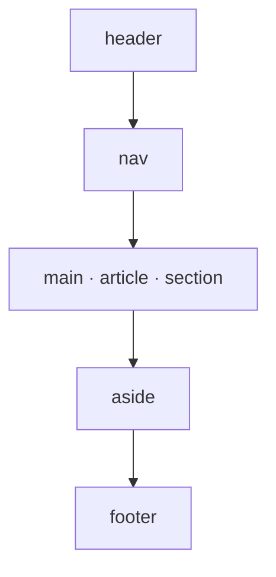
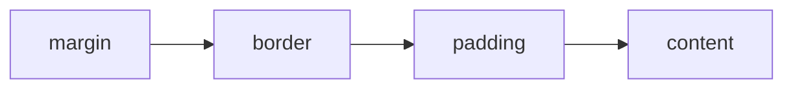

<SlidesViewer>

## RA3.1 · Lenguajes de marcas

::: accent-box 🏷️ HTML5 y CSS3
**Aplicaciones Web · 2º SMR**

Estructura con HTML, presentación con CSS.
:::

---

## Qué vamos a aprender

::: accent-box purple 🎯 Objetivos
- Clasificar los lenguajes de marcas y sus versiones.
- Analizar la estructura de un documento HTML.
- Usar las principales etiquetas y atributos.
- Comparar HTML y HTML5.
- Aplicar hojas de estilo CSS con herramientas de edición.
:::

---

## Lenguaje de marcas

> Texto + **etiquetas** que describen su **estructura**, su **presentación** o su **significado**.

::: info-box Familia web
HTML · XHTML · XML · RSS/Atom · SVG · MathML · Markdown
:::

::: warning-box No es programación
CSS = estilos · JavaScript = programación · JSON = datos
:::

---

## Evolución

| | |
|---|---|
| GML → SGML | Metalenguaje (ISO 8879) |
| HTML 2.0 → 4.01 | Web clásica |
| XHTML | HTML con reglas de XML |
| **HTML5** | Semántica, multimedia, APIs |
| **Living Standard** | WHATWG, versión "viva" |

---

## Estructura de un documento

```html
<!DOCTYPE html>
<html lang="es">
  <head> <meta charset="UTF-8"> <title>…</title> </head>
  <body> … </body>
</html>
```

::: tip-box head vs body
`head` = metadatos · `body` = contenido visible
:::

---

## Estructura semántica



---

## HTML vs HTML5

| HTML 4 / XHTML | HTML5 |
|---|---|
| DOCTYPE largo | `<!DOCTYPE html>` |
| `div id="menu"` | `nav` |
| Flash / plugins | `video`, `audio`, `canvas` |
| `font`, `center`, `frameset` | Eliminados → CSS |
| Formularios básicos | `email`, `date`, `range`, `required`… |

---

## CSS: ventajas

::: accent-box success ✨ Por qué CSS
Separación contenido/diseño · un cambio, todo el sitio · coherencia · ficheros ligeros · adaptable a dispositivos · accesibilidad
:::

```css
selector { propiedad: valor; }
```

---

## Selectores y cascada

- `p` · `.clase` · `#id` · `nav a` · `ul > li` · `a:hover` · `p::first-line`
- Especificidad: **en línea > #id > .clase > etiqueta**
- Empate → gana la **última** regla

---

## Modelo de caja



::: tip-box Imprescindible
`*, *::before, *::after { box-sizing: border-box; }`
:::

---

## CSS3

- Variables `--color: …;`
- **Flexbox** (una dimensión) · **Grid** (dos dimensiones)
- `@media (min-width: 768px)` → diseño adaptable
- `border-radius`, `box-shadow`, degradados, `transition`
- Fuentes web

---

## Herramientas

::: info-box Edición
VS Code + Emmet + Live Server · editores WYSIWYG · CodePen
:::

::: tip-box Comprobación
DevTools (`F12`) · validadores W3C · WAVE · Lighthouse
:::

---

## Resumen

::: accent-box purple 🧭 Recuerda
HTML para **qué es** cada cosa, CSS para **cómo se ve**. Semántica, validación y diseño adaptable desde el principio.
:::

</SlidesViewer>
