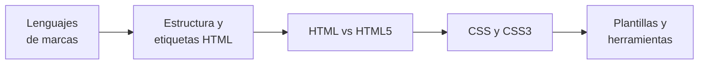

# 🏷️ RA3.1 · Elaboración de páginas web con lenguajes de marcas

<ExportPDF />

::: accent-box 🎯 Resultado de aprendizaje
**RA3.1.** Utiliza lenguajes de marcas para la transmisión de información a través de la web, analizando la estructura de los documentos e identificando sus elementos.
:::

Todo lo que ves en un navegador, incluidas las páginas que generan WordPress o Moodle, acaba siendo **HTML** con **CSS**. Un técnico que administra aplicaciones web necesita leer y escribir estos lenguajes para personalizar plantillas, diagnosticar problemas de visualización o crear páginas sencillas. En esta unidad aprenderás a **estructurar documentos con HTML5** y a **darles estilo con CSS3**.

## Criterios de evaluación

| CE | Descripción | Dónde se trabaja |
|:--:|-------------|------------------|
| a | Se han identificado y clasificado los lenguajes de marcas relacionados con la web y sus diferentes versiones. | [Apuntes 1](./contenidos/1-lenguajes-marcas) · P3 |
| b | Se ha analizado la estructura de un documento HTML e identificado las secciones que lo componen. | [Apuntes 2](./contenidos/2-estructura-html) · P1 |
| c | Se ha reconocido la funcionalidad de las principales etiquetas y atributos del lenguaje HTML. | [Apuntes 2](./contenidos/2-estructura-html) · P1 |
| d | Se han establecido las semejanzas y diferencias entre los lenguajes HTML y HTML5. | [Apuntes 3](./contenidos/3-html-vs-html5) · P3 |
| e | Se han utilizado herramientas en la creación de documentos web. | [Apuntes 5](./contenidos/5-plantillas-herramientas) · P1, P2, P3 |
| f | Se han identificado las ventajas que aporta la utilización de hojas de estilo CSS. | [Apuntes 4](./contenidos/4-css) · P2 |
| g | Se han aplicado hojas de estilo CSS. | [Apuntes 4](./contenidos/4-css) · P2, P3 |

## Contenidos

1. [Lenguajes de marcas: concepto, clasificación y versiones](./contenidos/1-lenguajes-marcas)
2. [Estructura de un documento HTML. Etiquetas y atributos](./contenidos/2-estructura-html)
3. [Semejanzas y diferencias entre HTML y HTML5](./contenidos/3-html-vs-html5)
4. [Hojas de estilo CSS y mejoras de CSS3](./contenidos/4-css)
5. [Elaboración de plantillas y herramientas de edición web](./contenidos/5-plantillas-herramientas)
6. [Ampliación: HTML5 y CSS3 paso a paso](./contenidos/6-ampliacion-html5-css3)

🎞️ [Diapositivas de la unidad](./contenidos/diapositivas) · 🛠️ [Prácticas y rúbricas](./ejercicios/)

## Qué necesitas

- **Visual Studio Code** (o VSCodium) con la extensión **Live Server**.
- Un navegador moderno (Firefox o Chrome) y sus **herramientas de desarrollo** (`F12`).
- Acceso al **validador del W3C**: [validator.w3.org](https://validator.w3.org/) y [jigsaw.w3.org/css-validator](https://jigsaw.w3.org/css-validator/).
