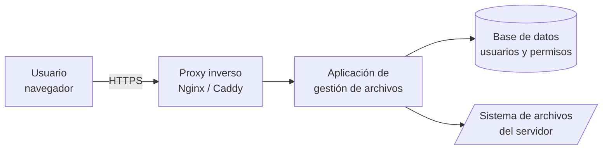
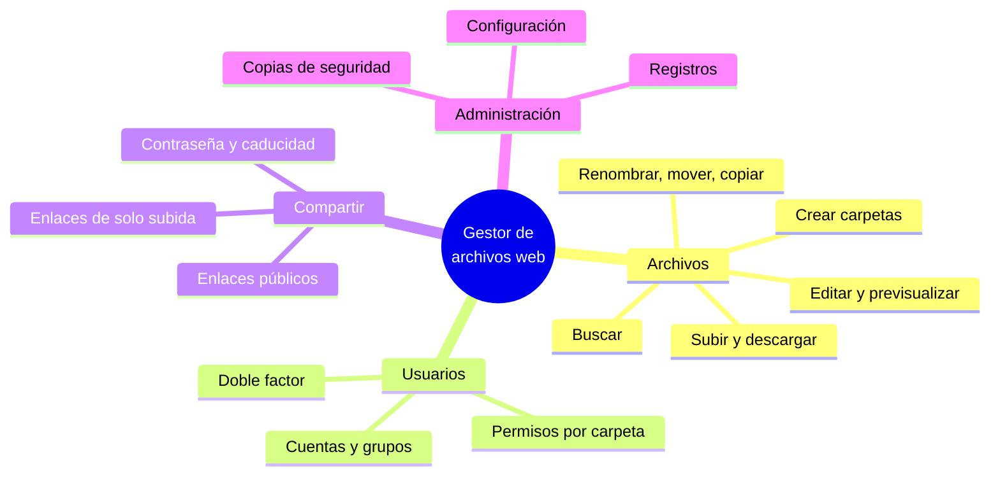

# 1. Servicios de gestión de archivos web

<ExportPDF />

::: accent-box purple 🎯 Objetivos
- Explicar qué es un servicio de gestión de archivos web y para qué sirve (CE a).
- Describir y comparar distintas aplicaciones de gestión de archivos web (CE b).
- Elegir la herramienta adecuada según las necesidades de una organización (CE b).
:::

## 1.1 ¿Qué es un gestor de archivos web?

Un **gestor de archivos web** es una aplicación que permite trabajar con los archivos de un servidor **desde el navegador**: ver carpetas, subir y descargar ficheros, crear directorios, renombrar, mover, editar documentos de texto y compartir enlaces. Es como el Explorador de Windows, pero los archivos están en un servidor y se accede a ellos por web.

Antes, para gestionar los archivos de un servidor había que usar **FTP**, **SFTP** o una sesión **SSH**, herramientas que requieren un cliente instalado y conocimientos técnicos. Con un gestor web basta con un navegador, un usuario y una contraseña.

## 1.2 Utilidad

| Situación | Cómo ayuda un gestor de archivos web |
|-----------|--------------------------------------|
| Un departamento necesita compartir documentos | Carpeta común accesible desde cualquier equipo, con permisos por usuario |
| Hay que enviar archivos grandes a un cliente | Enlace de descarga con contraseña y fecha de caducidad, sin adjuntar nada al correo |
| Se trabaja desde casa o desde el móvil | Acceso desde cualquier dispositivo con navegador |
| El personal no técnico debe actualizar los ficheros de una web | Sube imágenes o PDF sin usar FTP ni la terminal |
| Se administra un servidor remoto | Gestión rápida de ficheros sin abrir una sesión SSH |

Frente a otras formas de compartir archivos:

| | Gestor de archivos web | FTP / SFTP | Carpeta compartida (SMB) | Nube pública (RA4) |
|---|---|---|---|---|
| **Cliente necesario** | Navegador | Programa FTP (FileZilla) | Explorador de archivos | Navegador o app |
| **Acceso desde fuera de la red local** | Sí, por HTTPS | Sí | Normalmente no (o con VPN) | Sí |
| **Enlaces para compartir** | Sí | No | No | Sí |
| **Dónde están los datos** | En **nuestro** servidor | En nuestro servidor | En nuestro servidor | En los servidores del proveedor |
| **Facilidad para usuarios no técnicos** | Alta | Baja | Media | Alta |

## 1.3 Cómo funciona

1. El usuario inicia sesión desde el navegador.
2. La aplicación comprueba en su base de datos **quién es** (autenticación) y **qué puede hacer** (autorización).
3. Si tiene permiso, lee o modifica los archivos de la carpeta que se le ha asignado en el servidor.
4. Un **proxy inverso** delante de la aplicación se encarga del certificado HTTPS.

::: warning-box La aplicación solo debe ver lo necesario
Un gestor de archivos web nunca debe tener acceso a **todo** el disco del servidor, solo a la carpeta de datos que va a gestionar. Si alguien consigue entrar, el daño queda limitado a esa carpeta.
:::

## 1.4 Aplicaciones de gestión de archivos web

| Tipo | Aplicaciones | Características |
|------|--------------|-----------------|
| **Gestores ligeros** | **FileBrowser Quantum**, Tiny File Manager | Se instalan en minutos (un contenedor o un único fichero PHP). Usuarios, permisos, enlaces para compartir y editor de texto |
| **Listados de descarga** | h5ai, el *autoindex* de Apache o Nginx | Solo muestran carpetas y permiten descargar. No hay subida ni usuarios |
| **Nubes privadas completas** | Nextcloud, ownCloud Infinite Scale, Seafile, Pydio Cells | Sincronización con escritorio y móvil, calendario, ofimática, versiones de archivos… Más pesadas de instalar y mantener. Nextcloud se estudia en el **RA4** |
| **Paneles de *hosting*** | Administrador de archivos de cPanel, Plesk, Webmin | Incluidos en el panel de administración del servidor o del *hosting* contratado |

### Criterios para elegir

- **Licencia:** software libre o comercial.
- **Requisitos:** ¿necesita PHP y base de datos, Docker, un servidor potente?
- **Usuarios y permisos:** ¿se pueden limitar carpetas y acciones por usuario o grupo?
- **Compartir:** enlaces con contraseña, caducidad y permiso solo de subida.
- **Seguridad:** HTTPS, doble factor de autenticación, registro de accesos.
- **Mantenimiento:** ¿el proyecto sigue recibiendo actualizaciones de seguridad?

::: danger-box Un caso real: software abandonado
**File Browser**, uno de los gestores ligeros más populares, se **archivó el 1 de septiembre de 2026**: no tendrá más versiones ni parches de seguridad, y sus responsables avisan de fallos conocidos que no se corregirán. Seguir usándolo es un riesgo. Por eso en esta unidad usamos **FileBrowser Quantum**, una continuación del proyecto que sigue activa. Antes de instalar cualquier aplicación, comprueba siempre en su repositorio la fecha de la última versión.
:::

## 1.5 Funciones habituales

::: details 🔁 Autoevaluación rápida
1. Explica con un ejemplo qué ventaja tiene un gestor de archivos web frente a FTP para un usuario no técnico.
2. ¿Qué diferencia hay entre un gestor ligero y una nube privada como Nextcloud? ¿Cuándo elegirías cada uno?
3. ¿Por qué el gestor solo debe tener acceso a una carpeta concreta del servidor?
4. ¿Qué riesgo supone instalar una aplicación cuyo proyecto está archivado?
:::

---

**Siguiente:** [2. Instalación y administración de un gestor de archivos web →](./2-gestor-archivos)
