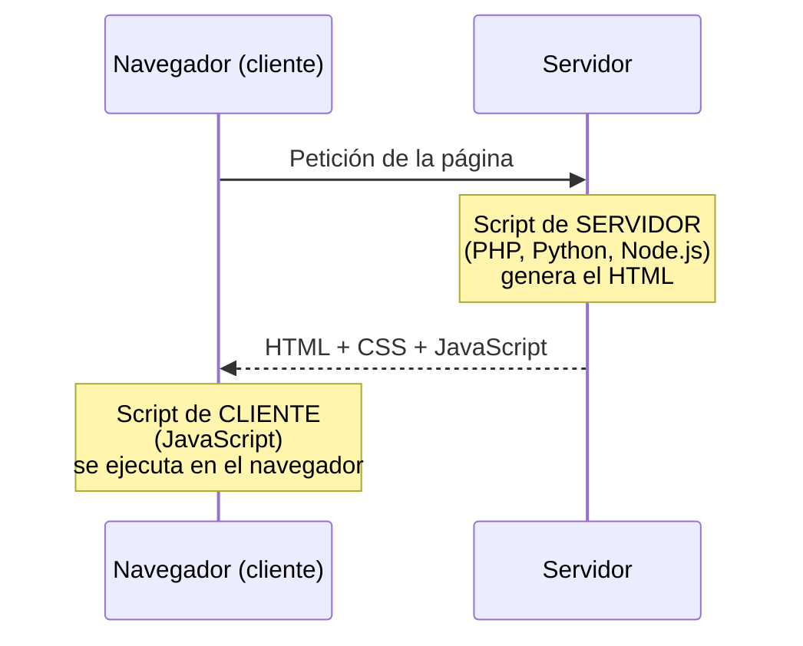

# 3. Lenguajes de script de cliente. Sintaxis básica

<ExportPDF />

::: accent-box purple 🎯 Objetivos
- Diferenciar scripts de cliente y de servidor (CE g).
- Identificar y clasificar los lenguajes de script de cliente, sus versiones y sus estándares (CE g).
- Escribir programas sencillos con variables, operadores, condiciones, bucles y funciones (CE h).
:::

## 3.1 Scripts de cliente y de servidor



| | Script de cliente | Script de servidor |
|---|---|---|
| **Dónde se ejecuta** | En el navegador del usuario | En el servidor web |
| **Lenguaje principal** | JavaScript | PHP, Python, Java, Node.js… |
| **El usuario ve el código** | Sí (`Ctrl+U`, DevTools) | No, solo el resultado |
| **Usos** | Interactividad, validación previa, animaciones, cambiar la página sin recargarla | Acceso a bases de datos, autenticación, lógica de negocio |
| **Ejemplo** | Mostrar un aviso si el correo no tiene `@` | Comprobar en la BD si el usuario existe |

::: warning-box Nunca solo en el cliente
Como el usuario puede desactivar o modificar el JavaScript de su navegador, **toda validación de seguridad debe repetirse en el servidor**. La validación en el cliente sirve para mejorar la experiencia del usuario, no para proteger.
:::

## 3.2 JavaScript: características y estándares

- Creado en 1995 por Brendan Eich para Netscape. No tiene relación con Java más allá del nombre.
- Está estandarizado como **ECMAScript** (norma **ECMA-262**). Desde 2015 (**ES6** / ES2015) se publica una versión cada año.
- Es **interpretado** (el navegador lo ejecuta directamente), **de tipado dinámico** (una variable puede guardar cualquier tipo) y **orientado a eventos** (reacciona a lo que hace el usuario).
- El acceso a la página lo define otro estándar: el **DOM** (*Document Object Model*), mantenido por el WHATWG.
- Hoy se usa también fuera del navegador (Node.js), pero en este módulo nos centramos en el **cliente**.

## 3.3 Lenguajes de script de cliente: clasificación y versiones

A lo largo de la historia de la web han existido varios lenguajes para programar en el navegador. Hoy **solo JavaScript se ejecuta de forma nativa** en todos ellos; el resto han desaparecido o se **traducen (transpilan)** a JavaScript antes de llegar al navegador.

| Lenguaje | Cómo se ejecuta | Estado actual |
|----------|-----------------|---------------|
| **JavaScript** (ECMAScript) | Nativo en todos los navegadores | ✅ Estándar de la web |
| **TypeScript** | Superconjunto de JavaScript con tipos; se compila a JavaScript | ✅ Muy usado en proyectos grandes |
| **Dart**, **CoffeeScript** | Se compilan a JavaScript | ⚠️ Minoritarios |
| **WebAssembly** (Wasm) | Formato binario que el navegador ejecuta junto a JavaScript; se programa en C, C++ o Rust | ✅ Para tareas de alto rendimiento (juegos, edición de vídeo) |
| **VBScript** y **JScript** | Solo en Internet Explorer | ❌ Obsoletos (Internet Explorer se retiró en 2022) |
| **ActionScript** (Flash) y **applets de Java** | Necesitaban un *plugin* | ❌ Desaparecidos (Flash dejó de tener soporte a finales de 2020) |

::: info-box ¿Por qué desaparecieron los plugins?
Flash, los applets o VBScript dependían de un fabricante o de un complemento instalado, daban muchos problemas de **seguridad** y no funcionaban en móviles. Los **estándares abiertos** (HTML5, CSS3 y JavaScript) ocuparon su lugar.
:::

### Versiones de ECMAScript

| Versión | Año | Novedades destacadas |
|---------|:---:|----------------------|
| ES1 | 1997 | Primera norma ECMA-262 |
| ES3 | 1999 | Expresiones regulares, `try…catch`. Fue la base durante diez años |
| ES5 | 2009 | Modo estricto (`"use strict"`), JSON, `forEach`, `map`, `filter` |
| **ES6 / ES2015** | 2015 | `let` y `const`, funciones flecha, clases, módulos, plantillas de texto, promesas |
| ES2016 y siguientes | Cada año | Ediciones anuales con mejoras pequeñas: `async`/`await` (ES2017), `?.` y `??` (ES2020)… |

### Quién define los estándares

| Estándar | Qué define | Organismo |
|----------|-----------|-----------|
| **ECMAScript** (ECMA-262) | El lenguaje: sintaxis, tipos, objetos | Ecma International (comité TC39) |
| **DOM** | Cómo acceder a la página y modificarla | WHATWG |
| **APIs web** (Fetch, Storage, Geolocation…) | Funciones extra que ofrece el navegador | WHATWG y W3C |

::: tip-box Consulta la compatibilidad
Antes de usar una función moderna, comprueba en [MDN](https://developer.mozilla.org/es/) o en [Can I use](https://caniuse.com/) qué navegadores la admiten.
:::

## 3.4 Dónde se escribe el código

```html
<!-- 1. Fichero externo (recomendado) -->
<script src="js/app.js" defer></script>

<!-- 2. Dentro del documento -->
<script>
  console.log("Hola desde la página");
</script>

<!-- 3. En un atributo de evento (evitar) -->
<button onclick="alert('Hola')">Saluda</button>
```

::: tip-box defer
El atributo `defer` hace que el script se ejecute **cuando el HTML ya está cargado**. Así el código encuentra todos los elementos de la página. Alternativa: poner el `<script>` justo antes de `</body>`.
:::

## 3.5 Sintaxis básica

### Variables y tipos

```js
const ciclo = "SMR";        // constante: no se puede reasignar
let curso = 1;              // variable que puede cambiar
curso = curso + 1;          // ahora vale 2

// Tipos primitivos
let texto = "Aplicaciones Web";  // string
let horas = 3;                   // number
let aprobado = true;             // boolean
let nada = null;                 // null
let sinValor;                    // undefined

// Objetos y arrays
const alumno = { nombre: "Ana", nota: 8.5 };
const modulos = ["AW", "SR", "SO"];
console.log(alumno.nombre, modulos[0], modulos.length);
```

::: info-box let y const
Usa `const` por defecto y `let` solo cuando el valor vaya a cambiar. La palabra `var` es la forma antigua; evítala.
:::

### Operadores

| Tipo | Operadores |
|------|-----------|
| Aritméticos | `+ - * / % **` |
| Asignación | `= += -= *= /=` |
| Comparación | `===` (igual valor y tipo), `!==`, `> < >= <=` |
| Lógicos | `&&` (y), `\|\|` (o), `!` (no) |
| Texto | `+` concatena; **plantillas**: `` `Hola, ${nombre}` `` |

::: warning-box == frente a ===
`"5" == 5` es `true` (convierte tipos) pero `"5" === 5` es `false`. Usa siempre `===`.
:::

### Condicionales

```js
const nota = 6.5;
if (nota >= 9) {
  console.log("Sobresaliente");
} else if (nota >= 5) {
  console.log("Aprobado");
} else {
  console.log("Suspenso");
}

// Operador ternario
const mensaje = nota >= 5 ? "Superado" : "No superado";
```

### Bucles

```js
for (let i = 1; i <= 3; i++) {
  console.log(`Vuelta ${i}`);
}

for (const modulo of modulos) {   // recorrer un array
  console.log(modulo);
}

let intentos = 0;
while (intentos < 3) { intentos++; }

modulos.forEach((m, posicion) => console.log(posicion, m));
```

### Funciones

```js
function calcularMedia(a, b) {
  return (a + b) / 2;
}

const saludar = (nombre) => `Hola, ${nombre}`;   // función flecha

console.log(calcularMedia(6, 8));   // 7
console.log(saludar("Luis"));       // Hola, Luis
```

### Arrays: métodos útiles

```js
const notas = [4, 7, 9, 5];
notas.push(10);                         // añade al final
const aprobadas = notas.filter(n => n >= 5);   // [7, 9, 5, 10]
const dobles = notas.map(n => n * 2);
const hay10 = notas.includes(10);       // true
```

## 3.6 La consola: tu laboratorio

Abre las herramientas de desarrollo (`F12`) → **Consola** y escribe código directamente. Además:

```js
console.log("Mensaje", variable);   // mostrar valores
console.table(arrayDeObjetos);      // ver arrays como tabla
console.error("Algo ha fallado");   // mensaje de error
```

Si el script tiene un error, la consola muestra **el mensaje y la línea**: es lo primero que debes mirar cuando algo no funciona.

::: details 🔁 Autoevaluación rápida
1. ¿Por qué no basta con validar un formulario en el cliente?
2. ¿Qué es ECMAScript? ¿Qué aportó la versión ES6?
3. Clasifica TypeScript, VBScript y WebAssembly: ¿cómo se ejecuta cada uno y siguen vigentes?
4. ¿Qué diferencia hay entre `let` y `const`? ¿Y entre `==` y `===`?
5. Escribe una función `esMayorDeEdad(edad)` que devuelva `true` o `false`.
6. Dado `const precios = [12, 5, 30]`, obtén con `filter` los mayores de 10.
:::

---

**Anterior:** [← 2. Instalación y administración de un gestor de archivos web](./2-gestor-archivos) · **Siguiente:** [4. El DOM. Selección de elementos →](./4-dom-seleccion)
