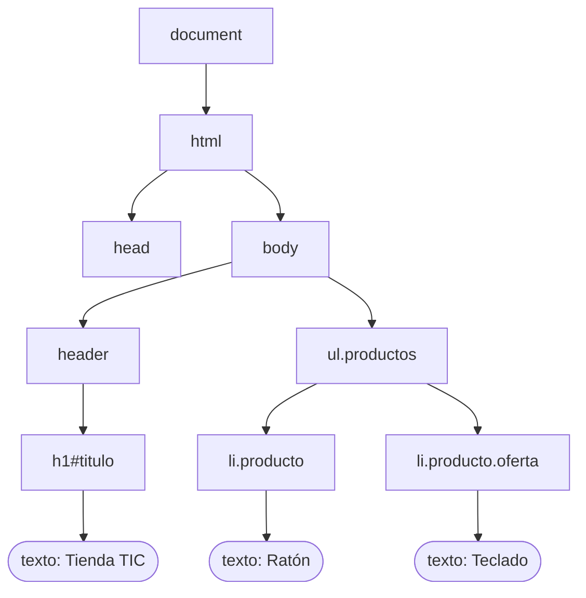
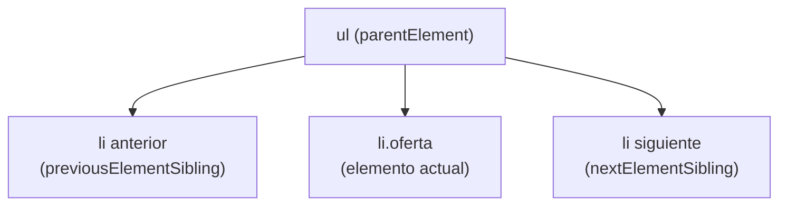

# 4. El DOM. Selección y acceso a elementos

<ExportPDF />

::: accent-box purple 🎯 Objetivos
- Entender el DOM como un árbol de nodos.
- Seleccionar elementos con los distintos métodos del DOM (CE i).
- Recorrer el árbol: padres, hijos y hermanos.
:::

## 4.1 ¿Qué es el DOM?

Cuando el navegador carga una página, convierte el HTML en una estructura de objetos en memoria: el **DOM** (*Document Object Model*). JavaScript no modifica el fichero `.html`: **modifica el DOM**, y el navegador redibuja la página al instante.

```html
<body>
  <header><h1 id="titulo">Tienda TIC</h1></header>
  <ul class="productos">
    <li class="producto">Ratón</li>
    <li class="producto oferta">Teclado</li>
  </ul>
</body>
```



- Cada etiqueta es un **nodo elemento**; el texto es un **nodo de texto**.
- El objeto **`document`** es la raíz y la puerta de entrada a todo el DOM.
- Puedes ver el DOM real en el **Inspector** del navegador (puede diferir del HTML original si un script lo ha modificado).

## 4.2 Métodos de selección

| Método | Devuelve | Ejemplo |
|--------|----------|---------|
| `document.getElementById("id")` | Un elemento o `null` | `document.getElementById("titulo")` |
| `document.querySelector("selector CSS")` | El **primer** elemento que coincide o `null` | `document.querySelector(".producto")` |
| `document.querySelectorAll("selector CSS")` | Una **lista** (`NodeList`) con todos | `document.querySelectorAll("ul.productos li")` |
| `document.getElementsByClassName("clase")` | Colección **viva** (*HTMLCollection*) | `document.getElementsByClassName("oferta")` |
| `document.getElementsByTagName("etiqueta")` | Colección viva | `document.getElementsByTagName("li")` |

::: accent-box teal 💡 Regla práctica
Usa **`querySelector`** y **`querySelectorAll`**: aceptan **cualquier selector CSS** de los que ya conoces (`#id`, `.clase`, `nav a`, `input[type="email"]`, `li:nth-child(2)`…).
:::

```js
const titulo   = document.querySelector("#titulo");
const primero  = document.querySelector(".producto");
const ofertas  = document.querySelectorAll(".producto.oferta");
const enlaces  = document.querySelectorAll("nav a");
const email    = document.querySelector('input[type="email"]');
```

### Recorrer varios elementos

```js
const productos = document.querySelectorAll(".producto");
console.log(productos.length);            // 2

productos.forEach((p, i) => {
  console.log(i, p.textContent);
});

for (const p of productos) {
  console.log(p.textContent);
}
```

::: warning-box Siempre comprueba que existe
Si el selector no encuentra nada, `querySelector` devuelve `null` y cualquier acción sobre él provoca el error *"Cannot read properties of null"*. Compruébalo con `if (elemento) { … }` y revisa que el script se ejecuta después de cargar el HTML (`defer`).
:::

## 4.3 Acceder a la información de un elemento

```js
const h1 = document.querySelector("#titulo");

h1.textContent      // "Tienda TIC" → solo el texto
h1.innerHTML        // HTML interno como cadena
h1.id               // "titulo"
h1.tagName          // "H1"
h1.className        // clases como cadena
h1.classList        // lista de clases (ver apartado 7)

const enlace = document.querySelector("a");
enlace.href                    // URL completa
enlace.getAttribute("href")    // valor tal como está escrito
enlace.hasAttribute("target")  // true / false

const campo = document.querySelector("#email");
campo.value                    // lo que ha escrito el usuario

const tarjeta = document.querySelector(".producto");
tarjeta.dataset.precio         // valor de data-precio="..."
```

## 4.4 Navegar por el árbol

```js
const oferta = document.querySelector(".oferta");

oferta.parentElement             // el <ul>
oferta.previousElementSibling    // el <li> anterior
oferta.nextElementSibling        // el siguiente (o null)
oferta.closest("section")        // el antepasado más cercano que coincide

const lista = document.querySelector(".productos");
lista.children                   // hijos (elementos)
lista.firstElementChild
lista.lastElementChild
lista.querySelectorAll("li")     // buscar dentro de un elemento
```



::: details 🔁 Autoevaluación rápida
1. ¿Modifica JavaScript el fichero HTML del servidor? ¿Qué modifica?
2. Escribe el código para seleccionar: el elemento con id `menu`; todos los párrafos dentro de `article`; el primer `input` de tipo `checkbox`.
3. ¿Qué diferencia hay entre `textContent` e `innerHTML`?
4. ¿Qué devuelve `querySelector` si no encuentra nada? ¿Qué error provoca usarlo después?
:::

---

**Anterior:** [← 3. JavaScript básico](./3-javascript-basico) · **Siguiente:** [5. Crear y modificar elementos →](./5-crear-modificar)
