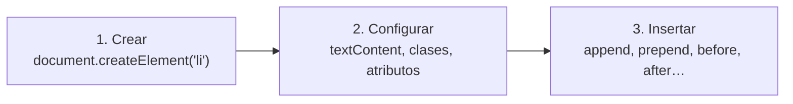
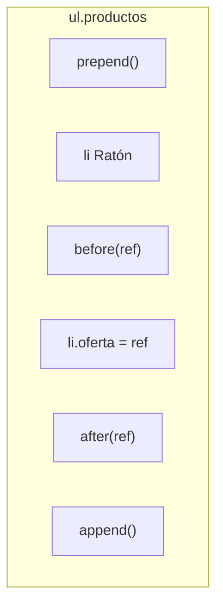

# 5. Creación y modificación de elementos

<ExportPDF />

::: accent-box purple 🎯 Objetivos
- Modificar el contenido y los atributos de elementos existentes (CE j).
- Crear elementos nuevos e insertarlos en la posición deseada (CE j).
- Generar contenido a partir de datos.
:::

## 5.1 Modificar el contenido

```js
const titulo = document.querySelector("#titulo");

titulo.textContent = "Tienda TIC · Ofertas de octubre";   // cambia el texto

const aviso = document.querySelector(".aviso");
aviso.innerHTML = "Envío <strong>gratis</strong> a partir de 50 €";  // interpreta HTML
```

::: danger-box innerHTML y seguridad
Nunca pongas en `innerHTML` texto que venga del usuario (un campo de formulario, la URL…): podría contener `<script>` u otro código malicioso (ataque **XSS**). Para texto, usa siempre **`textContent`**.
:::

## 5.2 Modificar atributos

```js
const logo = document.querySelector("#logo");
logo.src = "img/logo-navidad.png";            // propiedad directa
logo.alt = "Logotipo navideño de Tienda TIC";

const enlace = document.querySelector("#web");
enlace.setAttribute("href", "https://ejemplo.es");
enlace.setAttribute("target", "_blank");
enlace.removeAttribute("title");

const boton = document.querySelector("#enviar");
boton.disabled = true;                          // desactivar un botón

const tarjeta = document.querySelector(".producto");
tarjeta.dataset.stock = "0";                    // data-stock="0"

document.querySelector("#cantidad").value = 1;  // valor de un campo
```

## 5.3 Crear elementos nuevos

El proceso siempre tiene tres pasos:



```js
// 1. Crear
const nuevo = document.createElement("li");
// 2. Configurar
nuevo.textContent = "Monitor 27\"";
nuevo.classList.add("producto");
nuevo.dataset.precio = "189";
// 3. Insertar
document.querySelector(".productos").append(nuevo);
```

### Dónde insertar

```js
const lista = document.querySelector(".productos");
const ref   = document.querySelector(".oferta");

lista.append(nuevo);     // al final, dentro de la lista
lista.prepend(nuevo);    // al principio, dentro de la lista
ref.before(nuevo);       // justo antes de .oferta (como hermano)
ref.after(nuevo);        // justo después de .oferta
ref.replaceWith(nuevo);  // sustituye a .oferta
```



También existe `insertAdjacentHTML`, cómodo para fragmentos con varias etiquetas (con la misma precaución que `innerHTML`):

```js
lista.insertAdjacentHTML("beforeend", '<li class="producto">Webcam</li>');
// posiciones: "beforebegin", "afterbegin", "beforeend", "afterend"
```

### Elementos con varios hijos

```js
const articulo = document.createElement("article");
articulo.className = "tarjeta";

const h2 = document.createElement("h2");
h2.textContent = "Portátil 14\"";

const precio = document.createElement("p");
precio.textContent = "599 €";

articulo.append(h2, precio);                      // append admite varios
document.querySelector("#catalogo").append(articulo);
```

## 5.4 Generar contenido a partir de datos

Lo habitual es que los datos vengan de un array (o, más adelante, de un servidor):

```js
const productos = [
  { nombre: "Ratón",   precio: 15,  oferta: false },
  { nombre: "Teclado", precio: 35,  oferta: true  },
  { nombre: "Monitor", precio: 189, oferta: false },
];

const lista = document.querySelector(".productos");
lista.textContent = "";                 // vaciar antes de pintar

for (const p of productos) {
  const li = document.createElement("li");
  li.textContent = `${p.nombre} – ${p.precio} €`;
  li.classList.add("producto");
  if (p.oferta) li.classList.add("oferta");
  lista.append(li);
}
```

### Plantillas `<template>`

Para estructuras repetitivas más complejas, el HTML puede incluir una plantilla que no se muestra y que se **clona**:

```html
<template id="tpl-producto">
  <article class="tarjeta">
    <h2 class="nombre"></h2>
    <p class="precio"></p>
  </article>
</template>
```

```js
const tpl = document.querySelector("#tpl-producto");
for (const p of productos) {
  const copia = tpl.content.cloneNode(true);
  copia.querySelector(".nombre").textContent = p.nombre;
  copia.querySelector(".precio").textContent = `${p.precio} €`;
  document.querySelector("#catalogo").append(copia);
}
```

::: details 🔁 Autoevaluación rápida
1. ¿Por qué es peligroso usar `innerHTML` con datos que escribe el usuario?
2. Escribe el código para añadir un párrafo "Última actualización: hoy" al final del `footer`.
3. ¿Qué diferencia hay entre `lista.append(li)` y `ref.after(li)`?
4. A partir de `const ciclos = ["SMR", "ASIR", "DAW"]`, genera una lista `<ul>` dentro de `#ciclos`.
:::

---

**Anterior:** [← 4. Selección de elementos](./4-dom-seleccion) · **Siguiente:** [6. Eliminar elementos →](./6-eliminar)
