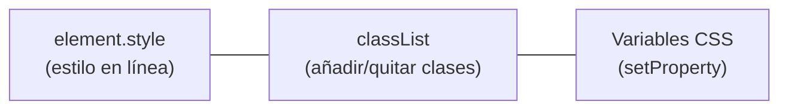

# 7. Manipulación de estilos

<ExportPDF />

::: accent-box purple 🎯 Objetivos
- Cambiar estilos de los elementos desde JavaScript (CE l).
- Usar `classList` para separar lógica y presentación.
- Leer estilos calculados y modificar variables CSS.
:::

## 7.1 Tres formas de cambiar estilos



| Forma | Ejemplo | Cuándo usarla |
|-------|---------|---------------|
| `elemento.style.propiedad` | `caja.style.backgroundColor = "gold"` | Valores calculados en el momento (posición, tamaño) |
| **`elemento.classList`** | `caja.classList.add("destacado")` | **Casi siempre**: el aspecto se define en el CSS |
| Variables CSS | `document.documentElement.style.setProperty("--acento", "#ED6E51")` | Temas, modo oscuro, personalización global |

## 7.2 La propiedad `style`

```js
const caja = document.querySelector("#caja");

caja.style.backgroundColor = "#1C375B";   // background-color → backgroundColor
caja.style.color = "white";
caja.style.padding = "1rem";
caja.style.borderRadius = "8px";
caja.style.width = `${50 + 20}%`;         // valores calculados

caja.style.removeProperty("padding");     // quitar un estilo
caja.style.cssText = "color: red; font-weight: bold;";  // varios a la vez (sobrescribe)
```

::: info-box De CSS a JavaScript
Las propiedades con guion se escriben en **camelCase**: `font-size` → `fontSize`, `z-index` → `zIndex`, `border-top-left-radius` → `borderTopLeftRadius`. Los valores son siempre **cadenas** con su unidad (`"20px"`, no `20`).
:::

`style` solo lee y escribe los estilos **en línea**. Para conocer el estilo real que aplica el navegador (sumando hojas de estilo y herencia) se usa:

```js
const real = getComputedStyle(caja);
console.log(real.fontSize, real.display, real.color);
```

## 7.3 `classList`: la forma recomendada

Defines el aspecto en el CSS…

```css
.oculto     { display: none; }
.destacado  { background: #FFF3CD; border-left: 4px solid #ED6E51; }
.error      { border: 2px solid #C0392B; }
.modo-oscuro { --fondo: #222; --texto: #F5F5F5; }
```

…y JavaScript solo **pone o quita clases**:

```js
const tarjeta = document.querySelector(".tarjeta");

tarjeta.classList.add("destacado");          // añadir
tarjeta.classList.remove("destacado");       // quitar
tarjeta.classList.toggle("oculto");          // alternar (si está la quita, si no la pone)
tarjeta.classList.contains("error");         // ¿la tiene? → true / false
tarjeta.classList.replace("error", "ok");    // sustituir
tarjeta.classList.toggle("activo", estaActivo);  // forzar según una condición
```

::: accent-box teal 💡 Por qué classList
Mantiene la **separación de responsabilidades**: el diseño se cambia en el CSS sin tocar el JavaScript, y el código es más corto y legible.
:::

### Ejemplo: botón de modo oscuro

```html
<button id="tema">🌙 Modo oscuro</button>
```

```css
:root       { --fondo: #F5F5F5; --texto: #222; }
.modo-oscuro { --fondo: #1E1E1E; --texto: #F5F5F5; }
body { background: var(--fondo); color: var(--texto); transition: background .3s; }
```

```js
const boton = document.querySelector("#tema");
boton.addEventListener("click", () => {
  const oscuro = document.body.classList.toggle("modo-oscuro");
  boton.textContent = oscuro ? "☀️ Modo claro" : "🌙 Modo oscuro";
});
```

## 7.4 Variables CSS desde JavaScript

```js
const raiz = document.documentElement;          // el elemento <html>

raiz.style.setProperty("--acento", "#2E8B57");  // cambia el color de acento en todo el sitio
getComputedStyle(raiz).getPropertyValue("--acento");  // leer el valor
```

## 7.5 Aplicar estilos a muchos elementos

```js
// Resaltar las filas de una tabla con nota menor que 5
document.querySelectorAll("#notas tbody tr").forEach(fila => {
  const nota = Number(fila.querySelector(".nota").textContent);
  fila.classList.toggle("suspenso", nota < 5);
});
```

::: details 🔁 Autoevaluación rápida
1. ¿Cómo se escribe en JavaScript la propiedad CSS `background-image`?
2. ¿Qué diferencia hay entre `elemento.style.color` y `getComputedStyle(elemento).color`?
3. Escribe el código para que un párrafo con id `info` alterne entre visible y oculto usando una clase.
4. ¿Por qué se recomienda `classList` en vez de `style`?
:::

---

**Anterior:** [← 6. Eliminar elementos](./6-eliminar) · **Siguiente:** [8. Eventos y formularios →](./8-eventos-formularios)
