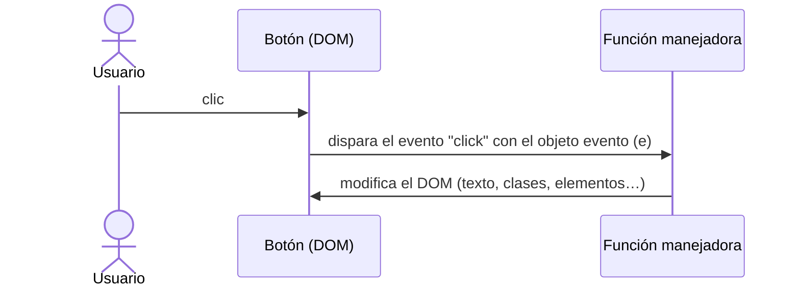

# 8. Eventos y validación de formularios

<ExportPDF />

::: accent-box purple 🎯 Objetivos
- Responder a las acciones del usuario mediante eventos (apoya los CE j y l).
- Validar formularios en el cliente combinando HTML5 y JavaScript (apoya los CE j y l).
- Integrar selección, creación, eliminación y estilos en una página interactiva.
:::

## 8.1 Eventos

Un **evento** es algo que ocurre en la página: un clic, una tecla, el envío de un formulario, el fin de la carga… JavaScript puede **escuchar** esos eventos y ejecutar una función:

```js
const boton = document.querySelector("#saludar");

boton.addEventListener("click", () => {
  alert("¡Hola!");
});
```



### Eventos más usados

| Evento | Se produce cuando… |
|--------|---------------------|
| `click`, `dblclick` | Se pulsa un elemento |
| `mouseover`, `mouseout` | El puntero entra o sale |
| `keydown`, `keyup` | Se pulsa o se suelta una tecla |
| `input` | Cambia el valor de un campo (en cada pulsación) |
| `change` | Cambia el valor y el campo pierde el foco (o cambia un `select`/`checkbox`) |
| `focus`, `blur` | Un campo gana o pierde el foco |
| `submit` | Se envía un formulario |
| `DOMContentLoaded` | El HTML se ha cargado y el DOM está listo |

### El objeto evento

```js
document.querySelector("#buscar").addEventListener("keyup", (e) => {
  console.log(e.type);           // "keyup"
  console.log(e.target.value);   // lo escrito en el campo
  if (e.key === "Enter") buscar(e.target.value);
});
```

- `e.target`: el elemento que originó el evento.
- `e.preventDefault()`: impide la acción por defecto (enviar el formulario, seguir un enlace).

### Delegación de eventos

Los eventos **suben** (*burbujean*) desde el elemento hasta sus antepasados. Por eso basta con un escuchador en el contenedor para gestionar todos sus hijos, incluidos los que se creen después:

```js
document.querySelector("#tareas").addEventListener("click", (e) => {
  const li = e.target.closest("li");
  if (!li) return;
  if (e.target.matches(".borrar")) li.remove();          // eliminar
  else li.classList.toggle("hecha");                      // marcar
});
```

## 8.2 Validación de formularios

La validación en el cliente avisa al usuario **antes** de enviar los datos. Se hace en dos capas:

### Capa 1: HTML5 (sin programar)

```html
<form id="registro" novalidate>
  <label for="usuario">Usuario (4-12 letras o números)</label>
  <input id="usuario" name="usuario" required pattern="[A-Za-z0-9]{4,12}">

  <label for="correo">Correo</label>
  <input id="correo" name="correo" type="email" required>

  <label for="edad">Edad</label>
  <input id="edad" name="edad" type="number" min="16" max="99" required>

  <label for="clave">Contraseña (mínimo 8)</label>
  <input id="clave" name="clave" type="password" minlength="8" required>

  <label for="clave2">Repite la contraseña</label>
  <input id="clave2" name="clave2" type="password" required>

  <button type="submit">Registrarme</button>
  <p id="resumen" aria-live="polite"></p>
</form>
```

| Atributo | Comprueba |
|----------|-----------|
| `required` | Que no esté vacío |
| `type="email"`, `type="url"`, `type="number"` | El formato |
| `minlength`, `maxlength` | Longitud del texto |
| `min`, `max`, `step` | Rango numérico o de fechas |
| `pattern` | Una expresión regular |

::: info-box novalidate
Sin `novalidate`, el navegador muestra sus propios globos de error. Con `novalidate` los desactivamos para mostrar **nuestros mensajes** con JavaScript, pero las reglas HTML5 siguen disponibles a través de la API `checkValidity()`.
:::

### Capa 2: JavaScript (reglas propias y mensajes personalizados)

```css
.campo-error { border: 2px solid #C0392B; }
.campo-ok    { border: 2px solid #2E8B57; }
.mensaje-error { color: #C0392B; font-size: .9rem; }
```

```js
const form = document.querySelector("#registro");

function mostrarError(campo, mensaje) {
  campo.classList.remove("campo-ok");
  campo.classList.add("campo-error");
  let msg = campo.nextElementSibling;
  if (!msg || !msg.classList.contains("mensaje-error")) {
    msg = document.createElement("span");               // crear
    msg.className = "mensaje-error";
    campo.after(msg);                                    // insertar
  }
  msg.textContent = mensaje;
}

function limpiarError(campo) {
  campo.classList.remove("campo-error");
  campo.classList.add("campo-ok");
  const msg = campo.nextElementSibling;
  if (msg && msg.classList.contains("mensaje-error")) msg.remove();   // eliminar
}

function obtenerError(campo) {
  const v = campo.validity;                      // estado de validación HTML5
  if (v.valueMissing)    return "Este campo es obligatorio";
  if (v.typeMismatch)    return "El formato no es válido";
  if (v.patternMismatch) return "Solo letras y números, de 4 a 12";
  if (v.tooShort)        return `Mínimo ${campo.minLength} caracteres`;
  if (v.rangeUnderflow || v.rangeOverflow) return `Entre ${campo.min} y ${campo.max}`;
  if (campo.id === "clave2" && campo.value !== form.clave.value) {
    return "Las contraseñas no coinciden";       // regla propia
  }
  return "";                                     // sin errores
}

function validarCampo(campo) {
  const error = obtenerError(campo);
  if (error) {
    mostrarError(campo, error);
    return false;
  }
  limpiarError(campo);
  return true;
}

// Validar cada campo al salir de él
form.querySelectorAll("input").forEach(c => c.addEventListener("blur", () => validarCampo(c)));

// Validar todo al enviar
form.addEventListener("submit", (e) => {
  e.preventDefault();
  const campos = [...form.querySelectorAll("input")];
  const correctos = campos.map(validarCampo).every(Boolean);
  form.querySelector("#resumen").textContent = correctos
    ? "✅ Registro correcto (aquí se enviarían los datos al servidor)"
    : "❌ Revisa los campos marcados en rojo";
});
```

Este ejemplo reúne todo lo de la unidad: **selecciona** campos, **crea** y **elimina** mensajes, **modifica** el texto y **cambia estilos** con `classList` en respuesta a **eventos**.

::: warning-box Recuerda
La validación en el cliente **mejora la experiencia**, pero no protege: el servidor debe volver a validar todos los datos.
:::

::: details 🔁 Autoevaluación rápida
1. ¿Qué diferencia hay entre los eventos `input` y `change`?
2. ¿Para qué sirve `e.preventDefault()` en el evento `submit`?
3. Explica con tus palabras qué es la delegación de eventos y qué ventaja tiene.
4. Añade al formulario un campo de teléfono de 9 cifras y su validación.
:::

---

**Anterior:** [← 7. Manipular estilos](./7-estilos) · **Unidad:** [Volver a la presentación](../index)
