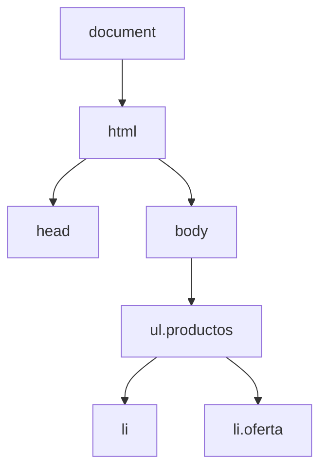

<SlidesViewer>

## RA3.2 · Gestión de archivos web y script de cliente

::: accent-box ⚡ Archivos web y JavaScript
**Aplicaciones Web · 2º SMR**

Gestionar archivos desde el navegador. Seleccionar, crear, modificar, eliminar y dar estilo desde código.
:::

---

## Qué vamos a aprender

::: accent-box purple 🎯 Objetivos
- Utilidad y tipos de gestores de archivos web.
- Instalar, adaptar y asegurar FileBrowser Quantum.
- Cuentas y permisos según perfiles.
- Lenguajes de script de cliente, versiones y estándares.
- Seleccionar, crear, modificar y eliminar elementos del DOM.
- Manipular estilos y responder a eventos.
:::

---

## Gestor de archivos web

Aplicación para trabajar con los archivos de un servidor **desde el navegador**: subir, descargar, organizar, editar y compartir.

| | Gestor web | FTP | Nube pública |
|---|---|---|---|
| Cliente | Navegador | FileZilla | Navegador |
| Enlaces | ✔ | ✘ | ✔ |
| Datos | En **nuestro** servidor | En nuestro servidor | En el proveedor |

---

## Aplicaciones

| Tipo | Ejemplos |
|---|---|
| Ligeros | **FileBrowser Quantum**, Tiny File Manager |
| Solo descarga | h5ai, *autoindex* |
| Nube privada | Nextcloud, Seafile, ownCloud |
| Paneles de *hosting* | cPanel, Plesk, Webmin |

::: danger-box Mantenimiento
File Browser se archivó el 1/9/2026: sin parches de seguridad. Comprueba siempre la última versión.
:::

---

## Instalación con Docker

```yaml
services:
  filebrowser:
    image: ghcr.io/gtsteffaniak/filebrowser:stable
    ports: ["8080:80"]
    volumes:
      - ./archivos:/folder
      - ./data:/home/filebrowser/data
```

`docker compose up -d` · contraseña inicial en `docker compose logs`

---

## Cuentas y permisos

| Perfil | Permisos |
|---|---|
| Administrador | Admin + todos |
| Editor | View, Download, Create, Modify, Delete, Share |
| Colaborador | View, Download, Create, Modify |
| Lector | View, Download |
| Externo | Enlace con contraseña y caducidad |

::: tip-box Mínimo privilegio
Permiso **y** regla de ruta: hacen falta los dos.
:::

---

## Seguridad del gestor

::: accent-box success 🔒 Checklist
HTTPS con proxy inverso · 2FA (TOTP) · `minLength` · `signup: false` · solo la carpeta de datos · enlaces con caducidad · actualizaciones · copias de `data/` y `archivos/`
:::

**Y probarlo:** tabla de pruebas con lo esperado y lo obtenido.

---

## Lenguajes de script de cliente

| Lenguaje | Estado |
|---|---|
| **JavaScript** (ECMAScript) | ✅ Nativo en todos los navegadores |
| TypeScript, Dart | ✅ Se compilan a JavaScript |
| WebAssembly | ✅ Binario junto a JavaScript |
| VBScript, JScript | ❌ Solo Internet Explorer |
| ActionScript (Flash), applets | ❌ Necesitaban *plugin* |

**ES5** (2009) → **ES6/ES2015** (`let`, `const`, flechas, clases) → una edición al año

---

## Cliente frente a servidor

| Cliente | Servidor |
|---|---|
| Se ejecuta en el navegador | Se ejecuta en el servidor |
| JavaScript | PHP, Python, Node.js… |
| Interactividad, validación previa | BD, autenticación, seguridad |

::: warning-box
Validar en el cliente **no** protege: el servidor siempre vuelve a validar.
:::

---

## JavaScript en 1 minuto

```js
const ciclo = "SMR";   let nota = 7;
if (nota >= 5) { console.log("Aprobado"); }
for (const m of ["AW", "SR"]) { console.log(m); }
const media = (a, b) => (a + b) / 2;
console.log(`Media: ${media(6, 8)}`);
```

::: info-box Estándar
ECMAScript (ECMA-262) · `let`/`const` · `===` · `defer`
:::

---

## El DOM



> JavaScript no cambia el fichero: cambia el **árbol en memoria**.

---

## Seleccionar

```js
document.querySelector("#titulo");
document.querySelectorAll("ul.productos li");
document.getElementById("menu");
el.parentElement · el.children · el.closest("section")
```

::: tip-box Regla práctica
`querySelector` + selectores CSS
:::

---

## Crear y modificar

```js
const li = document.createElement("li");   // 1. crear
li.textContent = "Teclado";                // 2. configurar
li.classList.add("producto");
lista.append(li);                          // 3. insertar
img.src = "nuevo.png"; a.setAttribute("href", url);
```

::: danger-box XSS
Texto del usuario → `textContent`, nunca `innerHTML`.
:::

---

## Eliminar

```js
elemento.remove();
padre.removeChild(hijo);      // forma clásica
lista.replaceChildren();      // vaciar
viejo.replaceWith(nuevo);     // sustituir
```

::: info-box ¿Eliminar u ocultar?
`remove()` lo quita del DOM · `hidden` / clases lo esconden
:::

---

## Estilos

```js
caja.style.backgroundColor = "gold";       // en línea
caja.classList.toggle("oculto");           // ✔ recomendado
root.style.setProperty("--acento", "#ED6E51");
getComputedStyle(caja).fontSize;
```

---

## Eventos

```js
boton.addEventListener("click", (e) => { … });
form.addEventListener("submit", (e) => { e.preventDefault(); … });
lista.addEventListener("click", (e) => e.target.closest("li")?.remove());
```

`click` · `input` · `change` · `keyup` · `submit` · `blur` · `DOMContentLoaded`

---

## Validar formularios

::: accent-box success ✨ Dos capas
**HTML5:** `required`, `type`, `pattern`, `min`, `minlength`
**JavaScript:** `validity`, mensajes propios, reglas extra, estilos de error
:::

---

## Resumen

::: accent-box purple 🧭 Recuerda
**Gestor de archivos:** instalar, adaptar, perfiles, probar la seguridad.
**JavaScript:** seleccionar → modificar / crear / eliminar → estilos con clases → eventos.
Y la consola (`F12`) es tu mejor amiga.
:::

</SlidesViewer>
