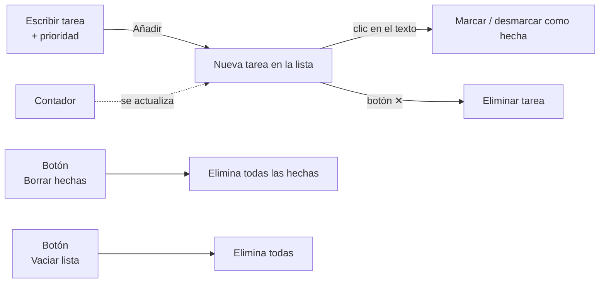

# 📋 P3 · Lista de tareas dinámica

<ExportPDF />

## Contexto

El equipo técnico de la entidad quiere una pequeña **lista de tareas de mantenimiento** (actualizar WordPress, revisar copias, renovar el certificado…) dentro de la web interna. La harás solo con HTML, CSS y JavaScript.

## Objetivos

- Crear y modificar elementos a partir de la interacción del usuario.
- Eliminar elementos de forma individual y masiva.
- Manipular estilos con `classList`, `style` y variables CSS.

## Requisitos funcionales

### 1. Crear y modificar (CE j)

1. Un formulario con un campo de texto, un `select` de prioridad (alta, media, baja) y un botón **Añadir**.
2. Al añadir, se crea un `li` con el texto (usando `textContent`), una **etiqueta de prioridad** y un botón ✕. No se deben añadir tareas vacías.
3. Un **contador** "X tareas pendientes de Y" que se actualiza siempre.
4. Un botón para **editar** el texto de una tarea (por ejemplo, con `prompt` o convirtiéndola en un `input`).

### 2. Eliminar (CE k)

1. El botón ✕ elimina **su** tarea (usa **delegación de eventos**).
2. **Borrar hechas** elimina todas las tareas marcadas.
3. **Vaciar lista** elimina todas tras pedir confirmación.
4. Si la lista queda vacía, se muestra un mensaje "No hay tareas" que desaparece al añadir una.

### 3. Estilos (CE l)

1. Las tareas hechas se muestran **tachadas y atenuadas** alternando una clase con `classList.toggle`.
2. La prioridad se distingue por **color** mediante clases (`.alta`, `.media`, `.baja`).
3. Un botón cambia el **tema** (claro/oscuro) modificando variables CSS.
4. Una **barra de progreso** cuyo ancho (`style.width`) refleja el porcentaje de tareas hechas.

### Ampliación (opcional)

Guarda las tareas en `localStorage` para que no se pierdan al recargar.

## Entregable

ZIP con la aplicación + PDF que explique el código de cada requisito, con capturas de los distintos estados (vacía, con tareas, con hechas, tema oscuro).

## Rúbrica

| CE | 0 | 1 | 2 | 3 | 4 |
|----|---|---|---|---|---|
| **j)** Creación y modificación de elementos | No entregado | Las tareas no se crean correctamente o se usa `innerHTML` con texto del usuario | Crear, prioridad, contador y edición funcionando | Además justifica el método de inserción y el uso de `textContent` | Además el código está organizado en funciones reutilizables y bien comentado |
| **k)** Eliminación de elementos | No entregado | Solo funciona alguna eliminación | Eliminación individual con delegación, borrar hechas, vaciar y mensaje de lista vacía | Además explica la delegación de eventos y por qué `querySelectorAll` es seguro al borrar | Además la experiencia es coherente (confirmación, contador actualizado) y está bien documentada |
| **l)** Manipulación de estilos | No entregado | Estilos cambiados solo con `style` en línea o sin funcionar | Clase de hecha, colores de prioridad, tema con variables y barra de progreso | Además justifica cuándo usa `classList`, `style` y variables CSS | Además el diseño es coherente con el sitio del RA3.1 y accesible |
