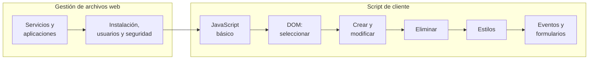

# ⚡ RA3.2 · Gestión de archivos web y script de cliente

<ExportPDF />

::: accent-box 🎯 Resultado de aprendizaje
**RA3.2.** Instala servicios de gestión de archivos web, identificando sus aplicaciones y verificando su integridad. Accede y manipula documentos web utilizando lenguajes de script de cliente.
:::

Esta unidad tiene dos partes. En la primera instalarás un **gestor de archivos web**: un servicio que permite subir, organizar y compartir archivos de un servidor desde el navegador, con usuarios, permisos y medidas de seguridad. En la segunda aprenderás **JavaScript**, el lenguaje que hace que una página **reaccione** (un menú que se despliega, un formulario que avisa de un error, una lista que crece al pulsar un botón): su sintaxis básica y, sobre todo, cómo **seleccionar, crear, modificar y eliminar elementos** y **cambiar sus estilos** a través del **DOM**.

## Criterios de evaluación

| CE | Descripción | Dónde se trabaja |
|:--:|-------------|------------------|
| a | Se ha establecido la utilidad de un servicio de gestión de archivos web. | [Apuntes 1](./contenidos/1-gestion-archivos-web) · P1 |
| b | Se han descrito diferentes aplicaciones de gestión de archivos web. | [Apuntes 1](./contenidos/1-gestion-archivos-web) · P1 |
| c | Se ha instalado y adaptado una herramienta de gestión de archivos web. | [Apuntes 2](./contenidos/2-gestor-archivos) · P1 |
| d | Se han creado y clasificado cuentas de usuario en función de sus permisos. | [Apuntes 2](./contenidos/2-gestor-archivos) · P1 |
| e | Se han gestionado archivos y directorios. | [Apuntes 2](./contenidos/2-gestor-archivos) · P1 |
| f | Se ha comprobado la seguridad del gestor de archivos. | [Apuntes 2](./contenidos/2-gestor-archivos) · P1 |
| g | Se han identificado y clasificado los lenguajes de script de cliente relacionados con la web y sus diferentes versiones y estándares. | [Apuntes 3](./contenidos/3-javascript-basico) · P2 |
| h | Se ha identificado la sintaxis básica de los lenguajes de script de cliente. | [Apuntes 3](./contenidos/3-javascript-basico) · P2 |
| i | Se han utilizado métodos para la selección y acceso de los diferentes elementos de un documento web. | [Apuntes 4](./contenidos/4-dom-seleccion) · P2 |
| j | Se han creado y modificado elementos de documentos web. | [Apuntes 5](./contenidos/5-crear-modificar) · [Apuntes 8](./contenidos/8-eventos-formularios) · P2, P3, P4 |
| k | Se han eliminado elementos de documentos web. | [Apuntes 6](./contenidos/6-eliminar) · P3 |
| l | Se han realizado modificaciones sobre los estilos de un documento web. | [Apuntes 7](./contenidos/7-estilos) · [Apuntes 8](./contenidos/8-eventos-formularios) · P3, P4 |

## Contenidos

**Gestión de archivos web**

1. [Servicios de gestión de archivos web](./contenidos/1-gestion-archivos-web)
2. [Instalación y administración de un gestor de archivos web](./contenidos/2-gestor-archivos)

**Manipulación de páginas web con script**

3. [Lenguajes de script de cliente. Características, sintaxis básica y estándares](./contenidos/3-javascript-basico)
4. [El DOM. Selección y acceso a elementos](./contenidos/4-dom-seleccion)
5. [Creación y modificación de elementos](./contenidos/5-crear-modificar)
6. [Eliminación de elementos](./contenidos/6-eliminar)
7. [Manipulación de estilos](./contenidos/7-estilos)
8. [Eventos y validación de formularios](./contenidos/8-eventos-formularios)

🎞️ [Diapositivas de la unidad](./contenidos/diapositivas) · 🛠️ [Prácticas y rúbricas](./ejercicios/)

## Qué necesitas

- Para la gestión de archivos: una máquina virtual **Ubuntu Server 24.04 LTS** con **Docker** y **Docker Compose** (la misma del RA4 te sirve).
- Para JavaScript, lo mismo que en el RA3.1: **VS Code** con **Live Server** y un navegador moderno.
- La **consola** de las herramientas de desarrollo (`F12` → *Consola*): será tu laboratorio para probar código.
- Los conocimientos de HTML y CSS del RA3.1.
