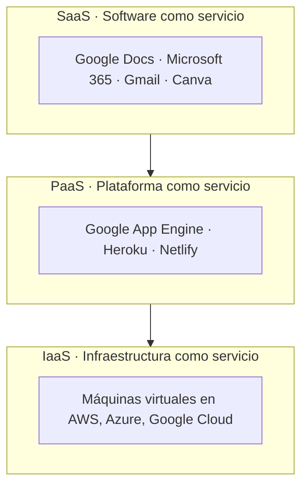

# 1. Aplicaciones web en la nube

<ExportPDF />

::: accent-box purple 🎯 Objetivos
- Definir *cloud computing* y sus modelos de servicio.
- Establecer la utilidad de las aplicaciones web en la nube (CE a).
- Valorar ventajas, inconvenientes y riesgos.
:::

## 1.1 ¿Qué es la nube?

En los esquemas de redes, Internet se dibuja como una **nube**: un conjunto de máquinas y redes cuyo detalle no nos interesa. De ahí el término.

::: accent-box 📖 Definición
La **computación en la nube** (*cloud computing*) consiste en usar recursos informáticos (aplicaciones, almacenamiento, servidores) **ofrecidos como servicio a través de Internet**, bajo demanda, sin que el usuario tenga que instalarlos ni mantenerlos. Normalmente se accede desde el **navegador** o desde una app.
:::

Una analogía: guardamos el dinero en un banco porque nos ofrece servicios (cajeros, tarjetas, transferencias) y no nos preocupa **cómo** lo guarda, sino **poder disponer de él** cuando lo necesitemos. Con los datos en la nube ocurre lo mismo.

## 1.2 Modelos de servicio

| Modelo | El proveedor gestiona | El cliente gestiona | Ejemplo |
|--------|----------------------|---------------------|---------|
| **SaaS** | Todo | Solo sus datos y su uso | Google Docs, Weebly |
| **PaaS** | Infraestructura y plataforma | Su aplicación | Publicar una web en Netlify |
| **IaaS** | Hardware y red | Sistema operativo, software y datos | Un servidor Ubuntu en la nube |

En esta unidad trabajamos sobre todo con **SaaS**.

### Modelos de despliegue

- **Nube pública:** servicios compartidos de un gran proveedor (Google, Microsoft, Amazon).
- **Nube privada:** infraestructura propia de una organización (por ejemplo, un **Nextcloud** en el servidor del centro).
- **Nube híbrida:** combinación de ambas.

## 1.3 Utilidad de las aplicaciones web en la nube

| Utilidad | Ejemplo |
|----------|---------|
| **Acceso desde cualquier lugar y dispositivo** | Empiezas un trabajo en clase y lo terminas en el móvil |
| **Colaboración en tiempo real** | Cinco personas editan el mismo documento a la vez |
| **Nada que instalar ni actualizar** | La versión siempre es la última |
| **Copias y versiones automáticas** | Recuperar el documento de hace dos días |
| **Compartir sin adjuntos** | Se envía un enlace, no 20 copias del fichero |
| **Integración entre aplicaciones** | Un formulario rellena una hoja de cálculo que alimenta un mapa |
| **Ahorro** | Menos hardware y licencias; pago por uso |

## 1.4 Inconvenientes y riesgos

| Inconveniente | Cómo mitigarlo |
|---------------|----------------|
| **Dependencia de la conexión** | Modo sin conexión de Docs/Drive, apps de escritorio sincronizadas |
| **Privacidad**: los datos están en servidores de terceros | Leer las condiciones, elegir proveedores que cumplan el **RGPD**, cifrar lo sensible |
| **Seguridad de la cuenta**: quien obtiene tu contraseña lo obtiene todo | Contraseñas robustas, **verificación en dos pasos** |
| **Dependencia del proveedor** (*vendor lock-in*) | Exportar periódicamente en formatos abiertos (ODT, ODS, PDF) |
| **Cambios de condiciones o cierre del servicio** | Servicios desaparecidos como Google+, eyeOS o Thinkfree recuerdan la importancia de tener copias propias |
| **Límites de almacenamiento** | Revisar la cuota y limpiar |

::: tip-box Datos personales y centros educativos
Cuando un centro usa la nube con datos del alumnado, debe hacerlo con plataformas autorizadas por la administración educativa y con contratos que garanticen el cumplimiento del RGPD. Por eso, en el entorno educativo se usan cuentas institucionales y no cuentas personales.
:::

## 1.5 Familias de aplicaciones web en la nube

| Familia | Ejemplos |
|---------|----------|
| **Ofimática** | Google Docs/Sheets/Slides, Microsoft 365 en la web, Zoho Writer, OnlyOffice |
| **Almacenamiento y sincronización** | Google Drive, OneDrive, Dropbox, Nextcloud |
| **Comunicación** | Gmail, Outlook, Meet, Teams, Chat |
| **Organización** | Calendar, Tasks, Keep, Trello |
| **Formularios y encuestas** | Google Forms, Microsoft Forms |
| **Diseño web** | Google Sites, Weebly, Wix, WordPress.com |
| **Diseño gráfico** | Canva, Figma, Penpot |
| **Aprendizaje** | Google Classroom, Moodle (RA2) |

::: details 🔁 Autoevaluación rápida
1. Clasifica en SaaS, PaaS o IaaS: Gmail, una máquina virtual en Azure, publicar una web en GitHub Pages, Canva.
2. Indica tres utilidades de las aplicaciones en la nube para un equipo de trabajo.
3. ¿Qué es el *vendor lock-in* y cómo se reduce?
4. ¿Por qué un centro educativo no debería usar cuentas personales del profesorado para gestionar datos del alumnado?
:::

---

**Siguiente:** [2. Almacenamiento y gestión de archivos →](./2-almacenamiento-archivos)
