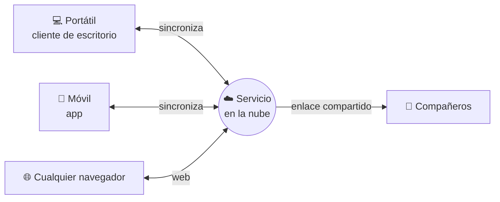
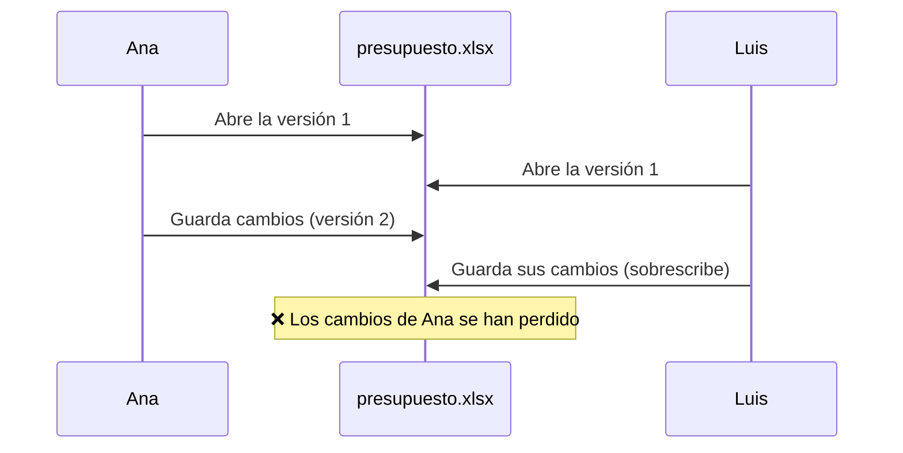

# 2. Servicios de almacenamiento y gestión de archivos web

<ExportPDF />

::: accent-box purple 🎯 Objetivos
- Describir y comparar los servicios de alojamiento de archivos en la nube (CE b).
- Entender los riesgos de la edición simultánea y la gestión documental (DMS).
- Instalar un servicio de archivos propio (nube privada).
:::

## 2.1 Archivos en la nube

Un **servicio de alojamiento de archivos** guarda tus ficheros en servidores de Internet y los **sincroniza** entre todos tus dispositivos.



| Ventaja | Inconveniente |
|---------|---------------|
| Acceso desde cualquier dispositivo | Necesita conexión para lo no sincronizado |
| Copia fuera del equipo (protege ante averías o robos) | Si borras en un sitio, se borra en todos (¡no es una copia de seguridad completa!) |
| Compartir con enlaces y permisos | Riesgo de compartir de más |
| Historial de versiones | Espacio gratuito limitado |

::: warning-box Sincronizar no es hacer copia de seguridad
Si un *ransomware* cifra tus ficheros o los borras por error, la sincronización **replica el daño** en la nube. Necesitas además el **historial de versiones**, la **papelera** y una copia independiente (regla 3-2-1 del RA1).
:::

## 2.2 Servicios más usados

| Servicio | Espacio gratuito* | Integración | Particularidades |
|----------|------------------|-------------|------------------|
| **Google Drive** | 15 GB (compartidos con Gmail y Fotos) | Google Docs, Sheets, Slides, Forms | Edición colaborativa nativa; unidades compartidas en Workspace |
| **Microsoft OneDrive** | 5 GB | Word, Excel, PowerPoint (web y escritorio), Windows | Integrado en el Explorador de Windows; "Archivos a petición" |
| **Dropbox** | 2 GB | Clientes para casi todos los sistemas | Sincronización muy eficiente; precursor del sector |
| **iCloud Drive** | 5 GB | Ecosistema Apple | — |
| **Proton Drive** | Variable | Cifrado de extremo a extremo | Enfoque en privacidad |
| **Nextcloud** | El de tu servidor | Calendario, contactos, ofimática (Collabora/OnlyOffice) | **Autoalojado**: nube privada, software libre |

\* Las cuotas cambian con frecuencia: compruébalas en la web de cada servicio.

### Prestaciones comunes

- **Cliente de escritorio** que integra el servicio en el sistema operativo como una carpeta más, con archivos **a petición** (solo se descargan al abrirlos).
- **Compartir** archivos y carpetas con personas concretas o por enlace, con permisos (ver, comentar, editar) y fecha de caducidad.
- **Historial de versiones** y **papelera** con recuperación.
- **Vista previa** de cientos de formatos sin descargarlos.
- **Búsqueda** por contenido, incluso en PDF escaneados (OCR).

## 2.3 Gestión documental y DMS

Cuando muchas personas trabajan con los mismos documentos aparecen problemas:



**Soluciones:**

- **Edición colaborativa en tiempo real** (Google Docs, Office en la web, OnlyOffice): todos editan **el mismo documento** a la vez.
- **Bloqueo de archivos** (*check-out / check-in*): mientras alguien edita, los demás solo pueden leer.
- **Control de versiones**: cada guardado crea una versión recuperable.

::: accent-box 📖 Sistema de gestión documental (DMS)
Un **DMS** (*Document Management System*) es una aplicación que gestiona el **ciclo de vida** de los documentos de una organización: creación, revisión, aprobación, publicación, archivo y destrucción. Añade **metadatos**, **versiones**, **permisos**, **flujos de trabajo** (aprobaciones), **auditoría** (quién hizo qué) y búsqueda avanzada.
:::

| DMS | Tipo |
|-----|------|
| **Nextcloud** (con módulos de flujo de trabajo) | Libre, autoalojado |
| **Alfresco Community**, **OpenKM**, **Mayan EDMS** | Libres, orientados a empresa |
| **Microsoft SharePoint** | Comercial, integrado en Microsoft 365 |
| **Google Drive** con unidades compartidas y aprobaciones | Comercial (Workspace) |

## 2.4 Instalar un servicio de archivos propio: Nextcloud

Con **Nextcloud** cualquier organización puede tener "su propio Drive" en un servidor controlado por ella.

::: info-box Relación con el RA3.2
En el RA3.2 instalaste un **gestor de archivos web ligero** (FileBrowser Quantum). Nextcloud va más allá: añade sincronización con el escritorio y el móvil, calendario, contactos y ofimática en línea, a cambio de una instalación y un mantenimiento más exigentes.
:::

### Instalación rápida con Docker

```yaml
# docker-compose.yml
services:
  db:
    image: mariadb:11
    environment:
      MARIADB_DATABASE: nextcloud
      MARIADB_USER: nextcloud
      MARIADB_PASSWORD: Cambia_Esta_Clave_2026
      MARIADB_ROOT_PASSWORD: Otra_Clave_Root_2026
    volumes: [db:/var/lib/mysql]
  app:
    image: nextcloud:latest
    ports: ["8080:80"]
    environment:
      MYSQL_HOST: db
      MYSQL_DATABASE: nextcloud
      MYSQL_USER: nextcloud
      MYSQL_PASSWORD: Cambia_Esta_Clave_2026
    volumes: [nextcloud:/var/www/html]
    depends_on: [db]
volumes:
  db:
  nextcloud:
```

```bash
docker compose up -d
# Abre http://IP-DEL-SERVIDOR:8080 y crea la cuenta de administración
```

::: info-box Alternativas de instalación
- **Nextcloud All-in-One** (contenedor oficial que instala todo, incluida la ofimática).
- **Snap** en Ubuntu: `sudo snap install nextcloud`.
- Instalación manual sobre LAMP, como hiciste con WordPress en el RA1.
:::

### Tareas básicas de administración

1. **Usuarios y grupos:** *Usuarios → Nuevo usuario*, asignar grupo y **cuota** de espacio.
2. **Aplicaciones:** activar *Calendar*, *Contacts*, *Deck* y una suite ofimática (*Nextcloud Office* o *OnlyOffice*).
3. **Compartir:** enlaces públicos con contraseña y caducidad, carpetas de grupo.
4. **Clientes:** instalar el cliente de escritorio y la app móvil, y comprobar la sincronización.
5. **Seguridad:** HTTPS, verificación en dos pasos (app *Two-Factor TOTP*), revisión en *Configuración → Vista general*.

::: note-box 📷 Captura sugerida
Panel de archivos de Nextcloud con una carpeta compartida con un grupo y el icono de enlace público.
:::

::: details 🔁 Autoevaluación rápida
1. ¿Por qué la sincronización con la nube no sustituye a una copia de seguridad?
2. Explica con un ejemplo el problema de la edición simultánea y dos formas de evitarlo.
3. ¿Qué aporta un DMS frente a una simple carpeta compartida?
4. ¿Qué ventajas tiene para un centro un Nextcloud propio frente a Google Drive? ¿Y qué inconvenientes?
:::

---

**Anterior:** [← 1. Aplicaciones web en la nube](./1-cloud-computing) · **Siguiente:** [3. Cuentas y seguridad →](./3-cuentas-seguridad)
