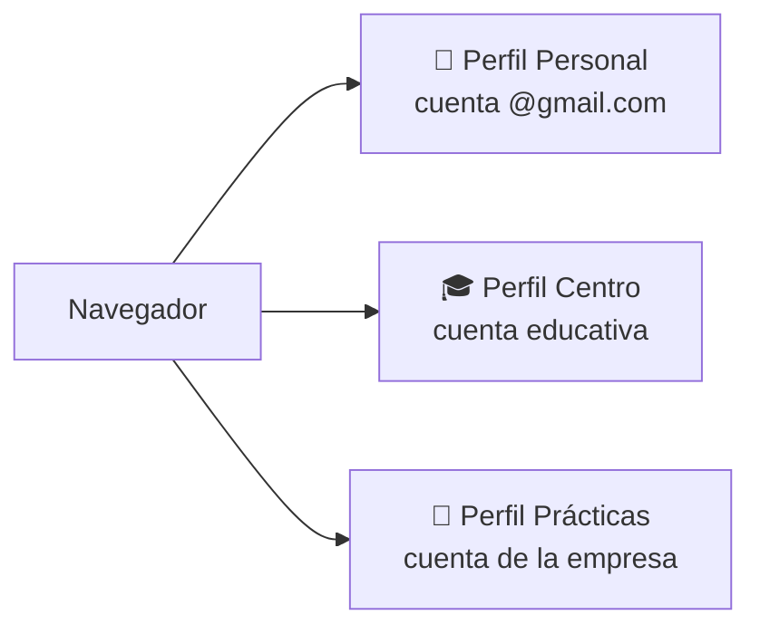

# 3. Cuentas de usuario: iniciar sesión correctamente y seguridad

<ExportPDF />

::: accent-box purple 🎯 Objetivos
- Gestionar cuentas de usuario de servicios en la nube (CE d).
- Iniciar sesión correctamente separando cuentas personales y de trabajo.
- Aplicar criterios de seguridad en el acceso (CE e).
:::

## 3.1 Tipos de cuenta

| Tipo | Quién la gestiona | Ejemplo |
|------|-------------------|---------|
| **Personal** | Tú | `nombre.apellido@gmail.com` |
| **Organizativa** (Google Workspace, Microsoft 365) | El administrador de la organización, que decide qué servicios hay, con quién se puede compartir y qué políticas de seguridad se aplican | `nia@alu.centro.es`, `nombre@empresa.com` |

::: info-box ¿Por qué separarlas?
Los documentos de trabajo pertenecen a la organización: si dejas la empresa o el centro, la cuenta organizativa se desactiva, pero el trabajo sigue disponible para el equipo. Mezclar cuentas provoca documentos "huérfanos", permisos que no funcionan y fugas de información.
:::

## 3.2 Iniciar sesión correctamente

### En tu propio equipo: un perfil de navegador por cuenta

Chrome, Edge y Firefox permiten crear **perfiles**: cada uno tiene sus propias sesiones, marcadores, extensiones y contraseñas.

1. Chrome → icono de perfil (arriba a la derecha) → **Añadir** → elige un nombre y color.
2. Inicia sesión con **una sola cuenta** en ese perfil.
3. Usa siempre el perfil que corresponda. Se acabaron los mensajes "No tienes acceso a este archivo" por estar en la cuenta equivocada.

::: warning-box Varias cuentas en la misma ventana
Google permite añadir varias cuentas en una misma sesión, pero la **primera** que inicias es la **predeterminada**: muchos enlaces se abrirán con ella. Es la principal causa de errores de permisos. Mejor un perfil por cuenta.
:::

### En un equipo compartido o público

- Usa una **ventana de incógnito / privada** o el **modo invitado**.
- **No** marques "Recordar" ni guardes la contraseña.
- **Cierra sesión** al terminar (y cierra la ventana).
- Si lo olvidaste: *Cuenta de Google → Seguridad → Tus dispositivos* → cierra la sesión de ese equipo.

## 3.3 Gestión de la cuenta

En **myaccount.google.com** (o en el portal de tu cuenta Microsoft):

| Apartado | Qué revisar |
|----------|------------|
| **Información personal** | Nombre, foto y datos de recuperación (correo y teléfono alternativos) |
| **Seguridad** | Contraseña, verificación en dos pasos, llaves de acceso, dispositivos, aplicaciones de terceros con acceso |
| **Datos y privacidad** | Historial, configuración de anuncios, **Google Takeout** (exportar todos tus datos) |
| **Personas y compartir** | Contactos y qué ven los demás de ti |
| **Almacenamiento** | Cuota usada por Drive, Gmail y Fotos |

### Administración de cuentas en una organización

En la **consola de administración** de Google Workspace (`admin.google.com`) un administrador puede: crear y suspender usuarios, organizarlos en **unidades organizativas** y **grupos**, restablecer contraseñas, forzar la verificación en dos pasos, limitar el uso compartido fuera del dominio y consultar **informes de auditoría** (quién compartió qué). Microsoft 365 ofrece lo mismo en su centro de administración.

## 3.4 Criterios de seguridad en el acceso

::: accent-box teal 💡 Cinco reglas
1. **Contraseña larga y única** para cada servicio (mejor una frase de 4-5 palabras).
2. **Verificación en dos pasos** (2FA/2SV) activada.
3. **Gestor de contraseñas** (Bitwarden, KeePassXC o el del navegador).
4. **Revisión periódica** de dispositivos y aplicaciones con acceso.
5. **Desconfiar** de correos que piden iniciar sesión (*phishing*): entra siempre escribiendo tú la dirección.
:::

### Métodos de verificación en dos pasos

| Método | Seguridad | Comentario |
|--------|-----------|-----------|
| SMS | Media | Vulnerable a duplicado de SIM |
| Notificación en el móvil ("¿Eres tú?") | Alta | Cómodo; comprueba el número que aparece |
| App autenticadora (Google Authenticator, Microsoft Authenticator, Aegis) | Alta | Funciona sin cobertura |
| **Llaves de acceso (*passkeys*)** y llaves físicas (FIDO2) | Muy alta | Resistentes al *phishing* |
| Códigos de seguridad de un solo uso | — | **Guárdalos** por si pierdes el móvil |

### Revisión de seguridad

Google ofrece una **Revisión de seguridad** (*Security Checkup*) que en dos minutos muestra dispositivos conectados, actividad sospechosa, aplicaciones de terceros y contraseñas filtradas. Hazla al menos una vez por trimestre.

::: note-box 📷 Captura sugerida
Página de Seguridad de la cuenta con la verificación en dos pasos activada (oculta tus datos personales).
:::

::: details 🔁 Autoevaluación rápida
1. ¿Por qué es mejor un perfil de navegador por cuenta que varias cuentas en la misma ventana?
2. Has iniciado sesión en un ordenador de la biblioteca y no la cerraste. ¿Qué haces desde casa?
3. Ordena de más a menos seguro: SMS, llave de acceso, app autenticadora.
4. ¿Qué puede hacer el administrador de una cuenta organizativa que no puede hacer el usuario?
:::

---

**Anterior:** [← 2. Almacenamiento y gestión de archivos](./2-almacenamiento-archivos) · **Siguiente:** [4. Drive y Docs →](./4-drive-docs)
