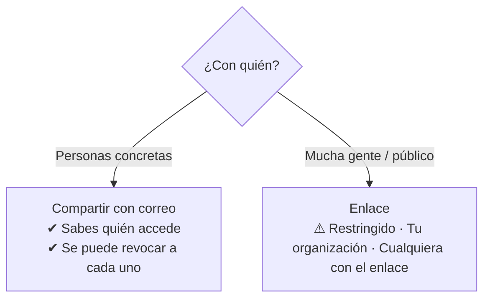
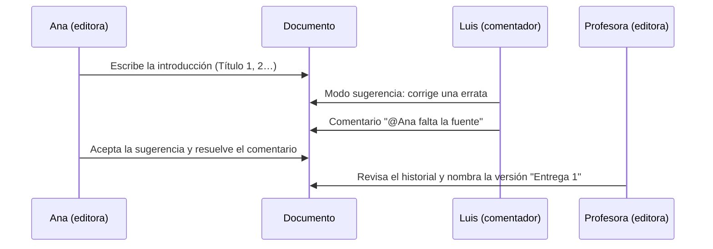

# 4. Google Drive y Docs: compartir, organizar, buscar y colaborar

<ExportPDF />

::: accent-box purple 🎯 Objetivos
- Compartir con buenas prácticas de seguridad (CE e).
- Organizar Drive "para no volverse loco" y buscar con eficacia.
- Reconocer las prestaciones de Docs y utilizarlo de forma colaborativa (CE f, g).
:::

## 4.1 Compartir: buenas prácticas

### Niveles de acceso

| Rol | Puede |
|-----|-------|
| **Lector** | Ver y descargar (salvo que se impida) |
| **Comentador** | Ver, comentar y hacer sugerencias |
| **Editor** | Modificar, y por defecto, volver a compartir |
| **Propietario** | Todo, incluido eliminar definitivamente y transferir la propiedad |

### Dos formas de compartir



::: accent-box teal 💡 Reglas para compartir sin sustos
1. **Por defecto, "Restringido"** y compartir con **personas concretas**.
2. **El mínimo permiso necesario**: si solo deben leer, *Lector*.
3. **"Cualquier persona con el enlace" solo para contenido público**: el enlace se puede reenviar.
4. Comparte **carpetas**, no archivos sueltos: lo que metas dentro hereda los permisos.
5. Pon **fecha de caducidad** a los accesos temporales (en Workspace).
6. En documentos sensibles, impide que los editores cambien los permisos y que lectores y comentadores descarguen o impriman (*Configuración* ⚙ en el cuadro Compartir).
7. **Revisa periódicamente** qué compartes: en Drive, filtro *Personas* o la columna *Compartido*.
:::

::: warning-box Enviar enlaces, no adjuntos
Adjuntar un documento al correo crea copias que nadie sabe cuál es la última. Comparte el **enlace** al original.
:::

## 4.2 Organizar Drive "para no volverse loco"

### Estructura de carpetas

Diseña la estructura **antes** de empezar, con pocos niveles (3-4 como máximo):

```text
📁 2SMR-2026-27
├── 📁 00-Administración          (horarios, normas)
├── 📁 AW-Aplicaciones-Web
│   ├── 📁 RA1-CMS
│   ├── 📁 RA2-LMS
│   └── 📁 Entregas
├── 📁 SR-Servicios-en-Red
└── 📁 99-Archivo                 (lo terminado)
```

### Normas de nombres

- **Prefijo numérico o de fecha** para ordenar: `2026-10-12_acta-reunion`, `01-introduccion`.
- **Descriptivo y sin ambigüedades**: `AW_P1_Instalacion-WordPress_GarciaAna` y no `práctica final definitiva (2).docx`.
- Sin "final", "definitivo", "v2": el **historial de versiones** ya guarda las versiones.

### Herramientas de organización

| Herramienta | Para qué |
|-------------|----------|
| **Colores de carpeta** | Distinguir de un vistazo (rojo = urgente, verde = terminado) |
| **Destacados** ⭐ | Acceso rápido a lo que usas a diario |
| **Accesos directos** | Tener un archivo en varias carpetas sin duplicarlo |
| **Unidades compartidas** (Workspace) | Carpetas que pertenecen al **equipo**, no a una persona: si alguien se va, nada se pierde |
| **Compartido conmigo** | Lo que otros te comparten **no** está en "Mi unidad" hasta que añades un acceso directo |
| **Descripción del archivo** | Información extra que también se puede buscar |

## 4.3 Buscar en Drive

La barra de búsqueda busca en **nombres y contenido** (incluso texto de imágenes y PDF). Con el icono de **filtros** (o los chips *Tipo, Personas, Modificado, Ubicación*) se acota la búsqueda. También admite operadores:

| Operador | Ejemplo | Encuentra |
|----------|---------|-----------|
| `"…"` | `"política de copias"` | La frase exacta |
| `-` | `rúbrica -borrador` | Excluye una palabra |
| `type:` | `type:spreadsheet`, `type:pdf`, `type:presentation` | Por tipo |
| `owner:` | `owner:me`, `owner:ana@centro.es` | Por propietario |
| `title:` | `title:acta` | Solo en el nombre |
| `after:` / `before:` | `after:2026-09-01` | Por fecha de modificación |
| `is:` | `is:starred`, `is:trashed` | Destacados, papelera |

Ejemplo: `type:pdf owner:me after:2026-09-01 rúbrica` → PDF que son tuyos, modificados desde septiembre, que contienen "rúbrica".

## 4.4 Google Docs: prestaciones

| Prestación | Para qué |
|------------|----------|
| **Estilos de título** (Título 1, 2…) | Generan el **esquema** lateral y el **índice** automático |
| **Modo sugerencia** | Proponer cambios que el autor acepta o rechaza (como el control de cambios) |
| **Comentarios y menciones** (`@nombre`) | Hablar sobre el texto y **asignar tareas** |
| **Historial de versiones** | Ver quién cambió qué y restaurar versiones; **nombrar versiones** importantes |
| **Smart chips** (`@`) | Insertar personas, fechas, archivos, eventos, desplegables |
| **Plantillas** | Partir de un formato común |
| **Dictado por voz**, **Explorar**, **Traducir documento** | Productividad |
| **Trabajo sin conexión** | Editar sin Internet; se sincroniza al volver |
| **Descargar como** | DOCX, ODT, PDF, TXT, EPUB, HTML |
| **Publicar en la web** | Versión pública de solo lectura |

## 4.5 Colaborar en un documento



Buenas prácticas de colaboración:

- **Repartir el trabajo** por apartados (un título por persona) y usar **comentarios asignados** como lista de tareas.
- Escribir con **modo sugerencia** cuando se edita el texto de otra persona.
- **Resolver** los comentarios atendidos para que no se acumulen.
- **Nombrar versiones** en los hitos (borrador, revisión, entrega).

::: details 🔁 Autoevaluación rápida
1. ¿Qué rol darías a un compañero que debe revisar tu trabajo sin modificarlo directamente?
2. ¿Por qué es mejor una unidad compartida que una carpeta de "Mi unidad" para un proyecto de equipo?
3. Escribe la búsqueda para encontrar las hojas de cálculo que te ha compartido `luis@centro.es`.
4. ¿Qué diferencia hay entre un comentario y una sugerencia?
:::

---

**Anterior:** [← 3. Cuentas y seguridad](./3-cuentas-seguridad) · **Siguiente:** [5. Sheets, Slides, Calendar, Forms y My Maps →](./5-sheets-slides-calendar-forms)
