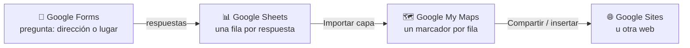

# 5. Sheets, Slides, Calendar, Forms y su conexión con My Maps

<ExportPDF />

::: accent-box purple 🎯 Objetivos
- Recordar las prestaciones específicas de Sheets, Slides y Calendar (CE b, f).
- Crear formularios y conectar sus respuestas con hojas de cálculo y mapas.
- Utilizar las aplicaciones de forma colaborativa (CE g).
:::

## 5.1 Google Sheets (hojas de cálculo)

Recordatorio de lo esencial y de lo que la hace **colaborativa**:

| Prestación | Ejemplo |
|------------|---------|
| Fórmulas y funciones | `=SUMA(B2:B20)`, `=PROMEDIO()`, `=SI(C2>=5;"Apto";"No apto")`, `=CONTAR.SI()`, `=BUSCARV()` |
| **Formato condicional** | Notas por debajo de 5 en rojo |
| **Validación de datos** | Desplegable con valores permitidos, casillas de verificación |
| **Filtros** y **vistas de filtro** | Cada persona filtra sin cambiar lo que ven los demás |
| **Tablas dinámicas** y **gráficos** | Resumir y visualizar |
| **Rangos protegidos** | Solo ciertas personas pueden editar ciertas celdas |
| Funciones de la nube | `=IMPORTRANGE()` (datos de otra hoja), `=GOOGLETRANSLATE()`, `=IMAGE()` |
| Comentarios, historial de versiones e historial de una celda | Trazabilidad |

::: tip-box Separador de argumentos
Con la configuración regional **España**, los argumentos de las funciones se separan con **punto y coma** (`;`) y los decimales con coma.
:::

## 5.2 Google Slides (presentaciones)

- **Diseño** (*Tema*) y **patrón de diapositivas** (*Ver → Tema*) para mantener un estilo común: lo que cambies en el patrón se aplica a todas.
- Imágenes, vídeos de YouTube o Drive, diagramas y **gráficos vinculados** a Sheets (se actualizan con los datos).
- **Notas del orador** y **vista del presentador**.
- **Preguntas del público** en directo durante la presentación.
- **Colaboración**: cada persona edita sus diapositivas a la vez; comentarios asignados.
- Exportar a PPTX, PDF o imágenes; **Publicar en la web** o insertar en Google Sites.

## 5.3 Google Calendar

| Prestación | Uso |
|------------|-----|
| **Varios calendarios** | Personal, clase, proyecto… cada uno con su color |
| **Compartir un calendario** | Ver solo libre/ocupado, ver detalles, hacer cambios, gestionar el uso compartido |
| **Eventos con invitados** | Confirmación de asistencia, enlace de Meet automático, archivos adjuntos de Drive |
| **Recordatorios y repeticiones** | Clases semanales, entregas |
| **Tareas** | Integradas con Google Tasks y con los comentarios asignados de Docs |
| **Páginas de reserva de citas** | Que otros reserven huecos libres (tutorías) |
| **Calendario público e insertable** | Publicar el calendario de un grupo en Google Sites |
| **Suscripción iCal** | Ver el calendario en otras aplicaciones (Thunderbird, Outlook, el móvil) |

## 5.4 Google Forms

Formularios para encuestas, inscripciones, cuestionarios autocorregidos o recogida de datos.

| Tipo de pregunta | Ejemplo |
|------------------|---------|
| Respuesta corta / párrafo | Nombre, comentarios |
| Varias opciones / casillas / desplegable | Ciclo, intereses |
| Escala lineal / cuadrícula | Valoración del 1 al 5 |
| Fecha / hora | Día de la visita |
| **Subida de archivos** (solo usuarios con cuenta) | Entregar un documento |

Prestaciones destacadas:

- **Secciones** y **ir a una sección según la respuesta** (formularios ramificados).
- **Validación de respuestas** (número, longitud, expresión regular, correo).
- **Modo cuestionario**: puntuación, respuestas correctas y comentarios automáticos.
- **Configuración**: recoger correos, limitar a una respuesta, permitir editar después, restringir a la organización.
- **Respuestas** en resumen, por pregunta e individuales, y **vinculadas a una hoja de cálculo** de Sheets.
- Compartir por enlace, código QR o **insertar** en una web (`iframe`).

## 5.5 De Forms a My Maps

**Google My Maps** (`mymaps.google.com`) permite crear mapas personalizados con capas, marcadores, iconos, rutas y descripciones, y compartirlos o insertarlos en una web. Su gran ventaja es que puede **importar datos desde una hoja de Sheets**, y Sheets puede recibir los datos de un **formulario**:

### Paso a paso

1. **Forms:** crea un formulario con una pregunta de **dirección** (por ejemplo, *"Dirección o municipio del lugar"*) y otras preguntas descriptivas (nombre del lugar, categoría, foto, comentario).
2. **Respuestas → Vincular con Hojas de cálculo**: se crea una hoja con una fila por respuesta.
3. Envía el formulario y recoge varias respuestas (pide que la dirección sea completa: calle, número, municipio).
4. **My Maps → Crear un mapa nuevo → Importar** (en la capa sin título) → **Google Drive** → elige la hoja.
5. Indica la **columna de ubicación** (la dirección) y la **columna para el título** del marcador.
6. Personaliza: **estilo por categoría** (colores e iconos según una columna), descripción emergente, mapa base.
7. **Compartir** el mapa o **insertarlo** en Google Sites.

::: info-box Actualizar los datos
La importación copia los datos en ese momento. Si llegan respuestas nuevas, en la capa usa **⋮ → Volver a importar y combinar** para añadirlas.
:::

::: tip-box Ideas de uso
Mapa de las empresas de FCT del grupo, de los puntos wifi del centro, de averías reportadas en un polígono, de rutas culturales de una asociación…
:::

::: note-box 📷 Captura sugerida
El mapa resultante con los marcadores coloreados por categoría y la ventana de información de uno de ellos.
:::

::: details 🔁 Autoevaluación rápida
1. ¿Para qué sirven las vistas de filtro en un Sheets compartido?
2. ¿Qué ventaja tiene insertar en Slides un gráfico vinculado a Sheets?
3. ¿Qué permisos darías al compartir el calendario de un grupo con las familias?
4. Explica el recorrido de un dato desde que alguien rellena un formulario hasta que aparece en un mapa de My Maps.
:::

---

**Anterior:** [← 4. Drive y Docs](./4-drive-docs) · **Siguiente:** [6. Diseño web en la nube →](./6-diseno-web-nube)
