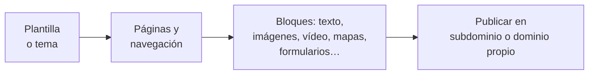

# 6. Diseño web en la nube: Google Sites frente a Weebly

<ExportPDF />

::: accent-box purple 🎯 Objetivos
- Conocer los constructores de sitios web en la nube.
- Reconocer las prestaciones específicas de Google Sites y Weebly (CE f).
- Comparar y evaluar su usabilidad (CE c).
:::

## 6.1 Constructores web en la nube

Un **constructor web** (*website builder*) es una aplicación SaaS para crear sitios **arrastrando y soltando bloques**, sin programar ni instalar servidor. El proveedor se encarga del alojamiento, la seguridad y las actualizaciones.

::: info-box ¿Constructor web o CMS instalado?
| | Constructor en la nube (RA4) | CMS instalado (RA1) |
|---|---|---|
| Instalación y mantenimiento | Ninguno | Servidor, actualizaciones, copias |
| Personalización | Limitada a lo que ofrece | Total (temas, plugins, código) |
| Coste | Gratuito con limitaciones / suscripción | Software libre + alojamiento |
| Control de los datos | Del proveedor | Tuyo |
:::

## 6.2 Google Sites

Integrado en Google Workspace y gratuito con cualquier cuenta de Google.

### Características

- Editor muy sencillo con panel lateral: **Insertar**, **Páginas** y **Temas**.
- **Temas** con paleta y tipografía configurables, cabecera con imagen, logotipo y favicon.
- **Diseños** (*layouts*) prediseñados de bloques y secciones arrastrables.
- **Integración nativa** con Drive, Docs, Sheets, Slides, Forms, Calendar, Maps, YouTube y gráficos de Sheets: se insertan y se mantienen **actualizados**.
- **Insertar código** HTML/`iframe` y **URL** (por ejemplo, un mapa de My Maps).
- **Edición colaborativa**: varias personas editan el sitio a la vez (se comparte como un documento).
- Navegación automática (superior o lateral), páginas anidadas y **páginas ocultas**.
- Publicación en `sites.google.com/view/nombre`, con **dominio personalizado** opcional y control de **quién puede ver** el sitio (público o solo la organización).
- **Historial de versiones** del sitio.
- Sin tienda online, blog limitado y sin plugins de terceros.

### Primeros pasos

1. `sites.google.com` → **Sitio en blanco** (o una plantilla).
2. Nombre del sitio, logotipo y título de la cabecera.
3. **Temas**: elige uno y ajusta colores y fuente.
4. **Páginas**: crea las páginas y subpáginas (aparecen solas en el menú).
5. **Insertar**: cuadros de texto, imágenes, diseños, contenidos de Drive, calendario, mapa…
6. **Compartir con otros** para editar en equipo.
7. **Publicar**: dirección web y quién puede verlo. Tras cada cambio, hay que volver a **Publicar**.

## 6.3 Weebly

Constructor web propiedad de **Square** (empresa de pagos), con fuerte orientación al **comercio electrónico**.

### Características

- Editor **arrastrar y soltar** con elementos: título, texto, imagen, galería, presentación, mapa, formulario de contacto, vídeo, botón, código incrustado…
- **Temas** adaptables y modificables (incluido el código HTML/CSS en el editor de temas).
- **Blog** integrado con categorías y comentarios.
- **Tienda online** (Square Online): productos, inventario, pagos.
- **Formularios** con recepción de respuestas.
- **Estadísticas** de visitas y opciones **SEO** por página.
- **App Center** para añadir funciones (algunas de pago).
- Publicación en `nombre.weebly.com` (gratuito, con publicidad de la plataforma) o dominio propio en planes de pago.
- Edición por **una persona** en el plan gratuito (colaboradores limitados).

::: warning-box Comprueba la oferta actual
Las condiciones del plan gratuito y la integración con Square Online cambian con frecuencia. Revisa qué incluye el plan gratuito antes de empezar un proyecto.
:::

## 6.4 Comparativa

| Criterio | Google Sites | Weebly |
|----------|--------------|--------|
| **Coste** | Gratuito | Gratuito con anuncios y limitaciones; planes de pago |
| **Facilidad de uso** | Muy alta: pocas opciones, todo a la vista | Alta: más opciones, curva algo mayor |
| **Plantillas y diseño** | Pocas, sobrias; personalización limitada | Más variedad; edición de HTML/CSS del tema |
| **Integración** | Ecosistema Google (Drive, Forms, Calendar…) | App Center, Square |
| **Colaboración** | Edición simultánea como en Docs | Limitada en el plan gratuito |
| **Blog** | No nativo | Sí |
| **Tienda online** | No | Sí |
| **Formularios** | Insertando Google Forms | Nativos |
| **Estadísticas** | Con Google Analytics | Integradas |
| **Dominio propio** | Sí (hay que verificar la propiedad del dominio) | En planes de pago |
| **Privacidad / acceso** | Puede restringirse a una organización | Público |
| **Uso ideal** | Webs de clase, proyectos, intranets, portafolios | Pequeños negocios, tiendas, blogs |

## 6.5 Evaluar la usabilidad

Para comparar herramientas de forma **objetiva** no basta con "me gusta más". Usa criterios y mídelos:

| Criterio (heurísticas de Nielsen adaptadas) | Qué observar |
|---------------------------------------------|--------------|
| **Facilidad de aprendizaje** | Tiempo hasta publicar la primera página |
| **Eficiencia** | Número de clics para tareas frecuentes (añadir página, insertar imagen, cambiar color) |
| **Visibilidad del estado** | ¿Sé si está guardado o publicado? |
| **Prevención y recuperación de errores** | Deshacer, historial de versiones |
| **Consistencia** | ¿Los elementos se comportan igual en todo el editor? |
| **Flexibilidad** | ¿Puedo personalizar lo que necesito? |
| **Resultado** | ¿El sitio es adaptable al móvil, accesible y rápido (Lighthouse)? |

Una forma sencilla de hacerlo: define **5 tareas**, realízalas en cada herramienta cronometrando el tiempo y contando clics y errores, y puntúa cada criterio de 1 a 5. Lo harás en la P3.

::: details 🔁 Autoevaluación rápida
1. Un club deportivo quiere vender camisetas en su web. ¿Google Sites o Weebly? ¿Por qué?
2. Un departamento quiere una web interna solo para su profesorado, con documentos de Drive siempre actualizados. ¿Cuál elegirías?
3. Indica tres criterios objetivos para comparar la usabilidad de dos editores web.
:::

---

**Anterior:** [← 5. Sheets, Slides, Calendar, Forms y My Maps](./5-sheets-slides-calendar-forms) · **Siguiente:** [7. Comparativa de suites →](./7-comparativa-suites)
