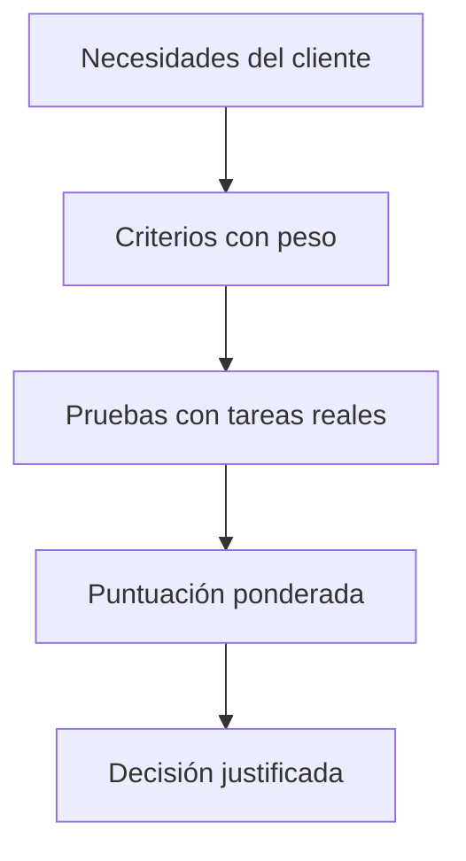

# 7. Comparación de suites ofimáticas web y herramientas de diseño web

<ExportPDF />

::: accent-box purple 🎯 Objetivos
- Describir las herramientas de cada suite ofimática web (CE b).
- Comparar y evaluar su usabilidad y prestaciones (CE c, f).
- Elegir la herramienta adecuada a un contexto.
:::

## 7.1 Las suites ofimáticas web

| Aplicación | Google Workspace | Microsoft 365 (web) | Zoho Workplace | OnlyOffice / Nextcloud Office |
|------------|------------------|---------------------|----------------|-------------------------------|
| Procesador de textos | Docs | Word | Writer | Documento |
| Hoja de cálculo | Sheets | Excel | Sheet | Hoja de cálculo |
| Presentaciones | Slides | PowerPoint | Show | Presentación |
| Formularios | Forms | Forms | Forms | Formularios (OnlyOffice) |
| Almacenamiento | Drive | OneDrive / SharePoint | WorkDrive | Nextcloud / DocSpace |
| Correo y calendario | Gmail, Calendar | Outlook | Mail, Calendar | Nextcloud Mail, Calendar |
| Comunicación | Meet, Chat | Teams | Cliq, Meeting | Nextcloud Talk |
| Diseño web | Sites | SharePoint (sitios) | Sites | — |
| Notas | Keep | OneNote | Notebook | Notes |

::: info-box Thinkfree y otras que ya no están
Algunas suites web populares hace unos años, como **Thinkfree Online**, han desaparecido o han cambiado por completo. Es un buen recordatorio de por qué conviene trabajar con **formatos abiertos** y exportar los documentos importantes.
:::

## 7.2 Comparativa de características

| Criterio | Google Workspace | Microsoft 365 web | Zoho Workplace | OnlyOffice / Nextcloud |
|----------|------------------|-------------------|----------------|------------------------|
| **Plan gratuito** | Sí (cuenta personal, 15 GB) | Sí (cuenta Microsoft, 5 GB) | Sí, con límites | Libre si lo autoalojas |
| **Formato nativo** | Propio (exporta a OOXML/ODF) | OOXML (DOCX, XLSX, PPTX) | Propio (exporta) | OOXML / ODF |
| **Compatibilidad con Office** | Buena | Total | Buena | Muy buena |
| **Colaboración en tiempo real** | Excelente, la más fluida | Muy buena | Buena | Buena |
| **Funciones avanzadas** | Medias | Las más completas (sobre todo Excel) | Medias | Medias-altas |
| **Trabajo sin conexión** | Con extensión/app | Apps de escritorio | Limitado | Apps de escritorio |
| **Control de los datos** | Proveedor | Proveedor | Proveedor | **Tuyo** (nube privada) |
| **Ideal para** | Equipos que colaboran mucho, educación | Empresas que ya usan Office | Pymes que buscan alternativa económica | Organizaciones que priorizan la soberanía de datos |

## 7.3 Comparación de herramientas de diseño web

| | Google Sites | Weebly | Wix | WordPress.com | Canva Sites |
|---|---|---|---|---|---|
| **Enfoque** | Sitios sencillos e intranets | Pequeño comercio | Diseño libre (píxel a píxel) | Blogs y webs con ecosistema WordPress | Páginas de una sola pantalla, muy visuales |
| **Curva de aprendizaje** | Muy baja | Baja | Media | Media | Muy baja |
| **Personalización** | Baja | Media | Alta | Alta (plugins en planes de pago) | Media |
| **Tienda** | No | Sí | Sí | Sí (pago) | No |
| **Gratuito sin anuncios** | Sí | No | No | No | Sí (subdominio) |

## 7.4 Cómo evaluar y elegir

Una **matriz de decisión ponderada** convierte la comparación en una decisión razonada:

| Criterio | Peso | Google Sites | Weebly |
|----------|:----:|:------------:|:------:|
| Facilidad de uso | 30 % | 5 | 4 |
| Colaboración | 25 % | 5 | 2 |
| Personalización del diseño | 20 % | 2 | 4 |
| Integración con otras herramientas | 15 % | 5 | 3 |
| Coste | 10 % | 5 | 3 |
| **Total ponderado** | | **4,40** | **3,25** |

*Ejemplo para una web de clase hecha en equipo: 5 × 0,30 + 5 × 0,25 + 2 × 0,20 + 5 × 0,15 + 5 × 0,10 = 4,40.* Para una tienda online, los criterios y pesos serían otros y el resultado podría invertirse.

::: tip-box La herramienta depende del contexto
No existe "la mejor herramienta": existe la **más adecuada para unas necesidades concretas**. Tu trabajo como técnico es identificar esas necesidades, elegir criterios y justificar la recomendación.
:::

::: details 🔁 Autoevaluación rápida
1. ¿Qué suite recomendarías a una empresa que intercambia hojas de Excel complejas con macros con sus clientes? ¿Y a un centro que quiere que el alumnado colabore en tiempo real?
2. ¿Qué ventaja tiene OnlyOffice o Nextcloud Office sobre las demás?
3. Construye una matriz ponderada para elegir entre Wix y WordPress.com para el blog de un fotógrafo.
:::

---

**Anterior:** [← 6. Diseño web en la nube](./6-diseno-web-nube) · **Unidad:** [Volver a la presentación](../index)
