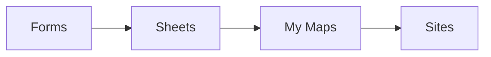

<SlidesViewer>

## RA4 · Aplicaciones web en la nube

::: accent-box ☁️ Ofimática y diseño web en la nube
**Aplicaciones Web · 2º SMR**

Trabajar, colaborar y publicar desde el navegador, con criterio profesional.
:::

---

## Qué vamos a aprender

::: accent-box purple 🎯 Objetivos
- Utilidad de las aplicaciones en la nube.
- Cuentas de usuario y acceso seguro.
- Compartir, organizar y buscar en Drive.
- Colaborar con Docs, Sheets, Slides, Calendar y Forms.
- Comparar herramientas: Google Sites vs Weebly y suites ofimáticas.
:::

---

## La nube

| Modelo | Ejemplo |
|---|---|
| **SaaS** | Docs, Gmail, Weebly |
| **PaaS** | Netlify, App Engine |
| **IaaS** | Máquina virtual en Azure |

::: tip-box Utilidad
Acceso desde cualquier sitio · colaboración en tiempo real · sin instalar · versiones · integración
:::

---

## Riesgos

::: warning-box Cuidado con
Dependencia de la conexión y del proveedor · privacidad (RGPD) · seguridad de la cuenta · cambios o cierre del servicio
:::

::: info-box Sincronizar ≠ copia de seguridad
Historial de versiones + papelera + copia independiente
:::

---

## Iniciar sesión correctamente

- **Un perfil de navegador por cuenta** (personal, centro, empresa)
- En equipos compartidos: **incógnito** y **cerrar sesión**
- Revisar **dispositivos** y **aplicaciones con acceso**

::: accent-box teal 💡 Seguridad
Contraseña larga y única · **2FA** · gestor de contraseñas · *passkeys* · desconfiar del *phishing*
:::

---

## Compartir sin sustos

| Rol | Puede |
|---|---|
| Lector | Ver |
| Comentador | Comentar y sugerir |
| Editor | Modificar |

::: tip-box Reglas
Restringido por defecto · mínimo permiso · carpetas mejor que archivos · enlaces, no adjuntos
:::

---

## Organizar y buscar en Drive

- Estructura de carpetas con **pocos niveles** y **prefijos**
- Nombres descriptivos (`2026-10-12_acta`) · sin "final-v2"
- Colores, destacados, accesos directos, **unidades compartidas**

```text
type:pdf owner:me after:2026-09-01 "rúbrica"
```

---

## Colaborar en Docs

- Estilos de título → esquema e índice
- **Modo sugerencia** · comentarios con **@menciones**
- **Historial de versiones** con nombre
- Reparto por apartados

---

## Forms → Sheets → My Maps



::: info-box Clave
Pregunta con **dirección** → columna de ubicación al importar en My Maps.
:::

---

## Google Sites vs Weebly

| | Sites | Weebly |
|---|---|---|
| Facilidad | ⭐⭐⭐⭐⭐ | ⭐⭐⭐⭐ |
| Colaboración | ⭐⭐⭐⭐⭐ | ⭐⭐ |
| Diseño | ⭐⭐ | ⭐⭐⭐⭐ |
| Tienda / blog | ✗ | ✔ |

---

## Evaluar y elegir

::: accent-box success ✨ Matriz ponderada
Necesidades → criterios con peso → pruebas con tareas reales → puntuación → **decisión justificada**
:::

---

## Resumen

::: accent-box purple 🧭 Recuerda
No hay una herramienta "mejor": hay **la adecuada para cada necesidad**. Y la seguridad empieza en **cómo inicias sesión y cómo compartes**.
:::

</SlidesViewer>
