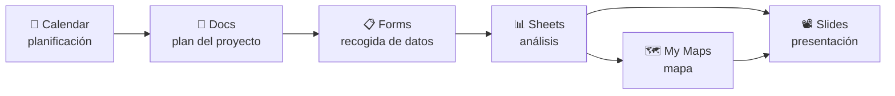

# 📋 P2 · Proyecto colaborativo: mapa de recursos TIC

<ExportPDF />

## Contexto

Vuestro equipo va a elaborar un **mapa de recursos TIC de la comarca** (tiendas de informática, puntos de reciclaje electrónico, bibliotecas con wifi, empresas del sector…). Usaréis la suite de Google de forma **colaborativa** de principio a fin.

## Objetivos

- Describir y usar las distintas herramientas de cada aplicación.
- Utilizar las aplicaciones de forma colaborativa.

## Flujo de trabajo

## Tareas

### 1. Planificación (Calendar + Docs)

1. Cread un **calendario compartido** del proyecto con los hitos (entregas, reuniones con Meet) y compartidlo con el profesorado en modo *ver todos los detalles*.
2. Redactad en Docs el **plan del proyecto** con estilos de título, índice automático, una tabla de reparto de tareas y **comentarios asignados** a cada miembro.
3. Cada miembro revisa el apartado de otro en **modo sugerencia**. Nombrad la versión final "Plan v1".

### 2. Recogida de datos (Forms)

1. Diseñad un formulario con **al menos 7 preguntas** de tipos distintos, incluyendo: nombre del recurso, **dirección completa**, categoría (desplegable), valoración (escala), fecha de la visita y una **sección condicional**.
2. Configurad validaciones y recogida de correos.
3. Cada miembro introduce **al menos 5 recursos** reales.

### 3. Análisis (Sheets)

1. Vinculad las respuestas a una hoja de cálculo.
2. En otra pestaña, calculad con fórmulas: número de recursos por categoría (`CONTAR.SI`), valoración media por categoría, y un **gráfico**.
3. Aplicad **formato condicional** y una **vista de filtro** por persona. **Proteged** la pestaña de respuestas.

### 4. Mapa (My Maps)

1. Importad la hoja en My Maps usando la columna de dirección.
2. Aplicad **estilo por categoría** (color e icono) y personalizad la ventana de información.
3. Añadid una capa con una **ruta** que recorra 4 recursos.

### 5. Presentación (Slides)

Preparad una presentación de **8-10 diapositivas** con un **patrón** común, el **gráfico vinculado** de Sheets, el **mapa** (captura o enlace) y **notas del orador**. Cada miembro hace al menos dos diapositivas.

### 6. Herramientas utilizadas (CE b)

Elaborad una tabla con **cada aplicación** usada y, para cada una, **las herramientas concretas** que habéis empleado (por ejemplo, Sheets → `CONTAR.SI`, formato condicional, vista de filtro, rango protegido) y para qué.

## Entregable

Documento del proyecto con enlaces a todos los ficheros, la tabla de herramientas y una **reflexión del equipo** sobre la colaboración (qué funcionó, qué problemas tuvisteis y cómo los resolvisteis).

## Rúbrica

| CE | 0 | 1 | 2 | 3 | 4 |
|----|---|---|---|---|---|
| **b)** Descripción de las herramientas de cada aplicación | No entregado | Tabla incompleta o aplicaciones sin usar | Las cinco aplicaciones usadas según lo pedido y tabla de herramientas completa | Además justifica la elección de cada herramienta | Además la tabla es una guía útil para otro equipo, clara y bien organizada |
| **g)** Uso colaborativo de las aplicaciones | No entregado | Trabajo hecho por una sola persona o sin evidencias de colaboración | Calendario compartido, comentarios asignados, sugerencias, versiones, datos de todos, diapositivas de todos | Además la reflexión explica cómo se ha colaborado y se resolvieron los problemas | Además la colaboración es equilibrada (verificable en el historial) y el resultado final es coherente y bien comunicado |
