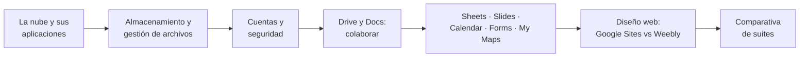

# ☁️ RA4 · Aplicaciones web en la nube y herramientas de diseño web

<ExportPDF />

::: accent-box 🎯 Resultado de aprendizaje
**RA4.** Uso de aplicaciones de ofimática web en la nube, describiendo sus características y entornos de uso. Comparar y evaluar diferencias entre distintas herramientas.
:::

Hoy la mayoría del trabajo de oficina se hace **en el navegador**: documentos que editan varias personas a la vez, carpetas compartidas con todo el equipo, formularios que alimentan hojas de cálculo y webs que se montan sin escribir código. En esta unidad aprenderás a **usar estas herramientas con criterio profesional**: iniciar sesión de forma segura, compartir sin riesgos, organizar el almacenamiento, colaborar y elegir la herramienta adecuada comparando alternativas.

## Criterios de evaluación

| CE | Descripción | Dónde se trabaja |
|:--:|-------------|------------------|
| a | Se ha establecido la utilidad de las aplicaciones web en la nube. | [Apuntes 1](./contenidos/1-cloud-computing) · P1 |
| b | Se han descrito diferentes herramientas de cada aplicación. | [Apuntes 2](./contenidos/2-almacenamiento-archivos), [5](./contenidos/5-sheets-slides-calendar-forms), [7](./contenidos/7-comparativa-suites) · P2 |
| c | Se han comparado y evaluado la usabilidad de las aplicaciones. | [Apuntes 6](./contenidos/6-diseno-web-nube), [7](./contenidos/7-comparativa-suites) · P3 |
| d | Se han gestionado las cuentas de usuario. | [Apuntes 3](./contenidos/3-cuentas-seguridad) · P1 |
| e | Se han aplicado criterios de seguridad en el acceso de los usuarios. | [Apuntes 3](./contenidos/3-cuentas-seguridad), [4](./contenidos/4-drive-docs) · P1 |
| f | Se han reconocido las prestaciones específicas de cada una de las aplicaciones. | [Apuntes 4](./contenidos/4-drive-docs), [5](./contenidos/5-sheets-slides-calendar-forms), [6](./contenidos/6-diseno-web-nube) · P3 |
| g | Se han utilizado las aplicaciones de forma colaborativa. | [Apuntes 4](./contenidos/4-drive-docs), [5](./contenidos/5-sheets-slides-calendar-forms) · P2 |

## Contenidos

1. [Aplicaciones web en la nube: concepto, modelos, ventajas e inconvenientes](./contenidos/1-cloud-computing)
2. [Servicios de almacenamiento y gestión de archivos web](./contenidos/2-almacenamiento-archivos)
3. [Cuentas de usuario: iniciar sesión correctamente y seguridad](./contenidos/3-cuentas-seguridad)
4. [Google Drive y Docs: compartir, organizar, buscar y colaborar](./contenidos/4-drive-docs)
5. [Recordatorio de Sheets, Slides y Calendar. Forms y su conexión con My Maps](./contenidos/5-sheets-slides-calendar-forms)
6. [Diseño web en la nube: Google Sites frente a Weebly](./contenidos/6-diseno-web-nube)
7. [Comparación de suites ofimáticas y herramientas de diseño web](./contenidos/7-comparativa-suites)

🎞️ [Diapositivas de la unidad](./contenidos/diapositivas) · 🛠️ [Prácticas y rúbricas](./ejercicios/)

## Qué necesitas

- Una **cuenta de Google** (preferiblemente la del centro, si dispone de Google Workspace for Education; si no, una cuenta personal creada para el módulo).
- Una **cuenta de Weebly** (gratuita).
- Un navegador actualizado y, para la autenticación en dos pasos, tu **móvil**.

::: warning-box Cuentas del centro
Si usas una cuenta del centro, respeta sus normas de uso: algunas funciones (compartir fuera del dominio, publicar sitios en abierto) pueden estar limitadas por el administrador.
:::
