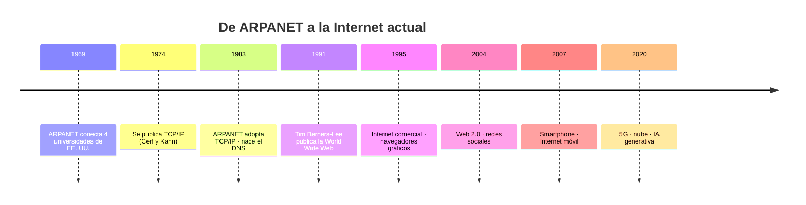
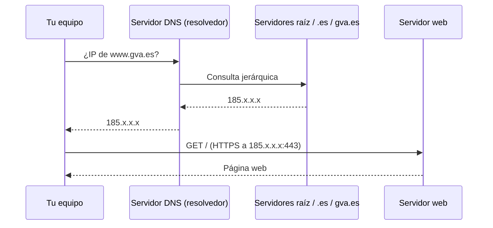
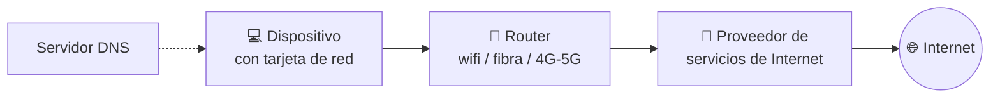

# 1. Conceptos básicos de Internet

<ExportPDF />

::: accent-box purple 🎯 Objetivos
- Definir Internet y conocer su origen.
- Comprender el papel de TCP/IP, las direcciones IP, los dominios y el DNS.
- Identificar los servicios de Internet y los elementos necesarios para conectarse.
:::

## 1.1 ¿Qué es Internet?

::: accent-box 📖 Definición
**Internet** es una red mundial formada por la interconexión de millones de redes que usan un conjunto común de protocolos, **TCP/IP**, para comunicarse. No pertenece a nadie en concreto: es una "red de redes".
:::

Hoy Internet es cotidiano: según la encuesta TIC-H del **INE**, más del 95 % de los hogares españoles tiene acceso a Internet y el móvil es el dispositivo más usado para conectarse.

### Un poco de historia



## 1.2 El protocolo TCP/IP

Un **protocolo** es un conjunto de reglas que permiten comunicarse a dos equipos. Internet se basa en la familia **TCP/IP**, organizada en capas:

| Capa | Función | Protocolos |
|------|---------|-----------|
| **Aplicación** | Servicios para el usuario | HTTP/HTTPS, SMTP, IMAP, DNS, FTP, SSH |
| **Transporte** | Comunicación entre aplicaciones (puertos) | TCP (fiable), UDP (rápido) |
| **Internet** | Direccionamiento y encaminamiento | IP (IPv4, IPv6), ICMP |
| **Acceso a la red** | Transmisión física | Ethernet, wifi, fibra, 4G/5G |

## 1.3 Direcciones IP, puertos y dominios

### Dirección IP

Identifica a cada equipo en una red:

- **IPv4:** 32 bits, cuatro números de 0 a 255 (`142.250.184.4`). Se agotaron, por eso se usa **NAT** (varias IP privadas comparten una pública).
- **IPv6:** 128 bits en hexadecimal (`2a00:1450:4003:80e::2004`).
- **Privadas** (`192.168.x.x`, `10.x.x.x`, `172.16-31.x.x`) dentro de una red local y **públicas** en Internet.

### Puertos

Identifican la **aplicación** dentro del equipo: `80` (HTTP), `443` (HTTPS), `25`/`587` (SMTP), `143`/`993` (IMAP), `22` (SSH), `3306` (MySQL).

### Nombres de dominio y DNS

Recordar IP es difícil, así que usamos **nombres de dominio**: `www.gva.es`.

```text
   www   .    gva    .    es
    │          │           └── Dominio de primer nivel (TLD): .es, .com, .org, .edu…
    │          └────────────── Dominio de segundo nivel: el nombre registrado
    └───────────────────────── Subdominio / nombre del servidor
```

El **DNS** (*Domain Name System*) traduce nombres a direcciones IP:



Puedes comprobarlo tú mismo:

```bash
nslookup www.gva.es        # Windows y Linux
ping www.gva.es            # ¿responde? ¿con qué IP?
tracert www.gva.es         # Windows: ruta de routers hasta el destino
traceroute www.gva.es      # Linux
```

## 1.4 Servicios de Internet

| Servicio | Protocolo | Para qué |
|----------|-----------|----------|
| **World Wide Web** | HTTP/HTTPS | Páginas y aplicaciones web |
| **Correo electrónico** | SMTP (envío), IMAP/POP3 (lectura) | Mensajes con adjuntos |
| **Transferencia de archivos** | FTP, SFTP | Subir y descargar ficheros |
| **Acceso remoto** | SSH (seguro), Telnet (obsoleto, sin cifrar) | Administrar equipos a distancia |
| **Resolución de nombres** | DNS | Traducir dominios a IP |
| **Mensajería y voz** | XMPP, SIP, protocolos propios | Chat, VoIP, videollamadas |
| **Streaming** | HLS, DASH sobre HTTP | Vídeo y audio |

::: info-box La web no es Internet
La **web** es **uno** de los servicios de Internet. El correo, el FTP o SSH funcionan por Internet sin ser "la web".
:::

## 1.5 ¿Qué necesito para conectarme?



- **Dispositivo** con tarjeta de red y un **sistema operativo** con TCP/IP.
- **Medio de acceso**: fibra (FTTH), ADSL (en retirada), cable, 4G/5G, satélite.
- **Router** que conecta tu red local con la del proveedor.
- **Proveedor de servicios de Internet (ISP)**: empresa que da el acceso, asigna la IP pública y suele ofrecer DNS, correo o alojamiento.
- **Configuración IP**: dirección, máscara, puerta de enlace y DNS (normalmente automática por **DHCP**).
- **Aplicaciones cliente**: navegador, cliente de correo…

::: details 🔁 Autoevaluación rápida
1. ¿Por qué se dice que Internet es una "red de redes"?
2. ¿Qué diferencia hay entre una IP privada y una pública? ¿Qué es NAT?
3. Explica qué ocurre, paso a paso, desde que escribes `www.gva.es` hasta que llega la página.
4. Indica tres servicios de Internet que no sean la web y su protocolo.
:::

---

**Siguiente:** [2. La web y su evolución →](./2-web-evolucion)
