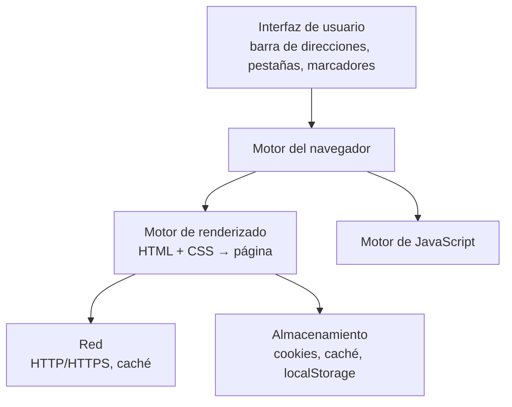

# 3. Navegadores y servidores web

<ExportPDF />

::: accent-box purple 🎯 Objetivos
- Conocer el funcionamiento y las herramientas de los navegadores web.
- Describir qué es un servidor web y los más utilizados.
- Instalar un servidor web en sistemas libres y propietarios.
:::

## 3.1 El navegador web

Un **navegador** es el **cliente** de la web: pide recursos a los servidores mediante HTTP y **interpreta** HTML, CSS y JavaScript para mostrar la página.

### Componentes



| Navegador | Motor de renderizado | Motor JavaScript |
|-----------|---------------------|------------------|
| Google Chrome, Microsoft Edge, Opera, Brave | Blink | V8 |
| Mozilla Firefox | Gecko | SpiderMonkey |
| Apple Safari | WebKit | JavaScriptCore |

::: info-box ¿Por qué una página se ve distinta en dos navegadores?
Porque cada **motor** interpreta los estándares con pequeñas diferencias o los implementa a distinto ritmo. Por eso hay que **probar en varios navegadores** y consultar la compatibilidad en [caniuse.com](https://caniuse.com/).
:::

### Funciones útiles para un técnico

- **Herramientas de desarrollo** (`F12`): inspector, consola, **red** (ver cada petición HTTP, su código y su tiempo), almacenamiento, rendimiento.
- **Perfiles** y **modo privado** (RA4).
- **Gestión de caché y cookies**: borrar datos de un sitio concreto para solucionar errores.
- **Certificados**: el candado muestra si la conexión es HTTPS y quién emitió el certificado.
- **Extensiones**: amplían funciones (con cuidado: pueden leer todo lo que visitas).
- **Actualizaciones automáticas**: imprescindibles por seguridad.

## 3.2 El servidor web

Un **servidor web** es un programa que **espera peticiones HTTP/HTTPS** (normalmente en los puertos 80 y 443) y **devuelve recursos**: ficheros (HTML, imágenes, CSS) o el resultado de ejecutar una aplicación (PHP, Python…).

| Servidor | Características | Cuota aproximada |
|----------|----------------|------------------|
| **Nginx** | Muy eficiente con muchas conexiones; muy usado como *proxy* inverso | Entre los más usados |
| **Apache HTTP Server** | Muy flexible, módulos, ficheros `.htaccess`; base de la pila LAMP | Entre los más usados |
| **Cloudflare** | Servicio de red de distribución (CDN) delante de otros servidores | Muy extendido |
| **LiteSpeed** | Compatible con Apache y de alto rendimiento | Habitual en alojamientos compartidos |
| **Microsoft IIS** | Integrado en Windows Server | Entornos Microsoft |
| **Caddy** | HTTPS automático, configuración sencilla | Creciente |

Puedes consultar estadísticas actualizadas en [w3techs.com](https://w3techs.com/technologies/overview/web_server).

## 3.3 Instalación de Apache en Linux (Ubuntu Server)

```bash
sudo apt update
sudo apt install -y apache2
sudo systemctl status apache2        # ¿está activo?
sudo systemctl enable apache2        # arrancar con el sistema
sudo ufw allow 'Apache Full'         # abrir 80 y 443 si usas el cortafuegos
ip a                                 # averigua la IP del servidor
```

Abre `http://IP-DEL-SERVIDOR` desde otro equipo: verás la página por defecto de Apache.

| Ruta | Contenido |
|------|-----------|
| `/var/www/html/` | **Raíz de documentos** (*DocumentRoot*): lo que se publica |
| `/etc/apache2/apache2.conf` | Configuración principal |
| `/etc/apache2/sites-available/` | Configuración de cada sitio (**hosts virtuales**) |
| `/etc/apache2/mods-available/` | Módulos (`rewrite`, `ssl`, `php`…) |
| `/var/log/apache2/access.log` y `error.log` | Registros de accesos y errores |

Comandos de administración:

```bash
sudo a2ensite misitio.conf     # activar un sitio   (a2dissite para desactivar)
sudo a2enmod rewrite ssl       # activar módulos    (a2dismod para desactivar)
sudo apache2ctl configtest     # comprobar la sintaxis
sudo systemctl reload apache2  # aplicar cambios
```

### Un host virtual

Permite alojar **varios sitios** en el mismo servidor, distinguidos por el nombre:

```apache
# /etc/apache2/sites-available/aw.local.conf
<VirtualHost *:80>
    ServerName aw.local
    DocumentRoot /var/www/aw.local
    ErrorLog ${APACHE_LOG_DIR}/aw-error.log
    CustomLog ${APACHE_LOG_DIR}/aw-access.log combined
</VirtualHost>
```

Para probarlo sin DNS, añade en el fichero `hosts` del cliente (`C:\Windows\System32\drivers\etc\hosts` o `/etc/hosts`) la línea `192.168.1.50  aw.local`.

### HTTPS con un certificado

- En Internet: **Let's Encrypt** con `certbot` (gratuito y automático).
- En el laboratorio: un certificado **autofirmado** (`sudo a2enmod ssl && sudo a2ensite default-ssl`); el navegador avisará de que no es de confianza.

## 3.4 Instalación en Windows

### XAMPP

1. Descarga e instala **XAMPP** (Apache + MariaDB + PHP + phpMyAdmin).
2. Desde el **Panel de control**, pulsa *Start* en **Apache**. Si el puerto 80 está ocupado (por IIS, Skype antiguo…), cámbialo en `httpd.conf` (`Listen 8080`).
3. La raíz de documentos es `C:\xampp\htdocs`. Abre `http://localhost`.
4. Permite Apache en el **Firewall de Windows** si quieres acceder desde otros equipos.

### IIS (Internet Information Services)

1. *Panel de control → Programas → Activar o desactivar las características de Windows → Internet Information Services*.
2. Abre el **Administrador de IIS** (`inetmgr`).
3. La raíz por defecto es `C:\inetpub\wwwroot`.

::: note-box 📷 Captura sugerida
Página de prueba servida por Apache en Linux, vista desde el navegador del equipo anfitrión, con la IP visible en la barra de direcciones.
:::

::: details 🔁 Autoevaluación rápida
1. ¿Qué motor de renderizado usan Chrome y Edge? ¿Y Firefox?
2. ¿En qué carpeta pondrías el `index.html` de tu web en Ubuntu con Apache? ¿Y en XAMPP?
3. ¿Para qué sirve un host virtual?
4. Apache no arranca en XAMPP. Indica la causa más habitual y cómo comprobarla.
:::

---

**Anterior:** [← 2. La web y su evolución](./2-web-evolucion) · **Siguiente:** [4. Servicio web, estructura y BD →](./4-servicio-web-bd)
