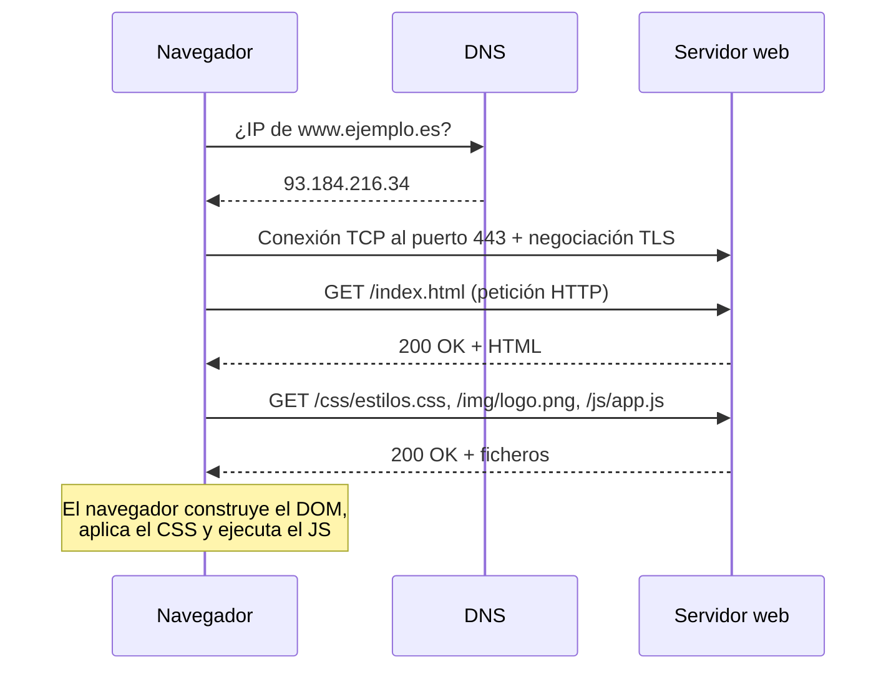
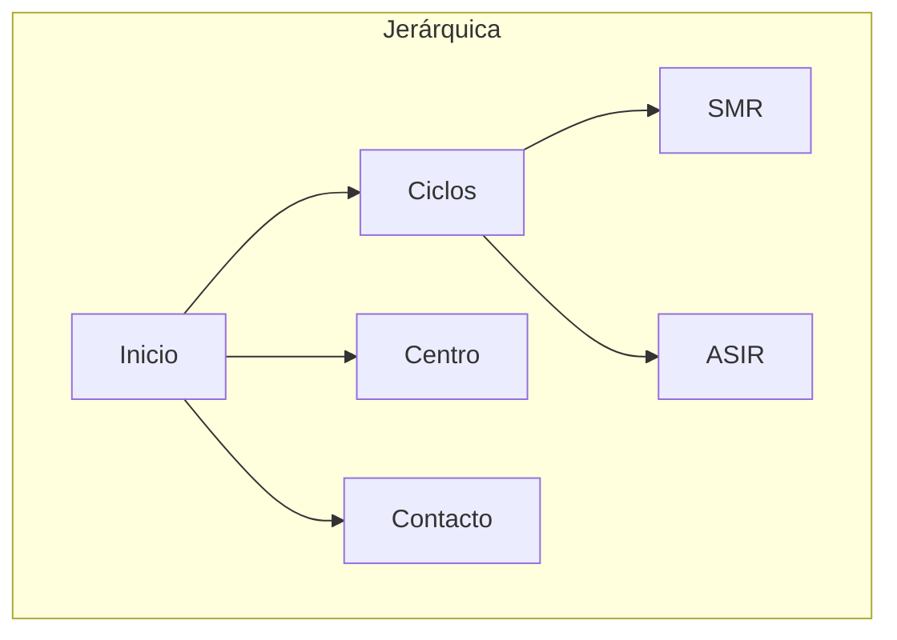
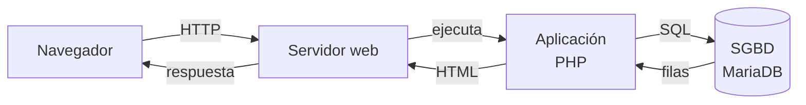

# 4. Funcionamiento de un servicio web, estructura de la información y bases de datos

<ExportPDF />

::: accent-box purple 🎯 Objetivos
- Describir el ciclo petición-respuesta de HTTP.
- Organizar la estructura de la información de un sitio web.
- Valorar el papel de las bases de datos en los servicios web.
:::

## 4.1 Funcionamiento básico: petición y respuesta

La web sigue el modelo **cliente-servidor**: el cliente (navegador) **pide** y el servidor **responde**.



### Una petición y una respuesta HTTP

```http
GET /cursos/aw.html HTTP/1.1
Host: www.ejemplo.es
User-Agent: Mozilla/5.0 (Windows NT 10.0) Firefox/131.0
Accept-Language: es-ES
```

```http
HTTP/1.1 200 OK
Server: Apache
Content-Type: text/html; charset=UTF-8
Content-Length: 5123

<!DOCTYPE html>
<html lang="es">…
```

### Métodos HTTP

| Método | Uso |
|--------|-----|
| `GET` | Obtener un recurso |
| `POST` | Enviar datos (formularios) |
| `PUT` / `PATCH` | Reemplazar / modificar (APIs) |
| `DELETE` | Eliminar (APIs) |

### Códigos de estado

| Familia | Significado | Ejemplos |
|---------|-------------|----------|
| **2xx** | Éxito | `200 OK`, `201 Created` |
| **3xx** | Redirección | `301 Moved Permanently`, `302 Found`, `304 Not Modified` (usa la caché) |
| **4xx** | Error del cliente | `400 Bad Request`, `401 Unauthorized`, `403 Forbidden`, `404 Not Found` |
| **5xx** | Error del servidor | `500 Internal Server Error`, `502 Bad Gateway`, `503 Service Unavailable` |

::: tip-box Míralo en directo
En las herramientas de desarrollo, pestaña **Red** (*Network*), recarga la página: verás cada petición, su método, su código de estado, su tamaño y su tiempo.
:::

### HTTP frente a HTTPS

**HTTPS** es HTTP **cifrado con TLS**: nadie en medio (la wifi del bar, el proveedor) puede leer ni modificar lo que se envía, y el **certificado** garantiza que el servidor es quien dice ser. Hoy es obligatorio en la práctica.

## 4.2 Páginas estáticas y dinámicas

| | Estáticas | Dinámicas |
|---|---|---|
| **Cómo se generan** | El fichero HTML ya existe en el servidor | El servidor **ejecuta un programa** que genera el HTML en cada petición |
| **Tecnologías** | HTML, CSS, JS | PHP, Python, Java, Node.js + **base de datos** |
| **Ventajas** | Rápidas, seguras, baratas | Contenido personalizado y actualizable desde un panel |
| **Ejemplos** | Esta web (VitePress), una página de presentación | WordPress (RA1), Moodle (RA2), una tienda online |

## 4.3 Estructura de la información de un sitio web

Antes de crear un sitio hay que decidir **cómo se organiza el contenido** (*arquitectura de la información*).



| Estructura | Descripción | Cuándo |
|------------|-------------|--------|
| **Lineal** | Una página tras otra (anterior/siguiente) | Tutoriales, formularios por pasos, presentaciones |
| **Jerárquica (árbol)** | De lo general a lo particular, por niveles | La mayoría de webs institucionales y corporativas |
| **En red** | Todas las páginas enlazadas entre sí | Wikis |
| **Mixta** | Jerárquica con enlaces cruzados | Lo habitual en la práctica |

Buenas prácticas:

- **Pocos niveles** de profundidad (cualquier página a 3 clics como máximo).
- **Menú** coherente en todas las páginas, **migas de pan** y **buscador**.
- **URL legibles** que reflejen la estructura: `/ciclos/smr/aplicaciones-web`.
- **Mapa del sitio** (`sitemap.xml`) para los buscadores.

### Estructura en el servidor

La organización lógica se refleja en las **carpetas** del servidor:

```text
/var/www/aw.local/
├── index.html
├── ciclos/
│   ├── smr.html
│   └── asir.html
├── css/
├── img/
└── js/
```

## 4.4 Bases de datos asociadas a un servicio web

Las aplicaciones web dinámicas guardan su información en un **sistema gestor de bases de datos (SGBD)**:



| SGBD | Tipo | Uso típico |
|------|------|-----------|
| **MySQL / MariaDB** | Relacional, libre | WordPress, Joomla, Moodle, la mayoría de aplicaciones PHP |
| **PostgreSQL** | Relacional, libre, muy completo | Moodle, aplicaciones empresariales |
| **SQLite** | Relacional en un fichero, sin servidor | Aplicaciones pequeñas, móviles, navegadores |
| **Microsoft SQL Server**, **Oracle** | Relacionales comerciales | Grandes empresas |
| **MongoDB**, **Redis** | NoSQL (documentos, clave-valor) | Big data, cachés, sesiones |

### Ejemplo mínimo: una página que lee una base de datos

```sql
CREATE DATABASE tienda;
USE tienda;
CREATE TABLE productos (id INT AUTO_INCREMENT PRIMARY KEY, nombre VARCHAR(50), precio DECIMAL(6,2));
INSERT INTO productos (nombre, precio) VALUES ('Ratón', 15.90), ('Teclado', 34.50);
```

```php
<?php // /var/www/html/productos.php  (requiere php y php-mysql)
$bd = new mysqli('localhost', 'tiendauser', 'Clave_2026', 'tienda');
$res = $bd->query('SELECT nombre, precio FROM productos');
echo '<ul>';
while ($fila = $res->fetch_assoc()) {
    echo '<li>' . htmlspecialchars($fila['nombre']) . ' – ' . $fila['precio'] . ' €</li>';
}
echo '</ul>';
```

Si añades un producto con `INSERT`, la página lo muestra **sin tocar el HTML**: esa es la esencia de un sitio dinámico y lo que hacen, a gran escala, WordPress o Moodle.

### Herramientas de gestión

- **phpMyAdmin** o **Adminer**: gestión web de MySQL/MariaDB.
- **Cliente de terminal**: `mariadb`, `mysql`, `psql`.
- **DBeaver**, **MySQL Workbench**: clientes gráficos de escritorio.

::: warning-box Seguridad de la base de datos
Un usuario por aplicación con permisos solo sobre su base de datos, contraseñas robustas, el puerto 3306 **no expuesto a Internet** y copias de seguridad periódicas (`mysqldump`).
:::

::: details 🔁 Autoevaluación rápida
1. ¿Qué significa un código `404`? ¿Y un `503`? ¿Quién tiene el problema en cada caso?
2. ¿Qué diferencia hay entre una página estática y una dinámica? Pon un ejemplo de cada una.
3. Diseña la estructura jerárquica de la web de un taller de reparación de ordenadores.
4. ¿Por qué `htmlspecialchars` es importante en el ejemplo de PHP?
:::

---

**Anterior:** [← 3. Navegadores y servidores](./3-navegadores-servidores) · **Siguiente:** [5. Aplicaciones web de escritorio →](./5-aplicaciones-escritorio)
