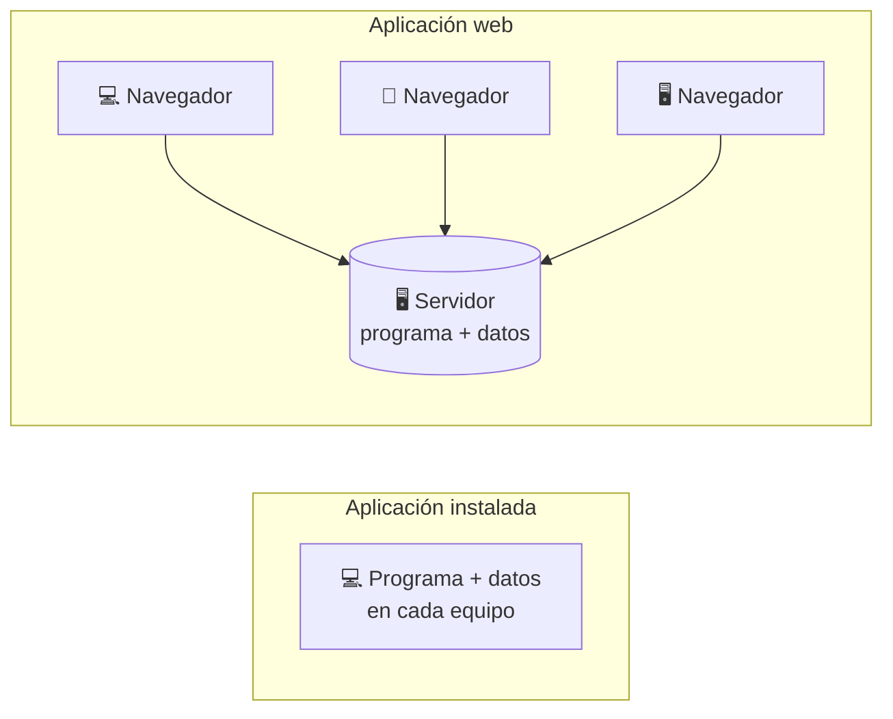
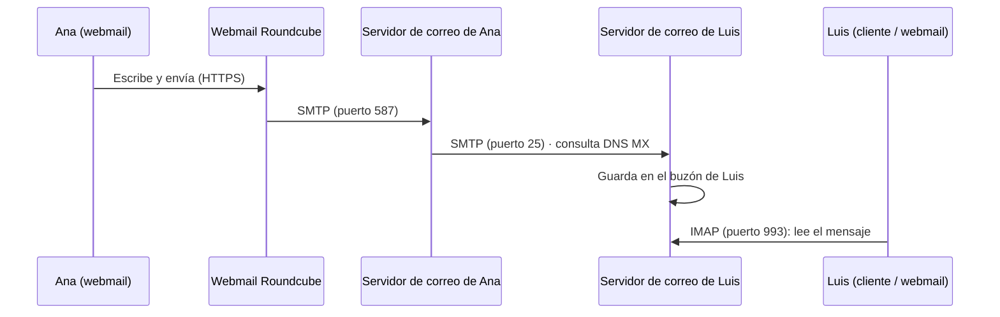

# 5. Aplicaciones web de escritorio

<ExportPDF />

::: accent-box purple 🎯 Objetivos
- Describir diferentes aplicaciones web de escritorio (CE a).
- Valorar sus ventajas e inconvenientes frente a las aplicaciones instaladas.
- Reconocer las prestaciones de correo web y calendario web (CE g).
:::

## 5.1 De la aplicación instalada a la aplicación web

Una **aplicación de escritorio** se instala en cada equipo (Outlook, Thunderbird, LibreOffice). Una **aplicación web de escritorio** ofrece las mismas funciones **desde el navegador**: el procesamiento y los datos están en el servidor y el usuario solo necesita una cuenta y un navegador.

| Ventajas | Inconvenientes |
|----------|---------------|
| Acceso desde cualquier equipo y sistema operativo | Requiere conexión con el servidor |
| Nada que instalar ni actualizar en los clientes | Las prestaciones dependen del navegador |
| Datos centralizados: copias de seguridad en un único sitio | El servidor es un punto único de fallo y un objetivo de ataques |
| Equipos cliente con pocos recursos | Privacidad: los datos están en el servidor |
| Administración centralizada de usuarios | Hay que mantener el servidor (actualizaciones, seguridad) |

## 5.2 Escritorios web (WebOS)

Un **escritorio web** o **sistema operativo web** reproduce en el navegador un escritorio completo, con ventanas, gestor de archivos y aplicaciones.

- **eyeOS** (2005–2014) fue el ejemplo más conocido y uno de los pioneros: un escritorio en PHP con procesador de textos, calendario, gestor de archivos y aplicaciones colaborativas. El proyecto se abandonó tras ser adquirido por una empresa, lo que muestra el **riesgo de depender de un único proveedor**.
- Hoy la idea pervive de varias formas:

| Enfoque | Ejemplos |
|---------|----------|
| **Plataformas de colaboración autoalojadas** que integran archivos, correo, calendario, contactos, ofimática y videollamadas en una interfaz web | **Nextcloud Hub**, ownCloud, SOGo |
| **Escritorios web de código abierto** | **Puter**, OS.js, Webtop (`linuxserver/webtop`, un escritorio Linux en el navegador) |
| **Sistemas basados en el navegador** | ChromeOS (Chromebooks), muy usados en educación |
| **Escritorios remotos a través del navegador** | Apache Guacamole, Kasm Workspaces, Windows 365 / Azure Virtual Desktop en la web |
| **Suites en la nube** | Google Workspace, Microsoft 365 (RA4) |

## 5.3 Correo electrónico web (*webmail*)

### Cómo funciona el correo

| Componente | Función | Ejemplos |
|------------|---------|----------|
| **MTA** (*Mail Transfer Agent*) | Envía y recibe correo entre servidores (**SMTP**) | Postfix, Exim, Microsoft Exchange |
| **MDA / servidor IMAP** | Guarda los buzones y permite leerlos (**IMAP/POP3**) | Dovecot |
| **MUA** (*Mail User Agent*) | Programa del usuario para leer y escribir | Thunderbird, Outlook, app del móvil… o un **webmail** |
| **Webmail** | MUA que funciona como **aplicación web**: habla IMAP y SMTP con el servidor y HTTP con el navegador | **Roundcube**, SnappyMail, SOGo, Horde, Nextcloud Mail |

::: info-box IMAP frente a POP3
- **IMAP**: los mensajes **se quedan en el servidor** y se sincronizan entre dispositivos. Es el que usa un webmail.
- **POP3**: los mensajes se **descargan** a un equipo y, normalmente, se borran del servidor.
:::

### Prestaciones de un webmail como Roundcube

- Bandeja de entrada con **carpetas**, búsqueda, etiquetas/marcas e hilos de conversación.
- Redacción en HTML con **adjuntos** (arrastrar y soltar), firmas e **identidades** múltiples.
- **Libreta de direcciones** (contactos y grupos), autocompletado; integración CardDAV con plugins.
- **Filtros** del lado del servidor (*Sieve*: mover, reenviar, respuesta automática de vacaciones).
- **Plugins**: calendario, cifrado PGP (*Enigma*), verificación en dos pasos, cambio de contraseña.
- **Temas** (*skins*) adaptables al móvil (Elastic).

## 5.4 Calendario web

Las aplicaciones de calendario web usan el estándar **CalDAV** (y **CardDAV** para contactos) para sincronizar con cualquier cliente: móvil, Thunderbird, Outlook.

| Aplicación | Características |
|------------|----------------|
| **Nextcloud Calendar + Tasks** | Calendarios personales y compartidos, citas, invitaciones, tareas, reserva de citas, CalDAV |
| **SOGo** | Groupware completo (correo + calendario + contactos), compatible con clientes de Microsoft |
| **Radicale**, **Baïkal** | Servidores CalDAV/CardDAV ligeros (sin interfaz completa de calendario) |
| **Google Calendar**, **Outlook Calendar** | En la nube (RA4) |

### Prestaciones específicas

| Prestación | Descripción |
|------------|-------------|
| **Citas / eventos** | Fecha, hora, lugar, descripción, **repetición**, **recordatorios** |
| **Invitaciones** | Envío por correo (formato iCalendar `.ics`) y respuesta de asistencia |
| **Tareas** (*VTODO*) | Pendientes con fecha límite, prioridad, porcentaje completado y subtareas |
| **Calendarios compartidos** | Con usuarios o grupos, en lectura o lectura/escritura |
| **Publicación** | Enlace público o suscripción `.ics` |
| **Reserva de citas** | Franjas que otros pueden reservar (tutorías) |
| **Disponibilidad** | Ver huecos libres de otros participantes |
| **Importar / exportar** | Ficheros `.ics` |

::: details 🔁 Autoevaluación rápida
1. Indica tres ventajas y tres inconvenientes de una aplicación web frente a una instalada.
2. ¿Qué aprendemos de la desaparición de eyeOS?
3. Explica el papel de Postfix, Dovecot y Roundcube en un sistema de correo.
4. ¿Qué protocolo permite que el calendario de Nextcloud aparezca en el móvil?
:::

---

**Anterior:** [← 4. Servicio web, estructura y BD](./4-servicio-web-bd) · **Siguiente:** [6. Webmail y calendario web →](./6-webmail-calendario)
