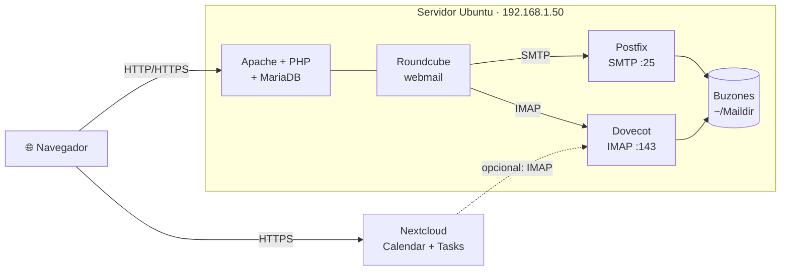

# 6. Instalación de webmail y calendario web

<ExportPDF />

::: accent-box purple 🎯 Objetivos
- Instalar una aplicación de acceso web al correo electrónico (CE b).
- Integrarla con un servidor de correo (CE c).
- Gestionar las cuentas de usuario y verificar el acceso al correo (CE d, e).
- Instalar una aplicación de calendario web y usar sus prestaciones (CE f, g).
:::

## 6.1 Escenario del laboratorio

Montaremos el correo y el calendario de una organización ficticia con dominio interno **`aw.local`**:



::: info-box Solo en red local
Un servidor de correo en Internet necesita además un dominio real, registros DNS (**MX**, **SPF**, **DKIM**, **DMARC**), IP con buena reputación y TLS. En el laboratorio el correo solo circula **dentro del servidor**, entre usuarios de `aw.local`, lo que basta para estudiar la integración.
:::

## 6.2 El servidor de correo: Postfix + Dovecot

### Postfix (SMTP)

```bash
sudo hostnamectl set-hostname mail.aw.local
sudo apt update
sudo apt install -y postfix mailutils
```

En el asistente elige **Sitio de Internet** y como nombre de correo del sistema **`aw.local`**. Después, guarda los correos en formato **Maildir** y acepta el dominio:

```bash
sudo postconf -e 'home_mailbox = Maildir/'
sudo postconf -e 'mydestination = $myhostname, aw.local, localhost.localdomain, localhost'
sudo systemctl restart postfix
```

### Dovecot (IMAP)

```bash
sudo apt install -y dovecot-imapd
```

En `/etc/dovecot/conf.d/10-mail.conf`, indica dónde están los buzones:

```ini
mail_location = maildir:~/Maildir
```

```bash
sudo systemctl restart dovecot
sudo ss -tlnp | grep -E ':25|:143'     # ¿escuchan SMTP e IMAP?
```

## 6.3 Gestión de las cuentas de usuario (CE d)

En esta configuración, cada **usuario del sistema** es una **cuenta de correo** (`usuario@aw.local`) y usa la misma contraseña:

```bash
sudo adduser ana          # crea ana@aw.local
sudo adduser luis
sudo adduser soporte      # cuenta compartida del departamento
```

| Tarea | Comando |
|-------|---------|
| Cambiar la contraseña | `sudo passwd ana` |
| Bloquear / desbloquear una cuenta | `sudo usermod -L ana` / `sudo usermod -U ana` |
| Eliminar una cuenta y su buzón | `sudo deluser --remove-home ana` |
| **Alias** (`info@aw.local` → Ana y Luis) | Añadir `info: ana, luis` a `/etc/aliases` y ejecutar `sudo newaliases` |

::: tip-box Usuarios virtuales
En servidores reales no se crea un usuario del sistema por buzón: se usan **usuarios virtuales** guardados en una base de datos o en LDAP y gestionados con una interfaz web (PostfixAdmin, el panel de Mailcow o de iRedMail).
:::

### Primera prueba desde la terminal

```bash
echo "Primer mensaje del servidor" | mail -s "Prueba" ana@aw.local
sudo ls /home/ana/Maildir/new/           # debe aparecer un fichero
sudo tail -n 20 /var/log/mail.log        # status=sent (delivered to maildir)
```

## 6.4 Instalación del webmail: Roundcube (CE b)

Roundcube es una aplicación PHP que guarda su configuración, contactos y preferencias en una base de datos.

```bash
sudo apt install -y apache2 mariadb-server php libapache2-mod-php
sudo apt install -y roundcube roundcube-mysql roundcube-plugins
```

Durante la instalación, **dbconfig-common** pregunta si quieres crear la base de datos automáticamente: responde **Sí** y asigna una contraseña.

Publica Roundcube en Apache. En `/etc/roundcube/apache.conf`, descomenta (quita el `#`) la línea del alias:

```apache
Alias /roundcube /var/lib/roundcube/public_html
```

```bash
sudo systemctl reload apache2
```

Roundcube queda disponible en `http://192.168.1.50/roundcube`.

::: info-box Otras formas de instalarlo
- **Docker:** imagen oficial `roundcube/roundcubemail`, indicando el servidor IMAP y SMTP por variables de entorno.
- **Paquete oficial** descargado de [roundcube.net](https://roundcube.net/) con el instalador web `installer/`.
- Soluciones **todo en uno** que instalan correo + webmail + antispam: **Mailcow**, **iRedMail**, **docker-mailserver**.
:::

## 6.5 Integración con el servidor de correo (CE c)

La integración se configura en `/etc/roundcube/config.inc.php`:

```php
// Servidor IMAP para leer el correo (Dovecot)
$config['imap_host'] = 'localhost:143';

// Servidor SMTP para enviar (Postfix). En local, sin autenticación.
$config['smtp_host'] = 'localhost:25';
$config['smtp_user'] = '';
$config['smtp_pass'] = '';

// Dominio que se añade a los usuarios: ana → ana@aw.local
$config['mail_domain'] = 'aw.local';

// Nombre del producto y plugins
$config['product_name'] = 'Webmail AW';
$config['plugins'] = ['archive', 'zipdownload', 'markasjunk'];
```

::: warning-box Conexiones sin cifrar
Dovecot solo permite contraseñas sin cifrar cuando la conexión viene de **localhost**, que es nuestro caso porque Roundcube y Dovecot están en la misma máquina. Si estuvieran en máquinas distintas, habría que usar **IMAPS (993)** y **SMTP con STARTTLS (587)** y autenticación.
:::

Para que el webmail se use de forma segura desde la red, activa **HTTPS** en Apache (apartado 3.3 de esta unidad).

## 6.6 Verificar el acceso al correo (CE e)

| # | Prueba | Resultado esperado |
|---|--------|--------------------|
| 1 | Iniciar sesión en Roundcube como `ana` | Bandeja de entrada con el mensaje de prueba |
| 2 | Contraseña incorrecta | "Error de inicio de sesión" y registro en `/var/log/mail.log` |
| 3 | Ana envía un correo a `luis@aw.local` | Luis lo recibe en su bandeja |
| 4 | Luis responde con un adjunto | Ana recibe la respuesta con el adjunto |
| 5 | Enviar a `info@aw.local` | Lo reciben Ana y Luis (alias) |
| 6 | Cuenta bloqueada con `usermod -L` | No puede iniciar sesión |
| 7 | Conectar desde el móvil o Thunderbird por IMAP | Se ven las mismas carpetas y mensajes |

Comprobaciones técnicas si algo falla:

```bash
sudo tail -f /var/log/mail.log            # envío (postfix) e inicios de sesión (dovecot)
sudo tail -f /var/log/apache2/error.log   # errores de PHP de Roundcube
sudo tail -f /var/log/roundcube/errors.log
nc localhost 143                          # ¿responde Dovecot? (* OK Dovecot ready)
```

::: note-box 📷 Captura sugerida
Bandeja de entrada de Roundcube de `ana@aw.local` con el correo recibido de Luis y el registro de `mail.log` donde aparece `status=sent`.
:::

## 6.7 Calendario web: Nextcloud Calendar y Tasks (CE f)

Usaremos **Nextcloud** (instalado en el RA4 con Docker o con `snap install nextcloud`) como servidor de calendario.

1. **Aplicaciones → Oficina y texto**: instala y activa **Calendar**, **Tasks** y **Contacts**.
2. **Usuarios**: crea `ana`, `luis` y un grupo `soporte`. Usa los mismos nombres que en el correo para que la organización sea coherente.
3. Cada usuario accede a **Calendario** desde el menú superior.

### Integración con el correo (opcional, recomendado)

- **Nextcloud Mail** (otra app web de correo) puede conectarse al mismo Dovecot/Postfix: *Mail → Configuración manual*, IMAP `192.168.1.50:143` y SMTP `192.168.1.50:25` (en el laboratorio).
- En **Ajustes de administración → Ajustes básicos → Servidor de correo electrónico**, configura el SMTP para que Nextcloud envíe las **invitaciones** a eventos por correo.

### Sincronización con otros clientes

- Dirección **CalDAV**: `https://servidor/remote.php/dav`
- **Thunderbird** detecta los calendarios con esa URL y el usuario y contraseña.
- **Android**: app DAVx⁵. **iOS**: Ajustes → Calendario → Cuentas → CalDAV.

## 6.8 Prestaciones del calendario (CE g)

| Prestación | Cómo probarla |
|------------|---------------|
| **Cita con repetición y recordatorio** | Ana crea "Revisión de copias" cada lunes a las 9:00 con aviso 15 min antes |
| **Invitación** | Ana invita a Luis a "Reunión de soporte"; Luis la acepta desde su correo o su calendario |
| **Calendario compartido** | El calendario "Soporte" se comparte con el grupo `soporte` con permiso de edición |
| **Calendario público** | Se publica el calendario de "Guardias" con un enlace de solo lectura |
| **Tareas** | Lista "Mantenimiento" con tareas, fechas límite, prioridad, porcentaje y subtareas |
| **Reserva de citas** | Ana ofrece franjas de 15 min para tutorías y Luis reserva una |
| **Importar / exportar** | Exportar un calendario a `.ics` e importarlo en otro usuario |
| **Sincronización** | El evento creado en Thunderbird o en el móvil aparece en la web |

::: details 🔁 Autoevaluación rápida
1. ¿Qué dos líneas de `config.inc.php` integran Roundcube con el servidor de correo?
2. ¿Por qué en el laboratorio Roundcube puede usar IMAP sin cifrar y en producción no?
3. Un usuario dice que no recibe correos. Indica tres comprobaciones que harías y en qué orden.
4. ¿Qué diferencia hay entre compartir un calendario con un grupo y publicarlo?
:::

---

**Anterior:** [← 5. Aplicaciones web de escritorio](./5-aplicaciones-escritorio) · **Unidad:** [Volver a la presentación](../index)
