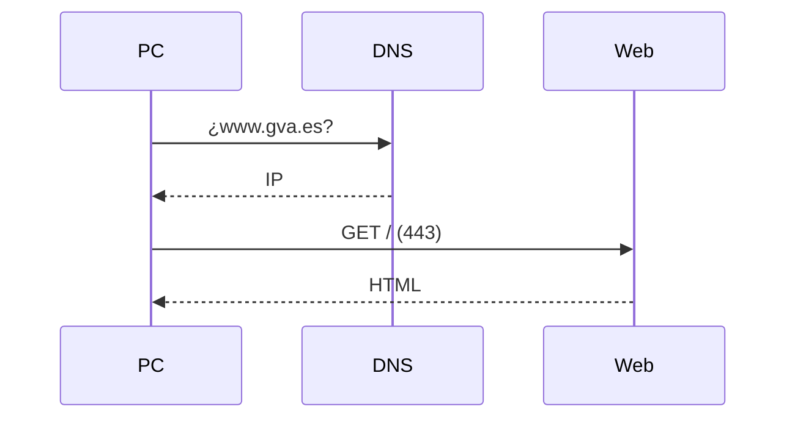
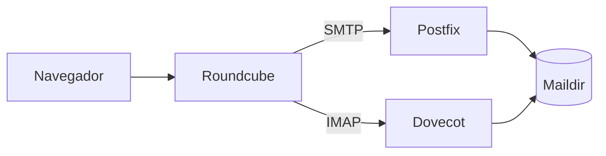

<SlidesViewer>

## RA5 · Internet y aplicaciones web de escritorio

::: accent-box 🌐 De la red de redes al webmail
**Aplicaciones Web · 2º SMR**

Cómo funciona Internet y cómo se instalan aplicaciones que viven en el navegador.
:::

---

## Qué vamos a aprender

::: accent-box purple 🎯 Objetivos
- Conceptos de Internet: TCP/IP, IP, DNS, servicios.
- La web: Web 1.0, 2.0 y tendencias.
- Navegadores, servidores web y bases de datos.
- Aplicaciones web de escritorio.
- Instalar webmail y calendario web.
:::

---

## Internet

> Red mundial de redes que se comunican con **TCP/IP**.

| Capa | Protocolos |
|---|---|
| Aplicación | HTTP(S), SMTP, IMAP, DNS, SSH |
| Transporte | TCP, UDP |
| Internet | IPv4, IPv6 |
| Acceso | Ethernet, wifi, 5G |

---

## Nombres e IP



---

## Evolución de la web

| Web 1.0 | Web 2.0 | Hoy |
|---|---|---|
| Leer | Leer, escribir, compartir | IA, móvil, PWA |
| Estática | Dinámica + BD | Nube, IoT |
| Pocos autores | Redes sociales, blogs, wikis | Web semántica, Fediverso |

---

## Navegadores y servidores

::: info-box Navegadores
Blink (Chrome, Edge) · Gecko (Firefox) · WebKit (Safari) · **F12** = tu caja de herramientas
:::

::: tip-box Servidores web
Apache · Nginx · IIS · Caddy → `/var/www/html`, `sites-available`, `access.log`
:::

---

## Petición y respuesta

- Métodos: `GET`, `POST`, `PUT`, `DELETE`
- Códigos: **2xx** éxito · **3xx** redirección · **4xx** error del cliente · **5xx** error del servidor
- HTTPS = HTTP + **TLS**
- Estáticas vs **dinámicas** (PHP + MariaDB)

---

## Aplicaciones web de escritorio

::: accent-box success ✨ Ventajas
Cualquier equipo · nada que instalar · datos centralizados
:::

::: warning-box Inconvenientes
Conexión · servidor como punto único de fallo · privacidad
:::

eyeOS (historia) → Nextcloud Hub · Puter · ChromeOS · Guacamole

---

## El correo



MTA · MDA · MUA · **Webmail**

---

## Integración Roundcube

```php
$config['imap_host'] = 'localhost:143';
$config['smtp_host'] = 'localhost:25';
$config['mail_domain'] = 'aw.local';
```

::: tip-box Verifica
Login · enviar/recibir · adjuntos · alias · `mail.log`
:::

---

## Calendario web

::: info-box Nextcloud Calendar + Tasks
Citas · repeticiones · recordatorios · invitaciones · tareas · calendarios compartidos y públicos · reserva de citas · **CalDAV**
:::

---

## Resumen

::: accent-box purple 🧭 Recuerda
Internet (TCP/IP + DNS) → Web (HTTP + HTML) → Servidores (Apache + BD) → **Aplicaciones web**: webmail integrado con el servidor de correo y calendario con CalDAV.
:::

</SlidesViewer>
