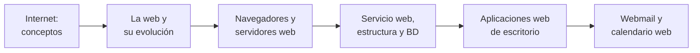

# 🌐 RA5 · Internet y aplicaciones web de escritorio

<ExportPDF />

::: accent-box 🎯 Resultado de aprendizaje
**RA5.** Instala aplicaciones web de escritorio, describiendo sus características y entornos de uso.
:::

Esta unidad tiene dos partes. En la primera repasamos **cómo funcionan Internet y la web**: protocolos, navegadores, servidores, bases de datos y la evolución de la Web 1.0 a las tendencias actuales. Es la base de todo el módulo. En la segunda, **instalamos aplicaciones web que sustituyen a programas de escritorio**: un **correo web** (*webmail*) conectado a un servidor de correo y un **calendario web** con citas y tareas.

::: tip-box Por dónde empezar
Aunque es el RA5, sus apuntes 1 a 4 son la **introducción** de todo el módulo: conviene estudiarlos al principio del curso.
:::

## Criterios de evaluación

| CE | Descripción | Dónde se trabaja |
|:--:|-------------|------------------|
| a | Se han descrito diferentes aplicaciones web de escritorio. | [Apuntes 5](./contenidos/5-aplicaciones-escritorio) · P3 |
| b | Se han instalado aplicaciones para proveer de acceso web al servicio de correo electrónico. | [Apuntes 6](./contenidos/6-webmail-calendario) · P3 |
| c | Se han configurado las aplicaciones para integrarlas con un servidor de correo. | [Apuntes 6](./contenidos/6-webmail-calendario) · P3 |
| d | Se han gestionado las cuentas de usuario. | [Apuntes 6](./contenidos/6-webmail-calendario) · P3 |
| e | Se ha verificado el acceso al correo electrónico. | [Apuntes 6](./contenidos/6-webmail-calendario) · P3 |
| f | Se han instalado aplicaciones de calendario web. | [Apuntes 6](./contenidos/6-webmail-calendario) · P3 |
| g | Se han reconocido las prestaciones específicas de las aplicaciones instaladas (citas, tareas, entre otras). | [Apuntes 5](./contenidos/5-aplicaciones-escritorio), [6](./contenidos/6-webmail-calendario) · P3 |

::: info-box Prácticas P1 y P2
Las prácticas P1 y P2 trabajan los contenidos de Internet y servidores web, que son la base técnica necesaria para la P3. Se califican con la escala 0-4, necesitan al menos el nivel 2 para que se corrija la P3 y su resultado se tiene en cuenta en el nivel 4 ("coherente con el resto del proyecto") de los criterios de la P3.
:::

## Contenidos

1. [Conceptos básicos de Internet](./contenidos/1-internet)
2. [Fundamentos de la web. Web 1.0, Web 2.0, redes sociales y nuevas tendencias](./contenidos/2-web-evolucion)
3. [Navegadores y servidores web](./contenidos/3-navegadores-servidores)
4. [Funcionamiento de un servicio web, estructura de la información y bases de datos](./contenidos/4-servicio-web-bd)
5. [Aplicaciones web de escritorio](./contenidos/5-aplicaciones-escritorio)
6. [Instalación de webmail y calendario web](./contenidos/6-webmail-calendario)

🎞️ [Diapositivas de la unidad](./contenidos/diapositivas) · 🛠️ [Prácticas y rúbricas](./ejercicios/)

## Qué necesitas

- Una máquina virtual **Ubuntu Server 24.04** (2 GB de RAM) y, opcionalmente, un equipo Windows con XAMPP.
- Un cliente con navegador en la misma red (puede ser tu equipo anfitrión).
- Para la P3: la instancia de **Nextcloud** del RA4 o una nueva.
